# 抓紧了 · 关卡与回放（C7 / C8）

从 main `7ffd856` 开始，沿用 C1（#172）的 JSON、四人逐帧回放和 A3/Pixi 截图流程。12 个 id、世界、中英文名字、teaches 均保持 C1 原值；第一屏教学保留，蒸笼与图腾整体下移以留出上方攀爬空间。仅修改 `games/hang-on/levels/**`、`docs/levels/**`、`games/hang-on/scripts/run-levels.mjs`。

## 运行与复核

在 `games/hang-on`，Node 22，Windows 使用 Git Bash：

```sh
export npm_config_script_shell="C:/Program Files/Git/bin/bash.exe"
npm ci
npm test
npm run typecheck
npm run ip-check
npm run levels
```

typecheck 保留 main 的 Worker 类型生成和 `/dev/null` 重定向。没有修改 src、物理参数、package.json、锁文件或 C4 文件。

验收器将未改动的 `world.ts` / `replay.ts` 用现有 esbuild 打到临时目录，逐关调用 `runReplay(level, replay)`，结束后清理。12 份回放均按新布局重新录制展开输入：4 人、60 Hz，seq 从 0 递增，t 为毫秒；模拟内部仍固定 120 Hz。沿用 C1 的离线操作录制方式，在创作时按真实状态选择手柄操作、按永久落点分批集合；提交的回放只含输入帧，验收时没有寻路或反馈控制器。没有传送、初始速度注入、物理覆盖、召唤或修改复活逻辑。

## 布局

横向关为 2560 px（两屏），总复习为 3200 px（三屏）；两道攀爬关为 2560×1440，先横后竖。终点位于延长路线末端，后屏继续练同一种抓取、荡行或攀爬动作，并增加错高、窄落点、较宽缝或组合机关。每屏有检查点，按路线顺序排列；精确分段时间见 [验收结果](validation.md)。

| 关卡 | 名称 / Name | 教学 | 长×高 | 检查点（依次） | par（秒 / 每人死） | 布局与操作 |
| --- | --- | --- | --- | --- | --- | --- |
| table-01 | 茶布起步 / Tea Cloth Crawl | crawl | 2560×720 | (1240, 536) → (2250, 376) | 110 / 2 | 原茶布起步；长茶布上练连续换抓，后段两道 80 px 折台，终点收窄。 |
| table-02 | 碗沿小缝 / Between the Bowls | gap | 2560×720 | (1240, 536) → (1890, 476) | 100 / 2 | 原 80 px 碗缝；后段 70 px 缝接定时饼干，再以 90 px 缝和上升碗沿收尾。 |
| table-03 | 筷子桥 / Chopstick Bridge | swing | 2560×720 | (1240, 506) → (1990, 326) | 90 / 2 | 原两根薄筷子保留；饼干 → 蜡烛上升 180 px → 两次 80 px 高差的筷台。 |
| table-04 | 蒸笼叠叠高 / Steamer Stack | climb | 2560×1440 | (1210, 936) → (2224, 396) | 110 / 2 | 原四级蒸笼整体下移 720 px；永久休息台后走蜡烛，续接六级 80 px 蒸笼。 |
| table-05 | 面条过火锅 / Noodle over the Hotpot | rope | 2560×720 | (1240, 536) → (2030, 496) | 70 / 2 | 原 280 px 绳坑；后段第二根面条绳跨 300 px，最后是 60 px 缝和 80 px 翻沿。 |
| table-06 | 一串汤圆过大锅 / Dumpling Chain | chain | 2560×720 | (1275, 356) → (2240, 196) | 80 / 2 | 原只能站的起台、高筷子和两人成链缺口保留；后段错高的窄碗沿，最后两道 80/90 px 缝。 |
| van-07 | 天车门把手 / SkyTrain Handles | door | 2560×720 | (1240, 536) → (2330, 466) | 100 / 2 | 原门把手保留；后段两组更窄、错高的门柱，门缝增至 90/100 px。 |
| van-08 | 图腾向上 / Totem Ascent | climb | 2560×1440 | (1210, 856) → (2224, 316) | 100 / 2 | 原五级窄图腾整体下移 720 px；蜡烛接六级窄柱，最后连续向上换手。 |
| van-09 | 摇摇浮筒 / Wobbling Pontoons | balance | 2560×720 | (1240, 536) → (2150, 516) | 100 / 2 | 原浮筒转轴下移 30 px，保留第一段教学水面；第二块 640 px 浮筒跨更宽水面。 |
| van-10 | 狮门抛接力 / Lions Gate Toss | throw | 2560×720 | (1275, 402) → (2140, 296) | 90 / 2 | 原只能站的起台、160 px 水面与 80 px 高差保留；两组队友抛接后，连续翻上错高的金属桥墩。 |
| van-11 | 雨中快抓 / Rain Grip | ice | 2560×720 | (1240, 536) → (2310, 296) | 80 / 2 | 原三道 70 px 冰缝保留；定时冰饼干接连续上升的冰岸，后段不能在消失平台上久留。 |
| van-12 | 从夜市到海湾 / Night Market to Harbour | combine | 3200×720 | (1275, 476) → (1760, 476) → (2754, 236) | 120 / 2 | 原台阶、绳、浮筒与冰岸串联；绳后加宽永久回收落点，后段加入冰饼干、蜡烛及三段上升冰岸。 |

## 机关与预算

饼干在 table-02、table-03、van-11、van-12；蜡烛在 table-03、table-04、van-08、van-12；table-03 和 van-12 两样都有。每块饼干都要求实际 terrain grab 的点落在其矩形内，每根蜡烛都要求对应编号的 bounce，不能只摆在路线外。

| 关卡 | 会动物体（≤40） | 矩形总数（≤60） | 饼干 / 蜡烛块数 |
| --- | ---: | ---: | ---: |
| table-01 | 0 | 4 | 0 / 0 |
| table-02 | 0 | 6 | 1 / 0 |
| table-03 | 0 | 10 | 1 / 1 |
| table-04 | 0 | 14 | 0 / 1 |
| table-05 | 16 | 5 | 0 / 0 |
| table-06 | 0 | 7 | 0 / 0 |
| van-07 | 0 | 11 | 0 / 0 |
| van-08 | 0 | 15 | 0 / 1 |
| van-09 | 2 | 6 | 0 / 0 |
| van-10 | 0 | 6 | 0 / 0 |
| van-11 | 0 | 9 | 1 / 0 |
| van-12 | 9 | 11 | 1 / 1 |

会动物体按绳节数 + 跷跷板 + 箱子累计；矩形总数从严包含永久平台、饼干、蜡烛、跷跷板初始矩形和箱子。所有初始矩形都进行两两不重叠检查，相邻边缘接触允许。

## 验收规则

保留 C1 的关数、双语内容、材质、几何、回放格式、四手柄、seq/t、轴值、过关、par、死亡、绳/浮筒真实使用、合作机制、单人投影和 PNG 尺寸检查。C7 增加身份固定、2400–3600 px 横关 / 1400–2200 px 攀爬关、末端终点、每个横向屏与攀爬纵向屏的检查点、物体预算和机关覆盖检查。

每个检查点必须在关内，按数组顺序实际触发且不能跳过；下方 24–80 px 必须有永久平台，能容纳复活位置 cp.x + 玩家编号 × 30 和身体半径 24。饼干、蜡烛和动态浮筒均不能充当这个复活落脚面。时间按模拟的 checkpoint 事件计算：出生 → 首旗、相邻旗、末旗 → 全员 win，每段原始数值均须在 15–60 秒内，不能只看四舍五入后的表。

par 按新回放重定，仍限制 60–180 秒，过关用时须为 par 的 0.5–2 倍。保留每人死亡数 ≤ deathsPerPlayer×4 的原检查，同时增加全队死亡总数 ≤ deathsPerPlayer×4。

第六关要求至少 0.25 秒真实的悬空「玩家 → 玩家 → 地形/绳」链；第十关要求至少两次释放正在向右上飞行的队友（vx>150、vy<−100）。四份录制输入分别投影为单人，两关均 0/4 通关；这沿用 C1 的防退化对照，不是任意输入可达性的穷举。第十二关实际抓绳、抓并压斜浮筒、抓冰、抓饼干和弹蜡烛，验收至少四种，当前五种都用到。

当前反例及完整 npm 输出在 [validation.md](validation.md)；逐个改坏、确认退出码 1，finally 恢复原文件，然后重新跑全部验收。

## 截图与浏览器回放

```sh
# 审查页：选择关卡，回放 / 暂停 / 重置；Ctrl+C 停止
npm run levels -- --serve

# 使用项目现有 Playwright 与已安装的 Chromium
HANG_ON_PLAYWRIGHT="$(pwd)/node_modules/playwright" npm run levels -- --screenshots
```

12 张同名 PNG 已重拍并逐张检查，均为 1280×720、deviceScaleFactor=1。使用游戏本身的 A3 Pixi Stage 与远景画；停在四人出生状态，相机缩到全关，机关与终点同时可见。仅审查页采用全关缩放，游戏镜头仍按 src/render/stage.ts 跟随玩家、到边停、最低 0.45。不可抓起台沿用虚线和「只能站 / Stand only」。


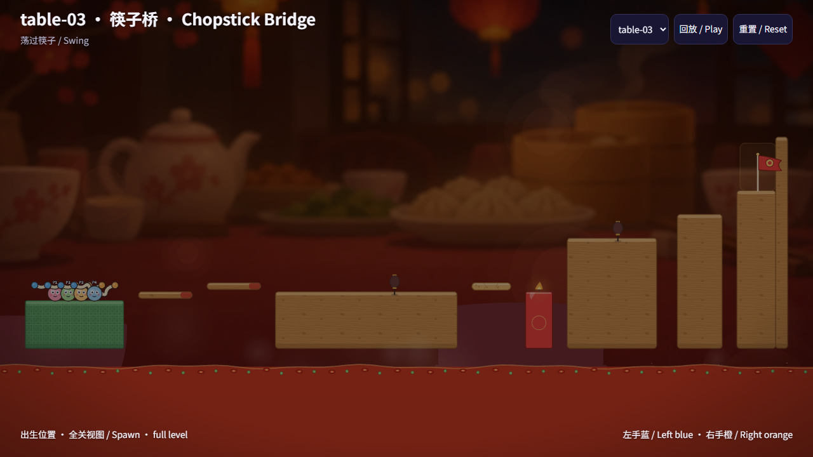


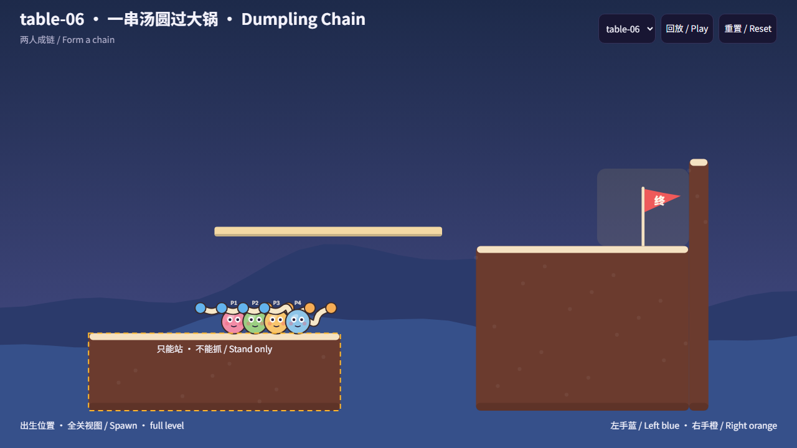
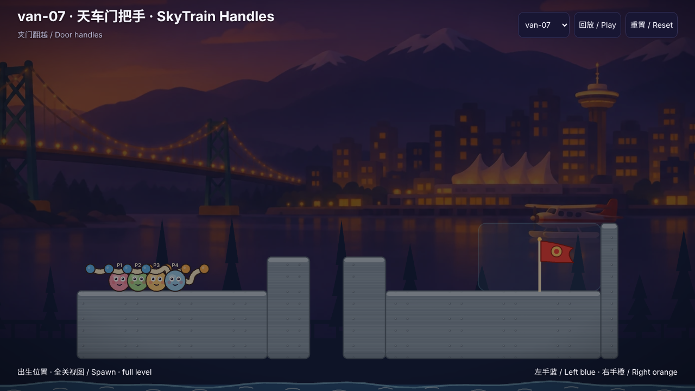
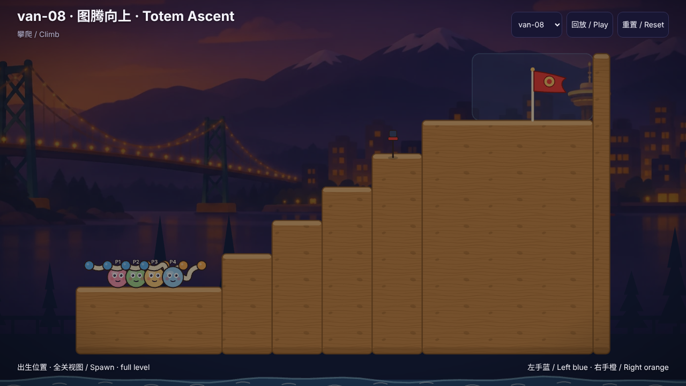


## ho-C8 · 独立难关与 #435 后的回放

PR #418 的第二版布局沿用 `7f42a65`。本轮合入 main `e3abe00`（含 #435 的悬空拉力限制、#436 的探路脚本），对最终物理重新录制全部 12 份四人回放和 4 份双人摆法回放。12 关除了必要的 par 外逐字段不变，16 份输入均重新生成，12 张难关截图沿用原图；基础 12 关及回放、所有截图保持原字节。只创作 `games/hang-on/levels/**` 与 `docs/levels/**`。

每关从第一屏起有自己的路线：斜行下降、向上抛接、慢速三臂转筷、港底上升、先下后上的码头、L 形升降与折线长摆渡分别展开；两道攀爬关的下层和上层接驳也不同。合作分别安排在第一处缺口和下一处动台、转杆或抛接缺口，详见下表及 [逐段证据](validation.md)。

| 关卡 | 名称 / Name | teaches | 长×高 | 检查点（顺序） | par 秒 / 每人死亡预算 | 哪里会死 | 路线与两处合作 | 按人数变化 |
| --- | --- | --- | --- | --- | --- | --- | --- | --- |
| table-13 | 竹签窄渡 / Skewer Narrows | spike | 3000×720 | (1200, 316) → (2200, 156) → (2800, 336) | 150 / 4 | 竹签沟与倒签、碗口往返签块、末沟竹签 | 第一屏抛过 180 px 竹签沟，三段碗沿向上；第二次抛接上高碗，再抓高处动盘过末沟 | 1–4 人同布局。 |
| table-14 | 转盘送席 / Serving Shuttle | mover | 2560×720 | (1192, 656) → (1980, 456) | 180 / 2 | 下沉盘下红油、倒挂热丝、中坑与末坑 | 起段抱下降的斜行盘，落入低碗；向上抛接回高桌，末段转筷接窄碗 | 1–2 人：中段抛接沟多一块 (1420,600) 接应木台；3–4 人撤去。 |
| table-15 | 红油吊廊 / Chilli-Oil Catwalk | hot | 2560×720 | (1180, 376) → (1900, 576) | 150 / 6 | 红油沟、碗口升降烫块、转筷下方与末坑 | 第一屏向上抛接，再过高低碗沿的升降门；中段抓转筷下落接应，末段斜盘上升 | 1–4 人同布局。 |
| table-16 | 筷影回环 / Chopstick Revolve | spinner | 2560×720 | (1040, 616) → (1940, 376) | 120 / 2 | 转筷下电丝、抛接坑电丝与致命短转杆、末沟电丝 | 第一屏三臂慢转筷，向下接低碗；中段抛上高碗，最后用更快的双臂转筷跨缝 | 1–2 人：首段转筷沟和中段抛接沟各多一块接应木台；3–4 人撤去。 |
| table-17 | 热丝蒸笼塔 / Steamer Wire Tower | zap | 2560×1440 | (1240, 936) → (1980, 456) | 180 / 5 | 下层电沟、升降电块、塔间电沟与末沟 | 低处抛过电沟再爬三层蒸笼；两人挂 L 形动盘向上约 600 px，末段转筷接高层 | 1–4 人同布局。 |
| table-18 | 年夜忙不停 / Reunion Rush | gauntlet | 3000×720 | (1200, 596) → (1980, 616) → (2764, 456) | 180 / 8 | 竹签沟、倒挂热丝、电沟、巡回烫块与锅底短转杆 | 第一屏折线盘；第二段转筷；最后两折长动盘，串接五类机关，三处永久回收点 | 1–4 人同布局。 |
| van-19 | 潮栅间隙 / Tidal Grating | spike | 2560×720 | (1160, 336) → (1860, 496) | 150 / 2 | 低码头栅沟、倒挂栅栏、岸口栅块与两处水下栅栏 | 第一屏先向下抛到低码头，再上两级护岸；中段转梁落接，末段水平摆渡到更低的岸 | 1–4 人同布局。 |
| van-20 | 海湾摆渡 / Harbour Shuttle | mover | 2560×720 | (1210, 536) → (1960, 616) | 180 / 8 | 港池栅栏、倒挂栏杆、往返栅块与末段顶栅 | 第一屏斜向上摆渡；中段反转钢梁接下层岸，最后攀两级短护岸，避开上方顶栅 | 1–2 人：反转钢梁下多一块 (1500,600) 接应木台；3–4 人撤去。 |
| van-21 | 电轨折返 / Switchback Current | zap | 2560×720 | (1210, 416) → (2020, 256) | 150 / 6 | 港池电轨、倒挂电轨、巡回电块、致命电杆与末沟 | 第一屏竖升再横走的 L 形平台；中段把队友抛到两层高岸，末段钢梁转到低岸 | 1–4 人同布局。 |
| van-22 | 塔顶接驳 / Totem Transfer | mover | 2560×1440 | (1240, 1096) → (2020, 616) | 180 / 5 | 下层电沟、倒挂电轨、升降电块与两层接驳沟 | 第一屏从港底抓三臂转梁上升；第二段长升降台向上约 600 px，最后转梁接高岸 | 1–2 人：下层转梁与长升降台旁各多一块木台，末沟电轨在 820 高度；3–4 人撤木台，电轨在 1000 高度。 |
| van-23 | 炙桥转轮 / Sizzling Bridge | hot | 2560×720 | (1240, 536) → (2080, 456) | 150 / 3 | 烤架沟、倒挂烤架、升降热块、长烤架与坑底短转杆 | 第一屏抛接后走先上后下的夜市台；中段挂斜升动台串过长烤架，末段抓转梁上岸 | 1–4 人同布局。 |
| van-24 | 海港夜班 / Harbour Night Shift | gauntlet | 3000×720 | (1160, 536) → (2080, 216) → (2764, 336) | 180 / 5 | 栅沟、倒挂电轨、烤架、巡回电块与末沟致命转梁 | 第一屏慢速三臂转梁；中段抛接连爬两层岸，末段高处长摆渡越过电轨与转梁，串五类机关 | 1–4 人同布局。 |

四张人数关的 `.p2.json` 分别覆盖 1/2 人摆法，四人主回放覆盖 3/4 人摆法。每种摆法都跑通，每台安全机关均被站/抓至少 0.25 秒，每处致命物均有身体到过 240 px 内。四人主回放每段 17.50–58.37 秒；攀爬关 table-17 / van-22 都是 2560×1440，分别从 1240 / 1320 高度爬到 400 / 480，横向屏与上下两层均有检查点。

沿用 C1 的离线输入录制：对最终关卡只调用原模拟的 setInput / step，按实际抓点与复活位置继续操作，录成 60 Hz 输入，seq 从 0 递增；每帧单独一行，便于对比。录制与验收都使用 #435 后的原模拟：未连接实物时的拉力限制由引擎照常执行，没有传送、初速、召唤、改复活或改物理。验收只重放固定输入，不运行录制控制器。12 份四人输入序列各不相同，全部单手柄投影为 0/4。六人出生及检查点落脚由 main 的 A7 测试覆盖；本轮 115 条测试还包含 #435 的三条悬空拉力回归检查。

### 自有布局与合作

原验收器按 40 px 上沿格比较所有基础关与难关。当前整关最高重合 36.3%（上限 60%），第一屏最高 44.9%（上限 85%）。不靠改世界或材质区分路线。

| 关卡 | 整关最接近 | 重合率 | 第一屏最接近 | 重合率 |
| --- | --- | ---: | --- | ---: |
| table-13 | van-10 | 16.2% | table-16 | 18.3% |
| table-14 | van-21 | 25.5% | van-19 | 23.3% |
| table-15 | van-23 | 36.3% | van-23 | 44.9% |
| table-16 | van-10 | 23.3% | table-13 | 18.3% |
| table-17 | table-04 | 18.1% | van-22 | 3.4% |
| table-18 | van-20 | 24.4% | table-13 | 0.0% |
| van-19 | table-14 | 20.7% | table-14 | 23.3% |
| van-20 | van-23 | 26.4% | van-23 | 20.4% |
| van-21 | van-23 | 31.4% | table-15 | 28.8% |
| van-22 | table-17 | 17.6% | table-17 | 3.4% |
| van-23 | table-15 | 36.3% | table-15 | 44.9% |
| van-24 | table-18 | 16.9% | van-20 | 16.7% |

| 关卡 | 两处实际合作位置（x 范围，px） | 各段挂链秒数 S0… | 各段抛接次数 S0… | 合作段数 |
| --- | --- | --- | --- | ---: |
| table-13 | 起段抛接（420–600）＋高碗抛接（1560–1740） | 0.00 / 0.00 / 6.78 / 0.00 | 5 / 4 / 2 / 0 | 3 |
| table-14 | 下降动盘（500–1000）＋向上抛接（1400–1580） | 14.78 / 14.77 / 0.02 | 0 / 2 / 4 | 3 |
| table-15 | 红油沟抛接（600–820）＋中段转筷接应（1400–1700） | 0.00 / 4.82 / 9.98 | 2 / 2 / 1 | 3 |
| table-16 | 首段转筷（520–820）＋中段高差抛接（1280–1520） | 5.90 / 0.02 / 0.02 | 3 / 5 / 2 | 3 |
| table-17 | 下层抛接（400–600）＋上升动盘（1360–1880） | 0.02 / 12.75 / 0.02 | 5 / 2 / 0 | 2 |
| table-18 | 折线动盘（400–900）＋中段转筷（1320–1660） | 16.22 / 5.35 / 0.00 / 0.00 | 0 / 0 / 0 / 0 | 2 |
| van-19 | 低码头抛接（360–560）＋转梁接应（1280–1600） | 0.00 / 4.78 / 7.17 | 2 / 2 / 2 | 3 |
| van-20 | 斜行摆渡（360–880）＋反转钢梁（1400–1720） | 1.35 / 0.00 / 1.00 | 1 / 1 / 0 | 3 |
| van-21 | L 形平台（480–1000）＋两层高岸抛接（1400–1640） | 12.50 / 0.08 / 0.02 | 0 / 2 / 2 | 3 |
| van-22 | 港底转梁（320–700）＋高层升降台（1360–1840） | 6.68 / 17.40 / 0.02 | 2 / 0 / 4 | 3 |
| van-23 | 夜市抛接（660–860）＋长烤架斜台（1380–1900） | 0.00 / 7.05 / 0.02 | 2 / 2 / 0 | 2 |
| van-24 | 首段转梁（280–640）＋两层岸抛接（1280–1500） | 6.70 / 0.00 / 6.52 / 0.68 | 0 / 4 / 2 / 0 | 4 |

S0 是出生到第一面旗，之后按实际检查点事件划段。表中位置同时说明两处合作障碍，避免只在同一个起段分两批连一下。挂链与抛接均按原验收器的真实抓点、悬空状态和释放速度统计；单手柄投影仍是 C1 的录制输入对照，不是穷举所有单人解法。

### 机关预算与截图

| 关卡 | 会动物体 ≤40 | 最多同场平台 ≤60 | 最多同场致命物 ≤40 |
| --- | ---: | ---: | ---: |
| table-13 | 2 | 11 | 5 |
| table-14 | 3 | 10 | 5 |
| table-15 | 3 | 10 | 6 |
| table-16 | 3 | 11 | 5 |
| table-17 | 3 | 10 | 6 |
| table-18 | 5 | 8 | 6 |
| van-19 | 4 | 10 | 6 |
| van-20 | 3 | 10 | 5 |
| van-21 | 4 | 9 | 6 |
| van-22 | 4 | 10 | 6 |
| van-23 | 4 | 10 | 6 |
| van-24 | 4 | 12 | 7 |

11 关有安全动台，11 关有安全转杆，11 关有致命动块，6 关有致命转杆。尖刺、烫、电均覆盖至少三关；table-18 与 van-24 都串接静态危险物、安全动台、致命动块、安全转杆、致命转杆五类。没有同时存在的平台重叠，物体预算和人数范围由原脚本检查。

原 `npm run levels -- --screenshots` 重拍下列 12 张 1280×720 出生全关图，逐张查看路线、旗与终点；基础 12 张截图恢复原字节。这些图拍摄于第二版，本轮布局未变，保留截图字节。本轮完整命令输出与探路参考见 [验收结果](validation.md)，#422 的两个反例保留在该文链接的第二版历史记录中。

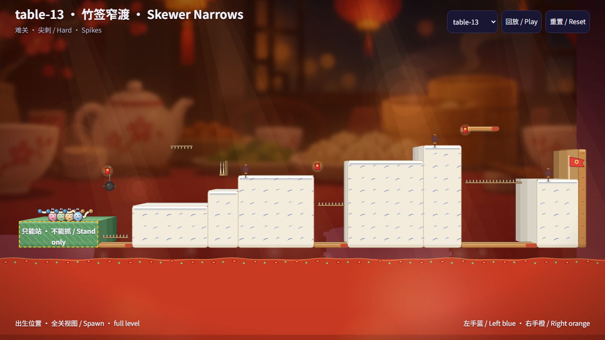


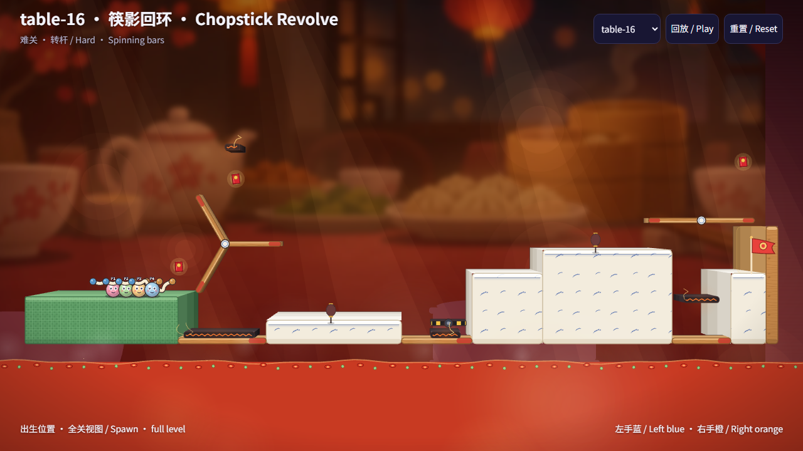
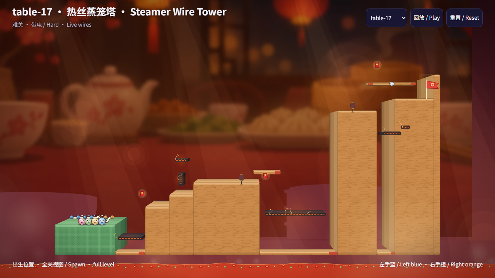


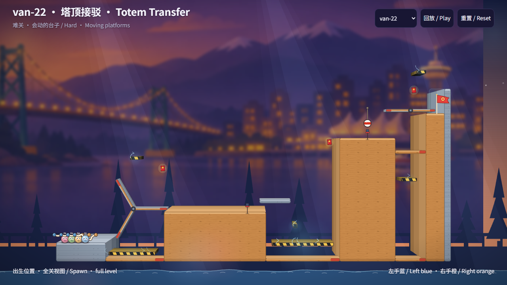


## ho-C12 · 老宅找钥匙

从 `origin/main`（`43a86d61`）新建独立 worktree 和 `codex/ho-c12-house-levels`。六关均为原创布局与双语名字：简单、中等、困难各两关。只增加老宅 JSON、十份输入回放、六张截图及本节；物理、src、验收器、package、锁文件和既有关卡保持原样。

### 布局与操作

| 关卡 / 名字 | tier / teaches | 长×高 | 检查点（依次） | par（秒 / 每人死亡预算） | 路线 |
| --- | --- | --- | --- | --- | --- |
| house-37 · 梅窗柜顶 / Plum Window Cupboard | 0 / key | 2480×720 | (1190, 616) → (2100, 536) | 100 / 2 | 青砖院子起步，翻上梅窗前的柜子拿钥匙，带到封口木门；跨过有底座的碎瓷沟，再翻两级箱台到右端。 |
| house-38 · 点灯穿耳房 / Light the Side Room | 0 / dark | 2560×720 | (1160, 536) → (2020, 576) | 110 / 2 | 从亮院子拿起灯笼进入耳房，依次碰亮两盏墙灯；地板分两级下降，越过凹下的炭盆，出口在第三段青砖台右端。 |
| house-39 · 阁楼寻灯 / Lights in the Attic | 1 / dark | 2440×1440 | (1090, 896) → (2130, 396) | 100 / 3 | 从下层攀上阁楼，九级错高木柜接两块宽休息台；两间黑屋子覆盖台面，沿路点灯，最后到最高层右端。 |
| house-40 · 天井灯影 / Lanterns in the Lightwell | 1 / combine | 2440×720 | (1224, 496) → (2240, 576) | 100 / 3 | 沿天井外沿下行，柜顶钥匙打开第一间黑屋子的门；跨炭盆沟、爬上另一组高柜点灯，再过电线沟到亮院子。 |
| house-41 · 月门递钥 / Key Relay at the Moon Gate | 2 / key | 2560×720 | (1270, 400) → (2070, 376) | 120 / 8 | 在两处错高断口分两组互抓、抛接；到第二面旗后进入暗库房取钥匙，一手带到尽头木门。上方转动的漏电杆需避开。 |
| house-42 · 藏书楼夜渡 / Night Crossing of the Library | 2 / combine | 2560×720 | (1240, 480) → (2080, 456) | 100 / 8 | 书楼两段青砖沟各有一次抛接接应，前段檐梁压住高飞路线，后段进入黑着的藏书间点灯找钥匙；开门后到右端。 |

### 钥匙、照明与预算

钥匙中心均比永久台面高 7 px，灯笼高 20 px；钥匙门均 `grab: false`、两端贴永久地形，只有对应钥匙开启。四关有钥匙，五关有黑屋子，其中三关同时有两样；三关有灯笼、五关有待点的墙灯。碎瓷片在三关、炭盆在四关、静态电线在三关，两个困难关另有转动的漏电杆。

| 关卡 | 钥匙 → 门（关闭位置；开启位移） | 黑屋子 | 墙灯（火苗；半径；初态） | 灯笼 | 平台 / 会动物体 / 危险物 / 墙灯 |
| --- | --- | --- | --- | --- | --- |
| house-37 | (520, 533) → plum-door: (950, 240) 32×400；(0, -240) | — | — | — | 7 / 2 / 1 / 0 |
| house-38 | — | (620, 200) 1200×520 | (780, 488)；240；灭（需点亮）<br>(1390, 536)；260；灭（需点亮） | (490, 500) | 5 / 1 / 1 / 2 |
| house-39 | — | (350, 780) 970×660<br>(1320, 200) 920×1240 | (610, 1096)；240；灭（需点亮）<br>(1710, 596)；260；灭（需点亮） | (300, 1300) | 10 / 1 / 0 / 2 |
| house-40 | (415, 393) → well-door: (820, 140) 32×380；(0, -140) | (270, 140) 650×580<br>(1200, 220) 630×500 | (620, 447)；220；灭（需点亮）<br>(1520, 406)；240；灭（需点亮） | (1110, 500) | 13 / 3 / 2 / 2 |
| house-41 | (2300, 393) → moon-lock: (2450, 160) 28×240；(0, -160) | (1960, 160) 600×560 | (1990, 376)；200；灭（需点亮） | — | 7 / 3 / 4 / 1 |
| house-42 | (2300, 473) → library-lock: (2380, 180) 24×300；(0, -180) | (1800, 180) 760×540 | (1860, 456)；280；灭（需点亮）<br>(2230, 456)；240；亮 | — | 7 / 3 / 4 / 2 |

按原验收器的 40 px 台面网格比较，整关最高重合 36.5%（house-41 / van-10），老宅第一屏最高 15.9%（house-37 / house-42），分别低于 60% 和 85%。

### 回放结果

回放只有 60 Hz 的普通手柄输入：每帧 seq 从 0 递增，t 为对应毫秒；没有传送、初速、复活覆盖或物理变更。四份单人回放单独录制，所有钥匙均已用掉；主回放同时点亮每盏灭灯、拿到三个红包。困难关的各四份手柄单人投影均 0/4 通关。

| 关卡 | 人数 | 用时（秒） | 死亡（P1…） | par 比 | 分段（秒） | 钥匙 / 墙灯 / 红包 |
| --- | ---: | ---: | --- | ---: | --- | --- |
| house-37 | 4 | 75.76 | 0 / 1 / 0 / 0 | 0.758 | 24.52 / 31.47 / 19.78 | 1/1；0/0；3/3 |
| house-37 | 1 | 42.87 | 0 | 0.429 | 32.20 / 7.28 / 3.38 | 1/1；0/0；1/3 |
| house-38 | 4 | 81.86 | 0 / 0 / 0 / 0 | 0.744 | 29.88 / 30.78 / 21.19 | 0/0；2/2；3/3 |
| house-38 | 1 | 20.39 | 0 | 0.185 | 11.05 / 6.92 / 2.42 | 0/0；2/2；2/3 |
| house-39 | 4 | 69.70 | 0 / 0 / 0 / 0 | 0.697 | 17.07 / 28.70 / 23.93 | 0/0；2/2；3/3 |
| house-39 | 1 | 24.74 | 0 | 0.247 | 11.08 / 11.92 / 1.74 | 0/0；2/2；3/3 |
| house-40 | 4 | 51.62 | 0 / 0 / 0 / 1 | 0.516 | 15.03 / 15.55 / 21.03 | 1/1；2/2；3/3 |
| house-40 | 1 | 32.81 | 0 | 0.328 | 17.18 / 14.88 / 0.74 | 1/1；2/2；3/3 |
| house-41 | 4 | 62.87 | 2 / 0 / 0 / 0 | 0.524 | 15.67 / 30.38 / 16.82 | 1/1；1/1；3/3 |
| house-42 | 4 | 66.77 | 0 / 1 / 5 / 0 | 0.668 | 15.60 / 24.03 / 27.13 | 1/1；2/2；3/3 |

单人回放不要求 0.5×par 下界和 15–60 秒分段；单人的红包星可另行探索，三个红包的可达性按主回放验证。

| 困难关 | 各段抛接次数 | 单人投影 |
| --- | --- | --- |
| house-41 | 2 / 3 / 2 | 0/4 |
| house-42 | 2 / 4 / 1 | 0/4 |

### 复核与预览

Node 22.23.5，`games/hang-on` 中运行 `npm test`、`npm run typecheck`、`npm run ip-check`、`npm run levels`。测试为 206 通过、1 失败：仅 `src/sides.test.ts:12` 固定旧 24 关名单的断言，按 Steve 补充要求保留，由 main 修正。类型检查通过，IP 检查 0 处；关卡验收为 `6/6 house PASS`。完整输出表及三项故意破坏的原始报错放在 PR 描述；每次破坏后原文件逐字节恢复。

截图使用 `npm run levels -- --screenshots` 的原 Pixi 审查页、1280×720、出生状态、全关相机。该脚本的预览 HTTP 路由仍只匹配 `table|van`；本次只在 Node 进程中为 `/levels/house-*`、`/replays/house-*` 补路由，并限制只写老宅六张截图、启用无头软件 WebGL。仓库脚本和全部验收规则未改；普通 `npm run levels` 不需要这个预览适配器。手动试玩依 Steve 补充要求跳过。

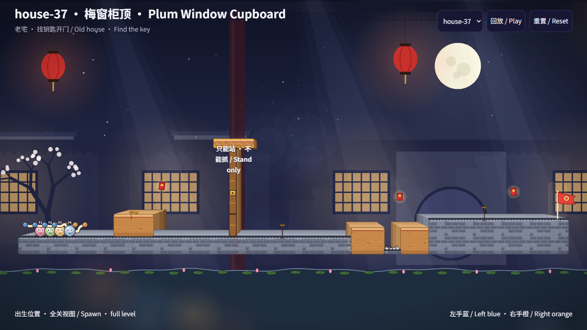

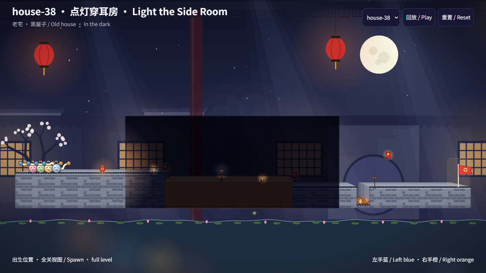

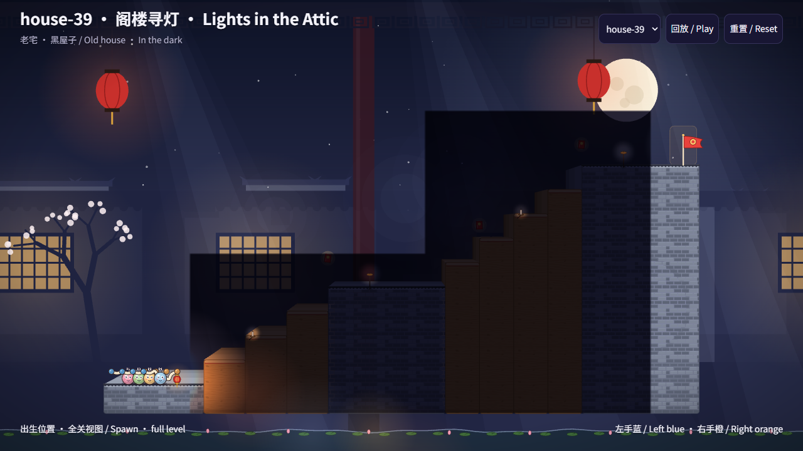


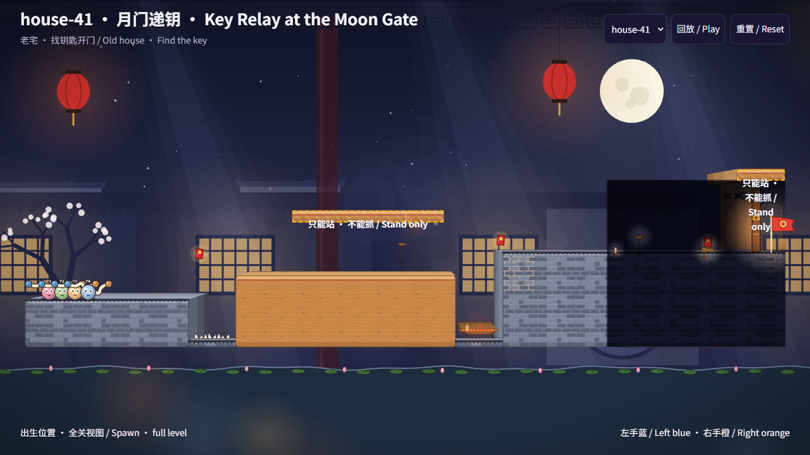

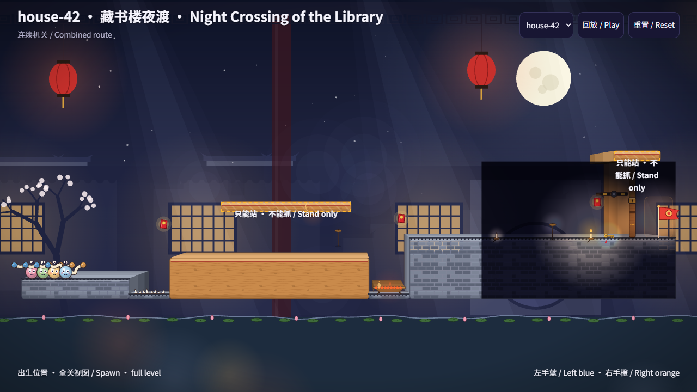

## 太空站（C13）

从 origin/main `43a86d61` 创建独立 worktree，分支 `codex/ho-c13-space-levels`。六关全部使用原 A10 物理与原验收规则；逐帧输入只含轴值、两只抓键、seq/t，60 Hz，无传送、初速、召唤、道具或复活覆盖。六张图是同一 Pixi Stage 的 1280×720 全关出生视图。

### 布局与操作

| 关卡 / 名称 | tier / teaches | 长×高 | 检查点（按顺序） | par（秒 / 每人死） | 失重区（x,y,w,h） | 拉杆 → 舱门 | 怎么过 |
| --- | --- | --- | --- | --- | --- | --- | --- |
| [space-43](space-43.png) · 气闸初航 / Airlock Drift | 0 / float | 2400×720 | (1100,556) → (1770,556) | 120 / 3 | (380,250,540,430) | 无 | 短气闸教学：430–870 的舱外断口只能在失重舱里跨过；两根高低扶手可借力，落回甲板后连续换抓到信标与终点。 |
| [space-44](space-44.png) · 对接口值守 / Docking Watch | 0 / lever | 2400×720 | (1150,476) → (1740,476) | 120 / 3 | 无 | (840,440) → dock；dock (920,180,36,340)，单杆 / 任一杆，hold 3s | 单拉杆教学：靠近 (840,440) 向上伸手拉住，舱门全开后松手向右快速换抓；3 秒延时足够单人通过。后甲板练连续换抓。 |
| [space-45](space-45.png) · 太阳翼检修 / Solar Wing Service | 1 / combine | 2560×720 | (1150,516) → (1730,516) | 110 / 3 | (450,180,650,460) | (1870,480) → solar；solar (1950,240,36,320)，单杆 / 任一杆，hold 3s | 太阳翼断口 500–1050，三根高低扶手与上方竖激光；从栅栏下侧绕过，落地后避开头顶喷口，再拉 (1870,480) 的单杆过门（hold 3 秒）。 |
| [space-46](space-46.png) · 观景环折返 / Observatory Dogleg | 1 / float | 2560×720 | (1120,436) → (2030,516) | 100 / 3 | (370,120,640,460)；(1320,180,640,460) | 无 | 两段失重折线：420–960 的第一处断口绕过下方碎片；1360–1900 的第二处断口从竖激光下方、喷口上方穿过，落到低一层观景甲板。 |
| [space-47](space-47.png) · 货舱双闸 / Cargo Twin Locks | 2 / lever | 2560×720 | (1190,556) → (1830,556) | 110 / 8 | (360,100,590,760)；(1310,100,540,760) | (600,520) → cargo；(960,520) → cargo；(1490,520) → control；(1860,520) → control；cargo (1040,200,36,400)，all，hold 12s；control (1960,200,36,400)，all，hold 12s | 货舱双闸：先在 (500,450) 扶手下挂链接应，再分别保持 (600,520)/(960,520) 拉杆；第二段在 (1680,430) 再接应一次，返回 (1490,520)/(1860,520) 同拉。两扇 all 门开后有 12 秒交接窗口，先过的人接应后到者。 |
| [space-48](space-48.png) · 主控舱交接 / Control Deck Handover | 2 / combine | 2560×720 | (1190,496) → (1830,496) | 110 / 8 | (360,100,590,760)；(1310,100,540,760) | (600,460) → cargo；(960,460) → cargo；(1490,460) → control；(1860,460) → control；cargo (1040,140,36,400)，all，hold 12s；control (1960,140,36,400)，单杆 / 任一杆，hold 12s | 主控交接：较高的首甲板和不同间距的扶手；(500,390) 与 (1680,370) 两次挂链接应。首闸需 (600,460)/(960,460) 同拉；后闸由 (1490,460) 或 (1860,460) 任一杆维持，接力交给下一人（hold 12 秒）。沿途绕过铝板、喷口、激光动块。 |

五关有失重区，四关有拉杆，三关两样都有，两关有分隔至少 300 px 的 all 门；碎片出现在 46/47/48，喷口与激光出现在 45/46/47/48。简单、中等均只有单杆门或没有门，有独立单人回放。失重区均跨过没有地板的断口；四个人在出生点与每个信标都有永久落脚。

### 结果表

| Level | Players | Seconds | Deaths (P1…) | All reached | Par ratio | Size | Checkpoint segments (s) | Cookie grabs / Candle bounces | Machines used (s) |
| --- | ---: | ---: | --- | :---: | ---: | --- | --- | --- | --- |
| space-43 | 4 | 68.57 | 0 / 0 / 0 / 0 | YES | 0.571 | 2400×720 | 18.03 / 28.65 / 21.88 | — / — | — |
| space-43 | 1 | 72.23 | 0 | YES | 0.602 | 2400×720 | 29.52 / 23.10 / 19.62 | — / — | — |
| space-44 | 4 | 65.16 | 0 / 0 / 0 / 0 | YES | 0.543 | 2400×720 | 26.32 / 18.32 / 20.52 | — / — | — |
| space-44 | 1 | 61.69 | 0 | YES | 0.514 | 2400×720 | 29.40 / 17.17 / 15.12 | — / — | — |
| space-45 | 4 | 59.21 | 0 / 0 / 0 / 0 | YES | 0.538 | 2560×720 | 17.83 / 26.03 / 15.34 | — / — | — |
| space-45 | 1 | 58.27 | 0 | YES | 0.530 | 2560×720 | 29.07 / 17.82 / 11.38 | — / — | — |
| space-46 | 4 | 52.99 | 0 / 0 / 0 / 0 | YES | 0.530 | 2560×720 | 16.88 / 19.55 / 16.56 | — / — | — |
| space-46 | 1 | 44.94 | 0 | YES | 0.449 | 2560×720 | 17.37 / 16.22 / 11.36 | — / — | — |
| space-47 | 4 | 89.76 | 0 / 0 / 0 / 0 | YES | 0.816 | 2560×720 | 22.22 / 16.37 / 51.18 | — / — | 0.0 |
| space-48 | 4 | 82.59 | 0 / 0 / 0 / 0 | YES | 0.751 | 2560×720 | 37.40 / 21.85 / 23.34 | — / — | 0.0 |

四人各段为 15.34–51.18 秒，全部零死亡；单人四份均通关且小于 par 两倍。每份回放每块失重区至少 1 秒、每根拉杆都拉过，每扇门都全开过；四人回放从 `npm run envelopes -- space-43 space-44 space-45 space-46 space-47 space-48` 选出每关 3 个红包，原验收逐个确认能拿到。

| 困难关 | S0 / S1 挂链秒数 | 单手柄投影 |
| --- | --- | --- |
| space-47 | 0.433 / 0.517 | 0/4 通过 |
| space-48 | 0.433 / 0.433 | 0/4 通过 |

整关与现有任意关最高重合 57.7%（space-44 / space-48），太空站首屏最高重合 59.5%，分别小于 60% / 85%。

| 关卡 | 平台（≤60） | 会动物件（≤40） | 静态危险（≤40） | 红包 |
| --- | ---: | ---: | ---: | ---: |
| space-43 | 5 | 0 | 0 | 3 |
| space-44 | 4 | 1 | 0 | 3 |
| space-45 | 7 | 1 | 2 | 3 |
| space-46 | 9 | 0 | 3 | 3 |
| space-47 | 12 | 3 | 4 | 3 |
| space-48 | 12 | 3 | 4 | 3 |

### 验收与截图说明

Node 22.23.5，Windows Git Bash。`npm run typecheck` 通过；`npm run ip-check` 0 处。`npm run levels -- --screenshots` 的原规则与全部回放通过，最后包含 `6/6 space PASS`。

现有 `scripts/run-levels.mjs` 的 review 服务路由正则仅接受 table/van，遗漏所有新场景。因此截图使用仓库外的 Playwright I/O 适配器：给 `/levels/space-*`、`/replays/space-*` 返回原 JSON 字节，保留原 Stage/页面/相机；只允许写六张 space PNG，其他场景 PNG 保持原字节。没有修改验收器，也没有改变检查、物理或回放结果；原截图命令的日志仍打印所有旧关截图行，但旧 PNG 写入已被抑制。

`npm test` 206 通过、1 失败：仅 `src/sides.test.ts` 的旧固定列表不包含新场景。Steve 明确要求本分支不修改该测试，先推分支并开 PR；由 Steve 在 main 修好后自行将 main 合入本分支再审。其余测试、typecheck、ip-check 与完整关卡验收均通过。完整关卡输出表和三项故意损坏的原验收错误随 PR 提供。

### 故意改坏的反例（均退出 1，已逐项恢复）

```text
levels: FAIL — space-43: an easy or medium space level needs a one-player replay (replays/space-43.p1.json); solo mode plays it too
levels: FAIL — space-47: levers for gate cargo (all) must be at least 300 px apart so one player can't hold two
levels: FAIL — space-43: a zero-gravity zone is at least 200 × 200
```

## ho-C11 · 雪山缆车

从 `origin/main` 的 `43a86d61` 建立独立 worktree，雪山机关 A10 已包含在基线中。只新增雪山的六关、十份逐帧回放和六张截图；源码、物理、验收器、package 与锁文件保持基线原样。每帧只记录真实 `setInput` 操作（60 Hz，seq 从 0 递增），没有传送、初速、召唤、物理或复活覆盖。四人录制按状态选择抓取和落点，单人另录；交付 JSON 只含输入帧，验收时不运行创作控制器。

### 布局与操作

| 关卡 | 名称 / Name | tier / teaches | 长×高 | 检查点（依次） | par 秒 / 每人死亡 | 布局、缆车与冰溜子、过法 |
| --- | --- | --- | --- | --- | --- | --- |
| snow-31 | 暮雪候车台 / Dusk Snow Station | 0 / lift | 2560×720 | (980,536) → (1740,446) | 90 / 3 | 三段慢缆椅接力：缆绳从 (285,520)→(1100,450)、(1080,460)→(1860,360)、(1830,370)→(2500,310)，跨 550、500、410 px 的雪坑。抓横杆或上座板，抵达各岸后先松手落站，再上下一段；无冰墙、无危险物，集中学上下车。 |
| snow-32 | 冰瀑换手 / Frozen Falls | 0 / slip | 2400×1400 | (850,787) → (1880,198) | 90 / 6 | 独立冰瀑攀爬：五段阶状冰墙在 x=280、640、1000、1460、1820，slip 2.4→1.5 秒；持续倒手，每隔几级有雪台落脚。最后先下到 x=2180 的雪槽，再换手爬 x=2320、340 px 高的收尾冰壁（slip 2 秒）；没有缆车。 |
| snow-33 | 林梢暖厢 / Cabin above the Pines | 1 / combine | 2560×720 | (1100,566) → (1840,356) | 110 / 6 | 松林上方先乘车厢 (280,550)→(1240,480)，再乘缆椅 (1190,490)→(2000,240)，分别跨 650、550 px 的坑。x=1800、2070 是 slip 1.8 / 1.4 秒的冰岸，及时离车抓岸、换手翻上终站；林梢有冰锥和火盆。 |
| snow-34 | 云脊换乘 / Cloud Ridge Transfer | 1 / combine | 2400×1400 | (1000,895) → (2020,197) | 120 / 6 | 两层云脊上行：车厢 (290,1242)→(1190,550) 跨 540 px 深坑；从木站落地、爬 x=1250 的 slip 1.5 秒冰柱，再转缆椅 (1360,690)→(2000,0) 跨 510 px 的断崖。落站在收车前，终段沿上层雪台走到山顶；有电轨和悬冰。 |
| snow-35 | 雪檐抛接 / Snow Cornice Relay | 2 / slip | 2400×1400 | (960,724) → (1900,218) | 90 / 8 | 没有缆车的高雪檐：x=300、660、1240、1600 的冰壁 slip 1 / 0.9 / 0.8 / 0.7 秒，窄檐上换手、抛接队友；中段电块横移，悬冰、火盆和电轨覆盖上下两层。至少在两段进行接应，终点在长山脊尽头。 |
| snow-36 | 极光风口 / Aurora Pass | 2 / gauntlet | 2560×720 | (1120,496) → (1860,356) | 120 / 8 | 三段断崖综合：缆椅 (320,500)→(1280,400)、缆椅 (1280,420)→(1970,260)、车厢 (1930,280)→(2530,50)，分别跨 630、480、420 px 的雪坑；x=1030 的 slip 1.2 秒冰岸和 x=2400 的 slip 0.8 秒终站要抓住及时倒手。悬冰、火盆、电轨与横移电块交错，多段连链 / 抛接后在收车前下车。 |

### 回放结果与预算

四人主回放的全部分段均为 15–60 秒；单人仅按契约检查不超过 par×2。每根缆绳实际乘坐至少 1 秒，每块冰溜子都有抓取，三枚红包均由 `npm run envelopes -- snow-31 snow-32 snow-33 snow-34 snow-35 snow-36` 从对应四人回放选择且实际拿到。

| 关卡 | 四人秒 / 死亡 P1…P4 | 单人秒 / 死亡 | 四人分段秒 | 动态物体 / 平台 / 危险物 |
| --- | --- | --- | --- | --- |
| snow-31 | 69.97 / 0,0,0,0 | 128.93 / 1 | 26.65 / 17.10 / 26.22 | 11 / 4 / 0 |
| snow-32 | 50.57 / 0,0,0,0 | 25.77 / 0 | 17.07 / 17.35 / 16.15 | 0 / 13 / 0 |
| snow-33 | 66.90 / 0,0,0,0 | 80.23 / 1 | 25.98 / 21.73 / 19.18 | 8 / 6 / 2 |
| snow-34 | 88.53 / 1,0,2,3 | 131.19 / 1 | 24.72 / 45.65 / 18.16 | 8 / 6 / 2 |
| snow-35 | 46.95 / 1,0,0,1 | — | 15.23 / 15.37 / 16.35 | 1 / 13 / 5 |
| snow-36 | 71.34 / 1,3,0,0 | — | 20.97 / 23.47 / 26.91 | 11 / 7 / 5 |

四关用缆车、五关用冰溜子、三关两样都有；缆椅与车厢均有真实乘坐。冰锥分布在 33–36，篝火在 33、35、36，电轨在 34–36。困难两关各有 5 处危险物（含 1 个横移电块），每屏都有；所有危险物在每份回放里均到过 240 px 以内。

| 困难关 | 各段成链秒 | 各段抛接次数 | 单手柄投影 |
| --- | --- | --- | --- |
| snow-35 | 1.35 / 0.03 / 0.90 | 7 / 20 / 15 | 0/4 通关 |
| snow-36 | 12.30 / 6.70 / 1.22 | 72 / 13 / 4 | 0/4 通关 |

### 复核与截图

在 `games/hang-on` 使用 Node 22、Git Bash 跑 `npm test`、`npm run typecheck`、`npm run ip-check` 和原样 `npm run levels`。完整验收表及三项反例的原始错误用于本次 PR 描述。本轮 typecheck 通过、ip-check 0 处、levels 含 `6/6 snow` 通过；`npm test` 为 206/207，唯一失败是 `src/sides.test.ts:12` 固定了旧 24 关的难度名单，合法新关会使断言失效。该文件超出本卡输出范围，保持未改。Steve 明确要求按当前结果先推分支、开 PR；由 Steve 在 main 修复该测试，再自行把 main 合入本分支后审查。反例分别删除 `snow-31.p1.json`、把 snow-31 第一根缆绳下移至穿过起站、把 snow-32 第一块冰壁的 slip 改成 10；逐项执行原验收器、确认退出 1，finally 按原字节恢复，再重新全验。

六张 1280×720 全关截图使用 `npm run levels -- --screenshots` 的原 Pixi Stage 和审查页。当前 `run-levels.mjs` 审查页服务的数据路由只匹配 `table|van`，故截图阶段用临时 Playwright 路由适配器提供六关的原始 JSON / 回放，且保留旧关截图原字节；不修改脚本或验收规则。浏览器内核为已安装的 Chromium。

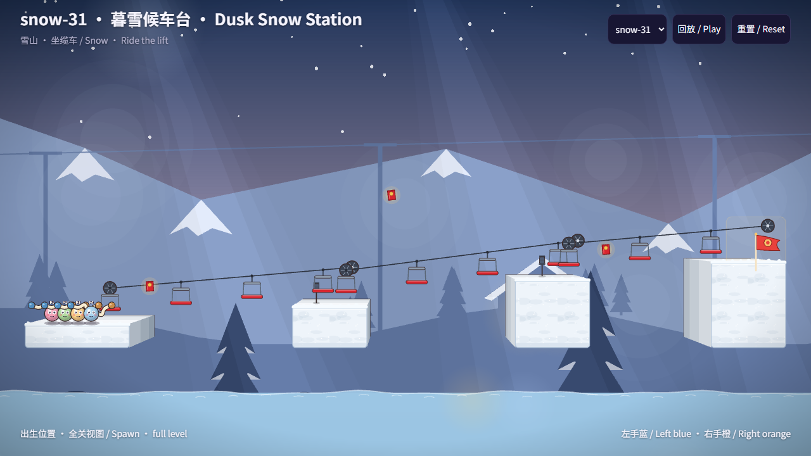


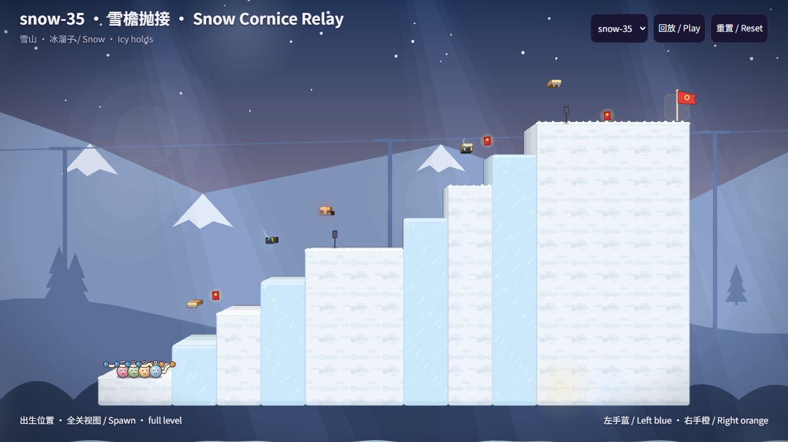

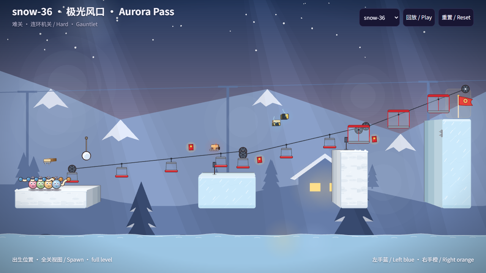
