# 抓紧了 · 关卡与回放（C7 / C8）

从 main `7ffd856` 开始，沿用 C1（#172）的 JSON、四人逐帧回放和 A3/Pixi 截图流程。12 个 id、世界、中英文名字、teaches 均保持 C1 原值；第一屏教学保留，蒸笼与图腾整体下移以留出上方攀爬空间。仅修改 `games/hang-on/levels/**`、`docs/levels/**`、`games/hang-on/scripts/run-levels.mjs`。

## 运行与复核

在 `games/hang-on`，Node 22，Windows 使用 Git Bash：

```sh
export npm_config_script_shell="C:/Program Files/Git/bin/bash.exe"
npm ci
npm test
npm run typecheck
npm run ip-check
npm run levels
```

typecheck 保留 main 的 Worker 类型生成和 `/dev/null` 重定向。没有修改 src、物理参数、package.json、锁文件或 C4 文件。

验收器将未改动的 `world.ts` / `replay.ts` 用现有 esbuild 打到临时目录，逐关调用 `runReplay(level, replay)`，结束后清理。12 份回放均按新布局重新录制展开输入：4 人、60 Hz，seq 从 0 递增，t 为毫秒；模拟内部仍固定 120 Hz。沿用 C1 的离线操作录制方式，在创作时按真实状态选择手柄操作、按永久落点分批集合；提交的回放只含输入帧，验收时没有寻路或反馈控制器。没有传送、初始速度注入、物理覆盖、召唤或修改复活逻辑。

## 布局

横向关为 2560 px（两屏），总复习为 3200 px（三屏）；两道攀爬关为 2560×1440，先横后竖。终点位于延长路线末端，后屏继续练同一种抓取、荡行或攀爬动作，并增加错高、窄落点、较宽缝或组合机关。每屏有检查点，按路线顺序排列；精确分段时间见 [验收结果](validation.md)。

| 关卡 | 名称 / Name | 教学 | 长×高 | 检查点（依次） | par（秒 / 每人死） | 布局与操作 |
| --- | --- | --- | --- | --- | --- | --- |
| table-01 | 茶布起步 / Tea Cloth Crawl | crawl | 2560×720 | (1240, 536) → (2250, 376) | 110 / 2 | 原茶布起步；长茶布上练连续换抓，后段两道 80 px 折台，终点收窄。 |
| table-02 | 碗沿小缝 / Between the Bowls | gap | 2560×720 | (1240, 536) → (1890, 476) | 100 / 2 | 原 80 px 碗缝；后段 70 px 缝接定时饼干，再以 90 px 缝和上升碗沿收尾。 |
| table-03 | 筷子桥 / Chopstick Bridge | swing | 2560×720 | (1240, 506) → (1990, 326) | 90 / 2 | 原两根薄筷子保留；饼干 → 蜡烛上升 180 px → 两次 80 px 高差的筷台。 |
| table-04 | 蒸笼叠叠高 / Steamer Stack | climb | 2560×1440 | (1210, 936) → (2224, 396) | 110 / 2 | 原四级蒸笼整体下移 720 px；永久休息台后走蜡烛，续接六级 80 px 蒸笼。 |
| table-05 | 面条过火锅 / Noodle over the Hotpot | rope | 2560×720 | (1240, 536) → (2030, 496) | 70 / 2 | 原 280 px 绳坑；后段第二根面条绳跨 300 px，最后是 60 px 缝和 80 px 翻沿。 |
| table-06 | 一串汤圆过大锅 / Dumpling Chain | chain | 2560×720 | (1275, 356) → (2240, 196) | 80 / 2 | 原只能站的起台、高筷子和两人成链缺口保留；后段错高的窄碗沿，最后两道 80/90 px 缝。 |
| van-07 | 天车门把手 / SkyTrain Handles | door | 2560×720 | (1240, 536) → (2330, 466) | 100 / 2 | 原门把手保留；后段两组更窄、错高的门柱，门缝增至 90/100 px。 |
| van-08 | 图腾向上 / Totem Ascent | climb | 2560×1440 | (1210, 856) → (2224, 316) | 100 / 2 | 原五级窄图腾整体下移 720 px；蜡烛接六级窄柱，最后连续向上换手。 |
| van-09 | 摇摇浮筒 / Wobbling Pontoons | balance | 2560×720 | (1240, 536) → (2150, 516) | 100 / 2 | 原浮筒转轴下移 30 px，保留第一段教学水面；第二块 640 px 浮筒跨更宽水面。 |
| van-10 | 狮门抛接力 / Lions Gate Toss | throw | 2560×720 | (1275, 402) → (2140, 296) | 90 / 2 | 原只能站的起台、160 px 水面与 80 px 高差保留；两组队友抛接后，连续翻上错高的金属桥墩。 |
| van-11 | 雨中快抓 / Rain Grip | ice | 2560×720 | (1240, 536) → (2310, 296) | 80 / 2 | 原三道 70 px 冰缝保留；定时冰饼干接连续上升的冰岸，后段不能在消失平台上久留。 |
| van-12 | 从夜市到海湾 / Night Market to Harbour | combine | 3200×720 | (1275, 476) → (1760, 476) → (2754, 236) | 120 / 2 | 原台阶、绳、浮筒与冰岸串联；绳后加宽永久回收落点，后段加入冰饼干、蜡烛及三段上升冰岸。 |

## 机关与预算

饼干在 table-02、table-03、van-11、van-12；蜡烛在 table-03、table-04、van-08、van-12；table-03 和 van-12 两样都有。每块饼干都要求实际 terrain grab 的点落在其矩形内，每根蜡烛都要求对应编号的 bounce，不能只摆在路线外。

| 关卡 | 会动物体（≤40） | 矩形总数（≤60） | 饼干 / 蜡烛块数 |
| --- | ---: | ---: | ---: |
| table-01 | 0 | 4 | 0 / 0 |
| table-02 | 0 | 6 | 1 / 0 |
| table-03 | 0 | 10 | 1 / 1 |
| table-04 | 0 | 14 | 0 / 1 |
| table-05 | 16 | 5 | 0 / 0 |
| table-06 | 0 | 7 | 0 / 0 |
| van-07 | 0 | 11 | 0 / 0 |
| van-08 | 0 | 15 | 0 / 1 |
| van-09 | 2 | 6 | 0 / 0 |
| van-10 | 0 | 6 | 0 / 0 |
| van-11 | 0 | 9 | 1 / 0 |
| van-12 | 9 | 11 | 1 / 1 |

会动物体按绳节数 + 跷跷板 + 箱子累计；矩形总数从严包含永久平台、饼干、蜡烛、跷跷板初始矩形和箱子。所有初始矩形都进行两两不重叠检查，相邻边缘接触允许。

## 验收规则

保留 C1 的关数、双语内容、材质、几何、回放格式、四手柄、seq/t、轴值、过关、par、死亡、绳/浮筒真实使用、合作机制、单人投影和 PNG 尺寸检查。C7 增加身份固定、2400–3600 px 横关 / 1400–2200 px 攀爬关、末端终点、每个横向屏与攀爬纵向屏的检查点、物体预算和机关覆盖检查。

每个检查点必须在关内，按数组顺序实际触发且不能跳过；下方 24–80 px 必须有永久平台，能容纳复活位置 cp.x + 玩家编号 × 30 和身体半径 24。饼干、蜡烛和动态浮筒均不能充当这个复活落脚面。时间按模拟的 checkpoint 事件计算：出生 → 首旗、相邻旗、末旗 → 全员 win，每段原始数值均须在 15–60 秒内，不能只看四舍五入后的表。

par 按新回放重定，仍限制 60–180 秒，过关用时须为 par 的 0.5–2 倍。保留每人死亡数 ≤ deathsPerPlayer×4 的原检查，同时增加全队死亡总数 ≤ deathsPerPlayer×4。

第六关要求至少 0.25 秒真实的悬空「玩家 → 玩家 → 地形/绳」链；第十关要求至少两次释放正在向右上飞行的队友（vx>150、vy<−100）。四份录制输入分别投影为单人，两关均 0/4 通关；这沿用 C1 的防退化对照，不是任意输入可达性的穷举。第十二关实际抓绳、抓并压斜浮筒、抓冰、抓饼干和弹蜡烛，验收至少四种，当前五种都用到。

当前反例及完整 npm 输出在 [validation.md](validation.md)；逐个改坏、确认退出码 1，finally 恢复原文件，然后重新跑全部验收。

## 截图与浏览器回放

```sh
# 审查页：选择关卡，回放 / 暂停 / 重置；Ctrl+C 停止
npm run levels -- --serve

# 使用项目现有 Playwright 与已安装的 Chromium
HANG_ON_PLAYWRIGHT="$(pwd)/node_modules/playwright" npm run levels -- --screenshots
```

12 张同名 PNG 已重拍并逐张检查，均为 1280×720、deviceScaleFactor=1。使用游戏本身的 A3 Pixi Stage 与远景画；停在四人出生状态，相机缩到全关，机关与终点同时可见。仅审查页采用全关缩放，游戏镜头仍按 src/render/stage.ts 跟随玩家、到边停、最低 0.45。不可抓起台沿用虚线和「只能站 / Stand only」。

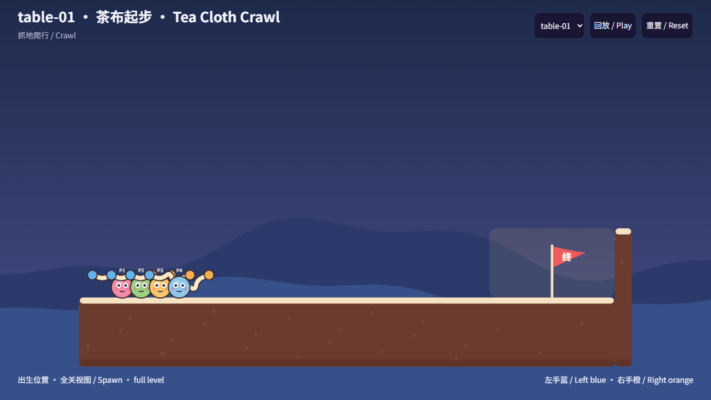


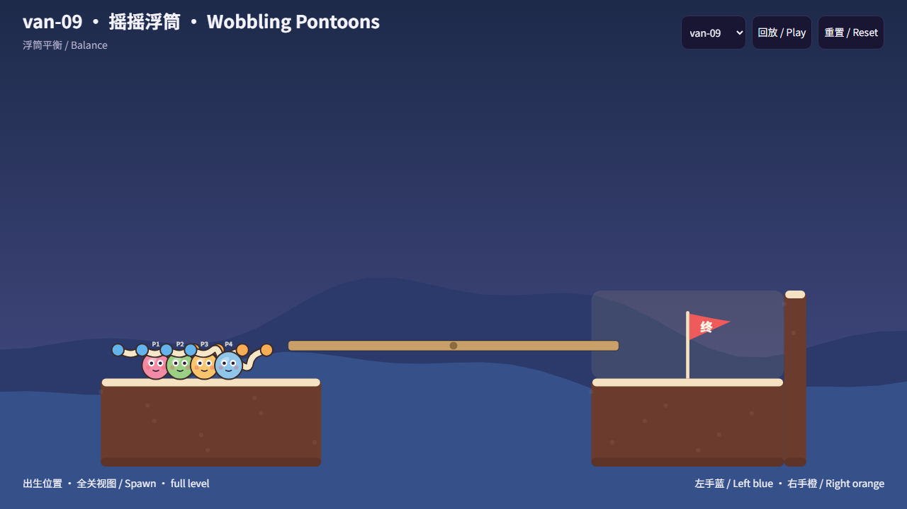
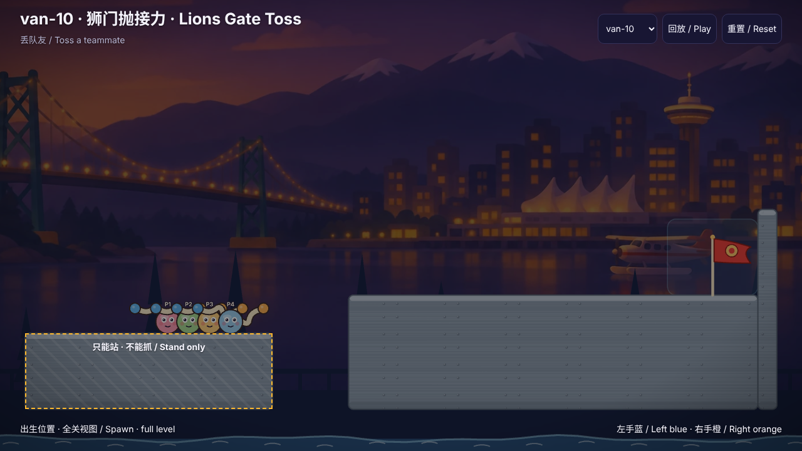


## ho-C8 · 独立难关与 #435 后的回放

PR #418 的第二版布局沿用 `7f42a65`。本轮合入 main `e3abe00`（含 #435 的悬空拉力限制、#436 的探路脚本），对最终物理重新录制全部 12 份四人回放和 4 份双人摆法回放。12 关除了必要的 par 外逐字段不变，16 份输入均重新生成，12 张难关截图沿用原图；基础 12 关及回放、所有截图保持原字节。只创作 `games/hang-on/levels/**` 与 `docs/levels/**`。

每关从第一屏起有自己的路线：斜行下降、向上抛接、慢速三臂转筷、港底上升、先下后上的码头、L 形升降与折线长摆渡分别展开；两道攀爬关的下层和上层接驳也不同。合作分别安排在第一处缺口和下一处动台、转杆或抛接缺口，详见下表及 [逐段证据](validation.md)。

| 关卡 | 名称 / Name | teaches | 长×高 | 检查点（顺序） | par 秒 / 每人死亡预算 | 哪里会死 | 路线与两处合作 | 按人数变化 |
| --- | --- | --- | --- | --- | --- | --- | --- | --- |
| table-13 | 竹签窄渡 / Skewer Narrows | spike | 3000×720 | (1200, 316) → (2200, 156) → (2800, 336) | 150 / 4 | 竹签沟与倒签、碗口往返签块、末沟竹签 | 第一屏抛过 180 px 竹签沟，三段碗沿向上；第二次抛接上高碗，再抓高处动盘过末沟 | 1–4 人同布局。 |
| table-14 | 转盘送席 / Serving Shuttle | mover | 2560×720 | (1192, 656) → (1980, 456) | 180 / 2 | 下沉盘下红油、倒挂热丝、中坑与末坑 | 起段抱下降的斜行盘，落入低碗；向上抛接回高桌，末段转筷接窄碗 | 1–2 人：中段抛接沟多一块 (1420,600) 接应木台；3–4 人撤去。 |
| table-15 | 红油吊廊 / Chilli-Oil Catwalk | hot | 2560×720 | (1180, 376) → (1900, 576) | 150 / 6 | 红油沟、碗口升降烫块、转筷下方与末坑 | 第一屏向上抛接，再过高低碗沿的升降门；中段抓转筷下落接应，末段斜盘上升 | 1–4 人同布局。 |
| table-16 | 筷影回环 / Chopstick Revolve | spinner | 2560×720 | (1040, 616) → (1940, 376) | 120 / 2 | 转筷下电丝、抛接坑电丝与致命短转杆、末沟电丝 | 第一屏三臂慢转筷，向下接低碗；中段抛上高碗，最后用更快的双臂转筷跨缝 | 1–2 人：首段转筷沟和中段抛接沟各多一块接应木台；3–4 人撤去。 |
| table-17 | 热丝蒸笼塔 / Steamer Wire Tower | zap | 2560×1440 | (1240, 936) → (1980, 456) | 180 / 5 | 下层电沟、升降电块、塔间电沟与末沟 | 低处抛过电沟再爬三层蒸笼；两人挂 L 形动盘向上约 600 px，末段转筷接高层 | 1–4 人同布局。 |
| table-18 | 年夜忙不停 / Reunion Rush | gauntlet | 3000×720 | (1200, 596) → (1980, 616) → (2764, 456) | 180 / 8 | 竹签沟、倒挂热丝、电沟、巡回烫块与锅底短转杆 | 第一屏折线盘；第二段转筷；最后两折长动盘，串接五类机关，三处永久回收点 | 1–4 人同布局。 |
| van-19 | 潮栅间隙 / Tidal Grating | spike | 2560×720 | (1160, 336) → (1860, 496) | 150 / 2 | 低码头栅沟、倒挂栅栏、岸口栅块与两处水下栅栏 | 第一屏先向下抛到低码头，再上两级护岸；中段转梁落接，末段水平摆渡到更低的岸 | 1–4 人同布局。 |
| van-20 | 海湾摆渡 / Harbour Shuttle | mover | 2560×720 | (1210, 536) → (1960, 616) | 180 / 8 | 港池栅栏、倒挂栏杆、往返栅块与末段顶栅 | 第一屏斜向上摆渡；中段反转钢梁接下层岸，最后攀两级短护岸，避开上方顶栅 | 1–2 人：反转钢梁下多一块 (1500,600) 接应木台；3–4 人撤去。 |
| van-21 | 电轨折返 / Switchback Current | zap | 2560×720 | (1210, 416) → (2020, 256) | 150 / 6 | 港池电轨、倒挂电轨、巡回电块、致命电杆与末沟 | 第一屏竖升再横走的 L 形平台；中段把队友抛到两层高岸，末段钢梁转到低岸 | 1–4 人同布局。 |
| van-22 | 塔顶接驳 / Totem Transfer | mover | 2560×1440 | (1240, 1096) → (2020, 616) | 180 / 5 | 下层电沟、倒挂电轨、升降电块与两层接驳沟 | 第一屏从港底抓三臂转梁上升；第二段长升降台向上约 600 px，最后转梁接高岸 | 1–2 人：下层转梁与长升降台旁各多一块木台，末沟电轨在 820 高度；3–4 人撤木台，电轨在 1000 高度。 |
| van-23 | 炙桥转轮 / Sizzling Bridge | hot | 2560×720 | (1240, 536) → (2080, 456) | 150 / 3 | 烤架沟、倒挂烤架、升降热块、长烤架与坑底短转杆 | 第一屏抛接后走先上后下的夜市台；中段挂斜升动台串过长烤架，末段抓转梁上岸 | 1–4 人同布局。 |
| van-24 | 海港夜班 / Harbour Night Shift | gauntlet | 3000×720 | (1160, 536) → (2080, 216) → (2764, 336) | 180 / 5 | 栅沟、倒挂电轨、烤架、巡回电块与末沟致命转梁 | 第一屏慢速三臂转梁；中段抛接连爬两层岸，末段高处长摆渡越过电轨与转梁，串五类机关 | 1–4 人同布局。 |

四张人数关的 `.p2.json` 分别覆盖 1/2 人摆法，四人主回放覆盖 3/4 人摆法。每种摆法都跑通，每台安全机关均被站/抓至少 0.25 秒，每处致命物均有身体到过 240 px 内。四人主回放每段 17.50–58.37 秒；攀爬关 table-17 / van-22 都是 2560×1440，分别从 1240 / 1320 高度爬到 400 / 480，横向屏与上下两层均有检查点。

沿用 C1 的离线输入录制：对最终关卡只调用原模拟的 setInput / step，按实际抓点与复活位置继续操作，录成 60 Hz 输入，seq 从 0 递增；每帧单独一行，便于对比。录制与验收都使用 #435 后的原模拟：未连接实物时的拉力限制由引擎照常执行，没有传送、初速、召唤、改复活或改物理。验收只重放固定输入，不运行录制控制器。12 份四人输入序列各不相同，全部单手柄投影为 0/4。六人出生及检查点落脚由 main 的 A7 测试覆盖；本轮 115 条测试还包含 #435 的三条悬空拉力回归检查。

### 自有布局与合作

原验收器按 40 px 上沿格比较所有基础关与难关。当前整关最高重合 36.3%（上限 60%），第一屏最高 44.9%（上限 85%）。不靠改世界或材质区分路线。

| 关卡 | 整关最接近 | 重合率 | 第一屏最接近 | 重合率 |
| --- | --- | ---: | --- | ---: |
| table-13 | van-10 | 16.2% | table-16 | 18.3% |
| table-14 | van-21 | 25.5% | van-19 | 23.3% |
| table-15 | van-23 | 36.3% | van-23 | 44.9% |
| table-16 | van-10 | 23.3% | table-13 | 18.3% |
| table-17 | table-04 | 18.1% | van-22 | 3.4% |
| table-18 | van-20 | 24.4% | table-13 | 0.0% |
| van-19 | table-14 | 20.7% | table-14 | 23.3% |
| van-20 | van-23 | 26.4% | van-23 | 20.4% |
| van-21 | van-23 | 31.4% | table-15 | 28.8% |
| van-22 | table-17 | 17.6% | table-17 | 3.4% |
| van-23 | table-15 | 36.3% | table-15 | 44.9% |
| van-24 | table-18 | 16.9% | van-20 | 16.7% |

| 关卡 | 两处实际合作位置（x 范围，px） | 各段挂链秒数 S0… | 各段抛接次数 S0… | 合作段数 |
| --- | --- | --- | --- | ---: |
| table-13 | 起段抛接（420–600）＋高碗抛接（1560–1740） | 0.00 / 0.00 / 6.78 / 0.00 | 5 / 4 / 2 / 0 | 3 |
| table-14 | 下降动盘（500–1000）＋向上抛接（1400–1580） | 14.78 / 14.77 / 0.02 | 0 / 2 / 4 | 3 |
| table-15 | 红油沟抛接（600–820）＋中段转筷接应（1400–1700） | 0.00 / 4.82 / 9.98 | 2 / 2 / 1 | 3 |
| table-16 | 首段转筷（520–820）＋中段高差抛接（1280–1520） | 5.90 / 0.02 / 0.02 | 3 / 5 / 2 | 3 |
| table-17 | 下层抛接（400–600）＋上升动盘（1360–1880） | 0.02 / 12.75 / 0.02 | 5 / 2 / 0 | 2 |
| table-18 | 折线动盘（400–900）＋中段转筷（1320–1660） | 16.22 / 5.35 / 0.00 / 0.00 | 0 / 0 / 0 / 0 | 2 |
| van-19 | 低码头抛接（360–560）＋转梁接应（1280–1600） | 0.00 / 4.78 / 7.17 | 2 / 2 / 2 | 3 |
| van-20 | 斜行摆渡（360–880）＋反转钢梁（1400–1720） | 1.35 / 0.00 / 1.00 | 1 / 1 / 0 | 3 |
| van-21 | L 形平台（480–1000）＋两层高岸抛接（1400–1640） | 12.50 / 0.08 / 0.02 | 0 / 2 / 2 | 3 |
| van-22 | 港底转梁（320–700）＋高层升降台（1360–1840） | 6.68 / 17.40 / 0.02 | 2 / 0 / 4 | 3 |
| van-23 | 夜市抛接（660–860）＋长烤架斜台（1380–1900） | 0.00 / 7.05 / 0.02 | 2 / 2 / 0 | 2 |
| van-24 | 首段转梁（280–640）＋两层岸抛接（1280–1500） | 6.70 / 0.00 / 6.52 / 0.68 | 0 / 4 / 2 / 0 | 4 |

S0 是出生到第一面旗，之后按实际检查点事件划段。表中位置同时说明两处合作障碍，避免只在同一个起段分两批连一下。挂链与抛接均按原验收器的真实抓点、悬空状态和释放速度统计；单手柄投影仍是 C1 的录制输入对照，不是穷举所有单人解法。

### 机关预算与截图

| 关卡 | 会动物体 ≤40 | 最多同场平台 ≤60 | 最多同场致命物 ≤40 |
| --- | ---: | ---: | ---: |
| table-13 | 2 | 11 | 5 |
| table-14 | 3 | 10 | 5 |
| table-15 | 3 | 10 | 6 |
| table-16 | 3 | 11 | 5 |
| table-17 | 3 | 10 | 6 |
| table-18 | 5 | 8 | 6 |
| van-19 | 4 | 10 | 6 |
| van-20 | 3 | 10 | 5 |
| van-21 | 4 | 9 | 6 |
| van-22 | 4 | 10 | 6 |
| van-23 | 4 | 10 | 6 |
| van-24 | 4 | 12 | 7 |

11 关有安全动台，11 关有安全转杆，11 关有致命动块，6 关有致命转杆。尖刺、烫、电均覆盖至少三关；table-18 与 van-24 都串接静态危险物、安全动台、致命动块、安全转杆、致命转杆五类。没有同时存在的平台重叠，物体预算和人数范围由原脚本检查。

原 `npm run levels -- --screenshots` 重拍下列 12 张 1280×720 出生全关图，逐张查看路线、旗与终点；基础 12 张截图恢复原字节。这些图拍摄于第二版，本轮布局未变，保留截图字节。本轮完整命令输出与探路参考见 [验收结果](validation.md)，#422 的两个反例保留在该文链接的第二版历史记录中。


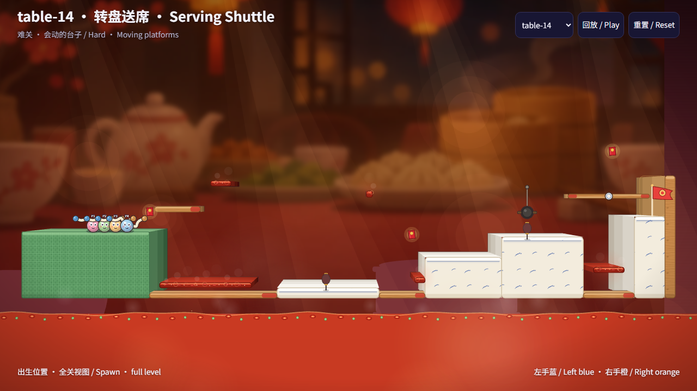
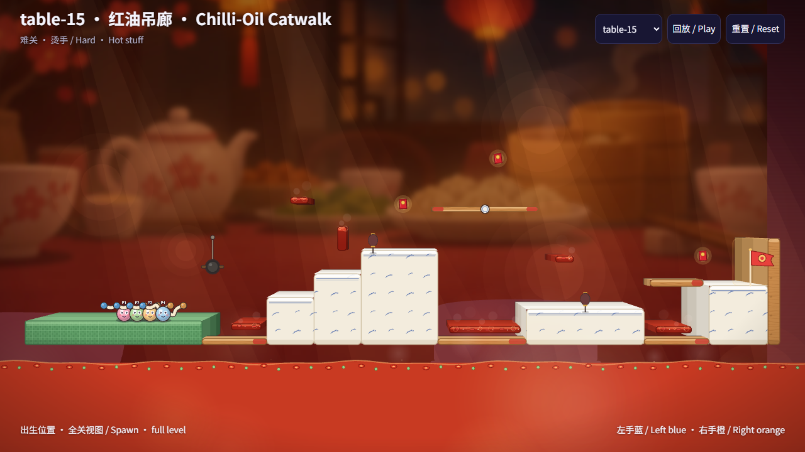


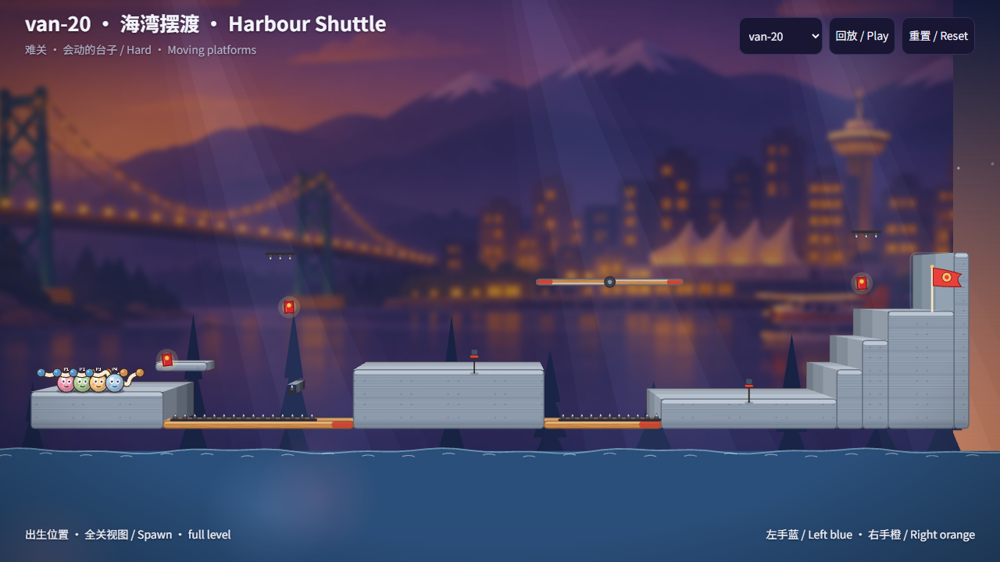
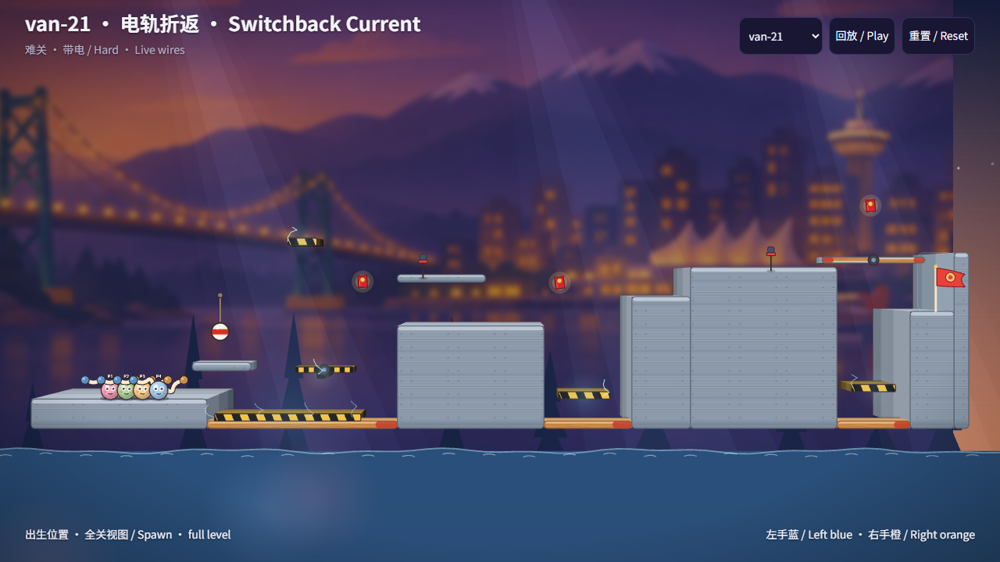


## ho-C12 · 老宅找钥匙

从 `origin/main`（`43a86d61`）新建独立 worktree 和 `codex/ho-c12-house-levels`。六关均为原创布局与双语名字：简单、中等、困难各两关。只增加老宅 JSON、十份输入回放、六张截图及本节；物理、src、验收器、package、锁文件和既有关卡保持原样。

### 布局与操作

| 关卡 / 名字 | tier / teaches | 长×高 | 检查点（依次） | par（秒 / 每人死亡预算） | 路线 |
| --- | --- | --- | --- | --- | --- |
| house-37 · 梅窗柜顶 / Plum Window Cupboard | 0 / key | 2480×720 | (1190, 616) → (2100, 536) | 100 / 2 | 青砖院子起步，翻上梅窗前的柜子拿钥匙，带到封口木门；跨过有底座的碎瓷沟，再翻两级箱台到右端。 |
| house-38 · 点灯穿耳房 / Light the Side Room | 0 / dark | 2560×720 | (1160, 536) → (2020, 576) | 110 / 2 | 从亮院子拿起灯笼进入耳房，依次碰亮两盏墙灯；地板分两级下降，越过凹下的炭盆，出口在第三段青砖台右端。 |
| house-39 · 阁楼寻灯 / Lights in the Attic | 1 / dark | 2440×1440 | (1090, 896) → (2130, 396) | 100 / 3 | 从下层攀上阁楼，九级错高木柜接两块宽休息台；两间黑屋子覆盖台面，沿路点灯，最后到最高层右端。 |
| house-40 · 穿堂寻灯 / Lightwell Lantern Circuit | 1 / wind | 3400×2160 | (1400, 1936) → (2680, 1106) → (1450, 1106) → (600, 256) → (1750, 256) | 280 / 6 | 池边向右走到右井，升到中层穿堂向左，再从左井到上廊。经过暗室时点亮墙灯，把钥匙带到右端木门后进终点。 [长关详情](#ho-c16-house-40) |
| house-41 · 回风双塔 / Drafts Between Twin Towers | 2 / pendulum | 3600×2160 | (1600, 2026) → (2900, 1346) → (1600, 1346) → (600, 616) → (1900, 616) | 290 / 6 | 下院到右塔、右塔回到中廊、再去左塔上顶廊。沿路接住或抛送队友，上层暗室取钥匙，开右端的门；快速摆灯与阵风交替出现。 [长关详情](#ho-c16-house-41) |
| house-42 · 藏书楼夜渡 / Night Crossing of the Library | 2 / combine | 2560×720 | (1240, 480) → (2080, 456) | 100 / 8 | 书楼两段青砖沟各有一次抛接接应，前段檐梁压住高飞路线，后段进入黑着的藏书间点灯找钥匙；开门后到右端。 |

### 钥匙、照明与预算

钥匙中心均比永久台面高 7 px，灯笼高 20 px；钥匙门均 `grab: false`、两端贴永久地形，只有对应钥匙开启。四关有钥匙，五关有黑屋子，其中三关同时有两样；三关有灯笼、五关有待点的墙灯。碎瓷片在三关、炭盆在四关、静态电线在三关，两个困难关另有转动的漏电杆。

| 关卡 | 钥匙 → 门（关闭位置；开启位移） | 黑屋子 | 墙灯（火苗；半径；初态） | 灯笼 | 平台 / 会动物体 / 危险物 / 墙灯 |
| --- | --- | --- | --- | --- | --- |
| house-37 | (520, 533) → plum-door: (950, 240) 32×400；(0, -240) | — | — | — | 7 / 2 / 1 / 0 |
| house-38 | — | (620, 200) 1200×520 | (780, 488)；240；灭（需点亮）<br>(1390, 536)；260；灭（需点亮） | (490, 500) | 5 / 1 / 1 / 2 |
| house-39 | — | (350, 780) 970×660<br>(1320, 200) 920×1240 | (610, 1096)；240；灭（需点亮）<br>(1710, 596)；260；灭（需点亮） | (300, 1300) | 10 / 1 / 0 / 2 |
| house-40 | (2530, 293) → lightwell；(2900, 0) 28×300；(0, 310) | (2100, 40) 1200×290 | (2400, 250)；240；灭（需点亮）<br>(3130, 240)；220；亮 | — | 3 / 7 / 0 / 2 |
| house-41 | (2700, 653) → towers；(3160, 360) 28×300；(0, -310) | (2050, 340) 1500×350 | (2400, 610)；250；灭（需点亮）<br>(3320, 590)；220；亮 | — | 4 / 8 / 4 / 2 |
| house-42 | (2300, 473) → library-lock: (2380, 180) 24×300；(0, -180) | (1800, 180) 760×540 | (1860, 456)；280；灭（需点亮）<br>(2230, 456)；240；亮 | — | 7 / 3 / 4 / 2 |

按原验收器的 40 px 台面网格比较，整关最高重合 36.5%（house-41 / van-10），老宅第一屏最高 15.9%（house-37 / house-42），分别低于 60% 和 85%。

### 回放结果

回放只有 60 Hz 的普通手柄输入：每帧 seq 从 0 递增，t 为对应毫秒；没有传送、初速、复活覆盖或物理变更。四份单人回放单独录制，所有钥匙均已用掉；主回放同时点亮每盏灭灯、拿到三个红包。困难关的各四份手柄单人投影均 0/4 通关。

| 关卡 | 人数 | 用时（秒） | 死亡（P1…） | par 比 | 分段（秒） | 钥匙 / 墙灯 / 红包 |
| --- | ---: | ---: | --- | ---: | --- | --- |
| house-37 | 4 | 75.76 | 0 / 1 / 0 / 0 | 0.758 | 24.52 / 31.47 / 19.78 | 1/1；0/0；3/3 |
| house-37 | 1 | 42.87 | 0 | 0.429 | 32.20 / 7.28 / 3.38 | 1/1；0/0；1/3 |
| house-38 | 4 | 81.86 | 0 / 0 / 0 / 0 | 0.744 | 29.88 / 30.78 / 21.19 | 0/0；2/2；3/3 |
| house-38 | 1 | 20.39 | 0 | 0.185 | 11.05 / 6.92 / 2.42 | 0/0；2/2；2/3 |
| house-39 | 4 | 69.70 | 0 / 0 / 0 / 0 | 0.697 | 17.07 / 28.70 / 23.93 | 0/0；2/2；3/3 |
| house-39 | 1 | 24.74 | 0 | 0.247 | 11.08 / 11.92 / 1.74 | 0/0；2/2；3/3 |
| house-40 | 4 | 249.28 | 0 / 0 / 0 / 0 | 0.890 | 18.63 / 52.33 / 42.47 / 44.38 / 48.37 / 43.10 | 1/1；2/2；3/3 |
| house-40 | 1 | 159.39 | 0 | 0.569 | 23.30 / 44.82 / 19.92 / 29.42 / 18.35 / 23.59 | 1/1；2/2；2/3 |
| house-41 | 4 | 174.57 | 1 / 1 / 2 / 1 | 0.602 | 18.53 / 45.13 / 25.52 / 37.63 / 17.73 / 30.02 | 1/1；2/2；3/3 |
| house-42 | 4 | 66.77 | 0 / 1 / 5 / 0 | 0.668 | 15.60 / 24.03 / 27.13 | 1/1；2/2；3/3 |

单人回放不要求 0.5×par 下界和 15–60 秒分段；单人的红包星可另行探索，三个红包的可达性按主回放验证。

| 困难关 | 各段抛接次数 | 单人投影 |
| --- | --- | --- |
| house-41 | 3 / 20 / 4 / 5 / 9 / 6 | 0/4 |
| house-42 | 2 / 4 / 1 | 0/4 |

### 复核与预览

Node 22.23.5，`games/hang-on` 中运行 `npm test`、`npm run typecheck`、`npm run ip-check`、`npm run levels`。测试为 206 通过、1 失败：仅 `src/sides.test.ts:12` 固定旧 24 关名单的断言，按 Steve 补充要求保留，由 main 修正。类型检查通过，IP 检查 0 处；关卡验收为 `6/6 house PASS`。完整输出表及三项故意破坏的原始报错放在 PR 描述；每次破坏后原文件逐字节恢复。

截图使用 `npm run levels -- --screenshots` 的原 Pixi 审查页、1280×720、出生状态、全关相机。该脚本的预览 HTTP 路由仍只匹配 `table|van`；本次只在 Node 进程中为 `/levels/house-*`、`/replays/house-*` 补路由，并限制只写老宅六张截图、启用无头软件 WebGL。仓库脚本和全部验收规则未改；普通 `npm run levels` 不需要这个预览适配器。手动试玩依 Steve 补充要求跳过。


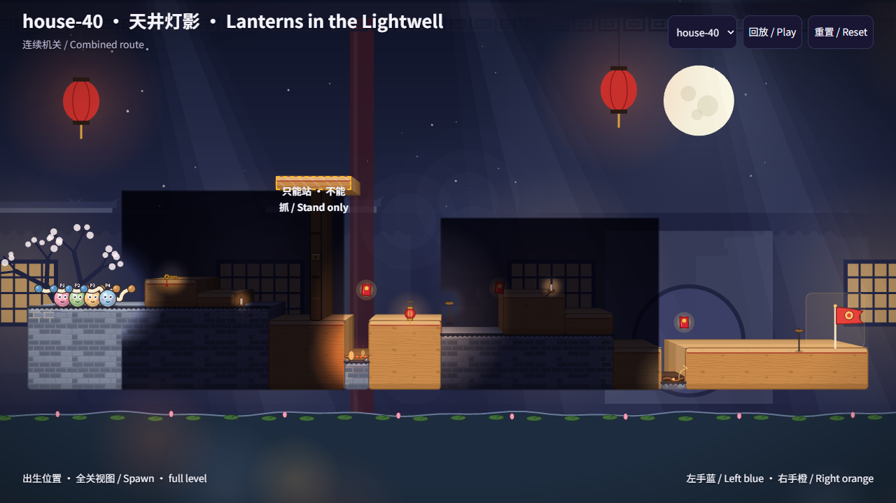


### ho-C16 · 当前长关

以下是本场景两关的当前记录。上方原任务的整体范围统计属于旧版本；涉及这两关时以本节及更新后的行数据为准。中等、困难按手酸录制，所有输入均为 60 Hz 普通手柄操作。

<a id="ho-c16-house-40"></a>
#### house-40 · 穿堂寻灯 / Lightwell Lantern Circuit

替换「天井灯影 / Lanterns in the Lightwell」（原四人约 52 秒）。tier 1（中等），teaches wind，long: true，开启手酸。尺寸 3400×2160；路线折线长 7869 px；par 280 秒 / 每人 6 次。

池边向右走到右井，升到中层穿堂向左，再从左井到上廊。经过暗室时点亮墙灯，把钥匙带到右端木门后进终点。

出生 (150, 1936)；五面旗依次为 (1400, 1936) → (2680, 1106) → (1450, 1106) → (600, 256) → (1750, 256)；终点 (3140, 100) 240×200。每面旗都有四人的永久落脚平台。等待队友和最难一段前，可在旗边站稳休息。

场景机关：钥匙 (2530, 293) → lightwell；门 (2900, 0) 28×300，开启位移 (0, 310)。暗室 (2100, 40) 1200×290；灭灯 (2400, 250) 需要碰亮。

新机关：摆锤 (1150, 1800)、绳长 100、周期 4.5s；(1900, 970)、绳长 100、周期 3.5s；(2450, 970)、绳长 100、周期 3s。阵风 (650, 1760) 360×220、right、喷/停 1.2/3.4s；(2480, 50) 320×250、right、喷/停 1.2/3.4s。
池水延迟 40s 后以 5px/s 上涨，到 y=340 停；主回放离最低活人的最近距离 186.31px，单人 319.07px。

预算：平台 3/60，会动物件 7/40，静态危险物 0/40；动台、转杆、摆锤共 5 件，其中快机关 2 件。整关最高台面重合 22.4%，同场景第一屏 0.0%。

| 人数 | 用时（秒） | 死亡（P1…） | 检查点分段（秒） |
| ---: | ---: | --- | --- |
| 4 | 249.28 | 0 / 0 / 0 / 0 | 18.63 / 52.33 / 42.47 / 44.38 / 48.37 / 43.10 |
| 1 | 159.39 | 0 | 23.30 / 44.82 / 19.92 / 29.42 / 18.35 / 23.59 |

红包（从四人回放选择并实际取得）：(3000, 973)、(338, 42)、(350, 409)。


<a id="ho-c16-house-41"></a>
#### house-41 · 回风双塔 / Drafts Between Twin Towers

替换「月门递钥 / Key Relay at the Moon Gate」（原四人约 63 秒）。tier 2（困难），teaches pendulum，long: true，开启手酸。尺寸 3600×2160；路线折线长 8316 px；par 290 秒 / 每人 6 次。

下院到右塔、右塔回到中廊、再去左塔上顶廊。沿路接住或抛送队友，上层暗室取钥匙，开右端的门；快速摆灯与阵风交替出现。

出生 (150, 2026)；五面旗依次为 (1600, 2026) → (2900, 1346) → (1600, 1346) → (600, 616) → (1900, 616)；终点 (3340, 460) 240×200。每面旗都有四人的永久落脚平台。等待队友和最难一段前，可在旗边站稳休息。

场景机关：钥匙 (2700, 653) → towers；门 (3160, 360) 28×300，开启位移 (0, -310)。暗室 (2050, 340) 1500×350；灭灯 (2400, 610) 需要碰亮。

新机关：摆锤 (1050, 1890)、绳长 100、周期 2.2s；(2350, 1210)、绳长 100、周期 2s；(1000, 480)、绳长 100、周期 3s；(2750, 480)、绳长 100、周期 2.8s。阵风 (650, 1850) 360×220、right、喷/停 1.2/3.4s；(2680, 410) 320×250、right、喷/停 1.2/3.4s。

预算：平台 4/60，会动物件 8/40，静态危险物 4/40；动台、转杆、摆锤共 6 件，其中快机关 4 件。整关最高台面重合 21.4%，同场景第一屏 0.0%。

| 人数 | 用时（秒） | 死亡（P1…） | 检查点分段（秒） |
| ---: | ---: | --- | --- |
| 4 | 174.57 | 1 / 1 / 2 / 1 | 18.53 / 45.13 / 25.52 / 37.63 / 17.73 / 30.02 |

合作证据 S0…S5：挂链秒数 1.38 / 0.12 / 0.23 / 0.05 / 0.47 / 0.95；抛接 3 / 20 / 4 / 5 / 9 / 6 次。四份手柄分别单独回放均 0/4 到顶。

红包（从四人回放选择并实际取得）：(3218, 1861)、(3163, 1135)、(252, 350)。


## 太空站（C13）

从 origin/main `43a86d61` 创建独立 worktree，分支 `codex/ho-c13-space-levels`。六关全部使用原 A10 物理与原验收规则；逐帧输入只含轴值、两只抓键、seq/t，60 Hz，无传送、初速、召唤、道具或复活覆盖。六张图是同一 Pixi Stage 的 1280×720 全关出生视图。

### 布局与操作

| 关卡 / 名称 | tier / teaches | 长×高 | 检查点（按顺序） | par（秒 / 每人死） | 失重区（x,y,w,h） | 拉杆 → 舱门 | 怎么过 |
| --- | --- | --- | --- | --- | --- | --- | --- |
| [space-43](space-43.png) · 气闸初航 / Airlock Drift | 0 / float | 2400×720 | (1100,556) → (1770,556) | 120 / 3 | (380,250,540,430) | 无 | 短气闸教学：430–870 的舱外断口只能在失重舱里跨过；两根高低扶手可借力，落回甲板后连续换抓到信标与终点。 |
| [space-44](space-44.png) · 对接口值守 / Docking Watch | 0 / lever | 2400×720 | (1150,476) → (1740,476) | 120 / 3 | 无 | (840,440) → dock；dock (920,180,36,340)，单杆 / 任一杆，hold 3s | 单拉杆教学：靠近 (840,440) 向上伸手拉住，舱门全开后松手向右快速换抓；3 秒延时足够单人通过。后甲板练连续换抓。 |
| [space-45](space-45.png) · 太阳翼环检 / Solar Wing Inspection Loop | 1 / wind | 3400×2160 | (2600, 1936) → (3100, 396) → (420, 396) → (400, 1116) → (1800, 1116) | 270 / 6 | (0, 0) 3400×2200 | (2820, 1040) → inspection | 从下层太阳翼向右绕入外侧竖井，上升到右上信标，再沿上层向左；从左侧通道下潜回中层，向右拉检修杆、穿过气闸到终点。 [长关详情](#ho-c16-space-45) |
| [space-46](space-46.png) · 泄压回廊 / Pressure Relief Galleries | 1 / wind | 3200×2000 | (1400, 1856) → (2700, 1206) → (1500, 1206) → (450, 506) → (1700, 506) | 220 / 6 | (0, 0) 3200×2000 | 无 | 在七个分离停靠岛之间按旗折返：下层向右、绕右侧挡板升到中层，再折回左端升上顶层，最后向右到舱门。两处阵风分布在底层和顶层，三只维修舱摆锤分层布置。 [长关详情](#ho-c16-space-46) |
| [space-47](space-47.png) · 货舱双闸 / Cargo Twin Locks | 2 / lever | 2560×720 | (1190,556) → (1830,556) | 110 / 8 | (360,100,590,760)；(1310,100,540,760) | (600,520) → cargo；(960,520) → cargo；(1490,520) → control；(1860,520) → control；cargo (1040,200,36,400)，all，hold 12s；control (1960,200,36,400)，all，hold 12s | 货舱双闸：先在 (500,450) 扶手下挂链接应，再分别保持 (600,520)/(960,520) 拉杆；第二段在 (1680,430) 再接应一次，返回 (1490,520)/(1860,520) 同拉。两扇 all 门开后有 12 秒交接窗口，先过的人接应后到者。 |
| [space-48](space-48.png) · 主控舱交接 / Control Deck Handover | 2 / combine | 2560×720 | (1190,496) → (1830,496) | 110 / 8 | (360,100,590,760)；(1310,100,540,760) | (600,460) → cargo；(960,460) → cargo；(1490,460) → control；(1860,460) → control；cargo (1040,140,36,400)，all，hold 12s；control (1960,140,36,400)，单杆 / 任一杆，hold 12s | 主控交接：较高的首甲板和不同间距的扶手；(500,390) 与 (1680,370) 两次挂链接应。首闸需 (600,460)/(960,460) 同拉；后闸由 (1490,460) 或 (1860,460) 任一杆维持，接力交给下一人（hold 12 秒）。沿途绕过铝板、喷口、激光动块。 |

五关有失重区，四关有拉杆，三关两样都有，两关有分隔至少 300 px 的 all 门；碎片出现在 46/47/48，喷口与激光出现在 45/46/47/48。简单、中等均只有单杆门或没有门，有独立单人回放。失重区均跨过没有地板的断口；四个人在出生点与每个信标都有永久落脚。

### 结果表

| Level | Players | Seconds | Deaths (P1…) | All reached | Par ratio | Size | Checkpoint segments (s) | Cookie grabs / Candle bounces | Machines used (s) |
| --- | ---: | ---: | --- | :---: | ---: | --- | --- | --- | --- |
| space-43 | 4 | 68.57 | 0 / 0 / 0 / 0 | YES | 0.571 | 2400×720 | 18.03 / 28.65 / 21.88 | — / — | — |
| space-43 | 1 | 72.23 | 0 | YES | 0.602 | 2400×720 | 29.52 / 23.10 / 19.62 | — / — | — |
| space-44 | 4 | 65.16 | 0 / 0 / 0 / 0 | YES | 0.543 | 2400×720 | 26.32 / 18.32 / 20.52 | — / — | — |
| space-44 | 1 | 61.69 | 0 | YES | 0.514 | 2400×720 | 29.40 / 17.17 / 15.12 | — / — | — |
| space-45 | 4 | 215.73 | 0 / 0 / 0 / 1 | YES | 0.799 | 3400×2160 | 35.65 / 39.07 / 34.30 / 25.10 / 24.00 / 57.62 | — / — | — |
| space-45 | 1 | 184.02 | 0 | YES | 0.682 | 3400×2160 | 35.65 / 39.07 / 34.30 / 25.10 / 24.00 / 25.90 | — / — | — |
| space-46 | 4 | 180.77 | 0 / 0 / 0 / 0 | YES | 0.822 | 3200×2000 | 15.25 / 46.22 / 20.57 / 42.68 / 21.62 / 34.43 | — / — | — |
| space-46 | 1 | 162.32 | 0 | YES | 0.738 | 3200×2000 | 15.25 / 46.22 / 20.57 / 42.68 / 21.62 / 15.98 | — / — | — |
| space-47 | 4 | 89.76 | 0 / 0 / 0 / 0 | YES | 0.816 | 2560×720 | 22.22 / 16.37 / 51.18 | — / — | 0.0 |
| space-48 | 4 | 82.59 | 0 / 0 / 0 / 0 | YES | 0.751 | 2560×720 | 37.40 / 21.85 / 23.34 | — / — | 0.0 |

四人各段为 15.34–51.18 秒，全部零死亡；单人四份均通关且小于 par 两倍。每份回放每块失重区至少 1 秒、每根拉杆都拉过，每扇门都全开过；四人回放从 `npm run envelopes -- space-43 space-44 space-45 space-46 space-47 space-48` 选出每关 3 个红包，原验收逐个确认能拿到。

| 困难关 | S0 / S1 挂链秒数 | 单手柄投影 |
| --- | --- | --- |
| space-47 | 0.433 / 0.517 | 0/4 通过 |
| space-48 | 0.433 / 0.433 | 0/4 通过 |

整关与现有任意关最高重合 57.7%（space-44 / space-48），太空站首屏最高重合 59.5%，分别小于 60% / 85%。

| 关卡 | 平台（≤60） | 会动物件（≤40） | 静态危险（≤40） | 红包 |
| --- | ---: | ---: | ---: | ---: |
| space-43 | 5 | 0 | 0 | 3 |
| space-44 | 4 | 1 | 0 | 3 |
| space-45 | 5 | 4 | 3 | 3 |
| space-46 | 9 | 3 | 4 | 3 |
| space-47 | 12 | 3 | 4 | 3 |
| space-48 | 12 | 3 | 4 | 3 |

### 验收与截图说明

Node 22.23.5，Windows Git Bash。`npm run typecheck` 通过；`npm run ip-check` 0 处。`npm run levels -- --screenshots` 的原规则与全部回放通过，最后包含 `6/6 space PASS`。

现有 `scripts/run-levels.mjs` 的 review 服务路由正则仅接受 table/van，遗漏所有新场景。因此截图使用仓库外的 Playwright I/O 适配器：给 `/levels/space-*`、`/replays/space-*` 返回原 JSON 字节，保留原 Stage/页面/相机；只允许写六张 space PNG，其他场景 PNG 保持原字节。没有修改验收器，也没有改变检查、物理或回放结果；原截图命令的日志仍打印所有旧关截图行，但旧 PNG 写入已被抑制。

`npm test` 206 通过、1 失败：仅 `src/sides.test.ts` 的旧固定列表不包含新场景。Steve 明确要求本分支不修改该测试，先推分支并开 PR；由 Steve 在 main 修好后自行将 main 合入本分支再审。其余测试、typecheck、ip-check 与完整关卡验收均通过。完整关卡输出表和三项故意损坏的原验收错误随 PR 提供。

### 故意改坏的反例（均退出 1，已逐项恢复）

```text
levels: FAIL — space-43: an easy or medium space level needs a one-player replay (replays/space-43.p1.json); solo mode plays it too
levels: FAIL — space-47: levers for gate cargo (all) must be at least 300 px apart so one player can't hold two
levels: FAIL — space-43: a zero-gravity zone is at least 200 × 200
```

### ho-C16 · 当前长关

以下是本场景两关的当前记录。上方原任务的整体范围统计属于旧版本；涉及这两关时以本节及更新后的行数据为准。中等、困难按手酸录制，所有输入均为 60 Hz 普通手柄操作。

<a id="ho-c16-space-45"></a>
#### space-45 · 太阳翼环检 / Solar Wing Inspection Loop

替换「太阳翼检修 / Solar Wing Service」（原四人约 59 秒）。tier 1（中等），teaches wind，long: true，开启手酸。尺寸 3400×2160；路线折线长 10336 px；par 270 秒 / 每人 6 次。

从下层太阳翼向右绕入外侧竖井，上升到右上信标，再沿上层向左；从左侧通道下潜回中层，向右拉检修杆、穿过气闸到终点。

出生 (160, 1936)；五面旗依次为 (2600, 1936) → (3100, 396) → (420, 396) → (400, 1116) → (1800, 1116)；终点 (3160, 850) 220×260。每面旗都有四人的永久落脚平台。等待队友和最难一段前，可在旗边站稳休息。

场景机关：失重区 (0, 0) 3400×2200。拉杆 (2820, 1040) 开 inspection 气闸，松手后保持 90 秒。

新机关：摆锤 (1300, 1790)、绳长 100、周期 4s；(2100, 250)、绳长 100、周期 3.2s；(1100, 950)、绳长 100、周期 2.5s。阵风 (840, 1750) 340×230、right、喷/停 1.2/3.4s；(1500, 160) 600×290、left、喷/停 2/0.8s。
岔路：上层直穿是快线，要经过风区与维修舱摆锤；稳线从右侧竖井下潜到上层甲板下方，绕到左侧开口再上浮，距离更长。上层 x=1730–1910 的检修口也可换层。

预算：平台 5/60，会动物件 4/40，静态危险物 3/40；动台、转杆、摆锤共 3 件，其中快机关 0 件。整关最高台面重合 22.4%，同场景第一屏 0.0%。

| 人数 | 用时（秒） | 死亡（P1…） | 检查点分段（秒） |
| ---: | ---: | --- | --- |
| 4 | 215.73 | 0 / 0 / 0 / 1 | 35.65 / 39.07 / 34.30 / 25.10 / 24.00 / 57.62 |
| 1 | 184.02 | 0 | 35.65 / 39.07 / 34.30 / 25.10 / 24.00 / 25.90 |

红包（从四人回放选择并实际取得）：(1266, 1799)、(2810, 251)、(74, 792)。

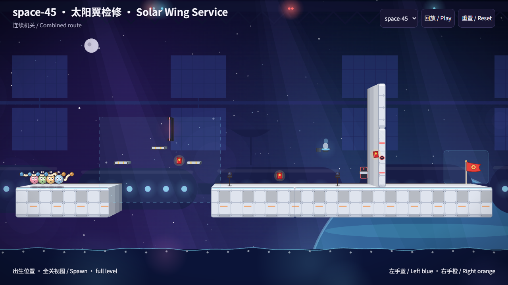

<a id="ho-c16-space-46"></a>
#### space-46 · 泄压回廊 / Pressure Relief Galleries

替换「观景环折返 / Observatory Dogleg」（原四人约 53 秒）。tier 1（中等），teaches wind，long: true，开启手酸。尺寸 3200×2000；路线折线长 7767 px；par 220 秒 / 每人 6 次。

在七个分离停靠岛之间按旗折返：下层向右、绕右侧挡板升到中层，再折回左端升上顶层，最后向右到舱门。两处阵风分布在底层和顶层，三只维修舱摆锤分层布置。

出生 (160, 1856)；五面旗依次为 (1400, 1856) → (2700, 1206) → (1500, 1206) → (450, 506) → (1700, 506)；终点 (2940, 350) 240×200。每面旗都有四人的永久落脚平台。等待队友和最难一段前，可在旗边站稳休息。

场景机关：失重区 (0, 0) 3200×2000。没有拉杆门。

新机关：摆锤 (1150, 1700)、绳长 100、周期 4s；(2060, 1050)、绳长 100、周期 3.3s；(1110, 350)、绳长 100、周期 2.8s。阵风 (700, 1680) 360×220、right、喷/停 1.2/3.4s；(2320, 300) 360×220、right、喷/停 1.2/3.4s。
岔路：中层两岛之间 x=1800–2500 是检修空隙，从 x=2400 附近直接上浮较快但旁边有激光；正常回放绕最右侧挡板外的净空竖井，路长但避开激光窄口。

预算：平台 9/60，会动物件 3/40，静态危险物 4/40；动台、转杆、摆锤共 3 件，其中快机关 0 件。整关最高台面重合 32.9%，同场景第一屏 0.0%。

| 人数 | 用时（秒） | 死亡（P1…） | 检查点分段（秒） |
| ---: | ---: | --- | --- |
| 4 | 180.77 | 0 / 0 / 0 / 0 | 15.25 / 46.22 / 20.57 / 42.68 / 21.62 / 34.43 |
| 1 | 162.32 | 0 | 15.25 / 46.22 / 20.57 / 42.68 / 21.62 / 15.98 |

红包（从四人回放选择并实际取得）：(1100, 1771)、(268, 1195)、(2007, 441)。

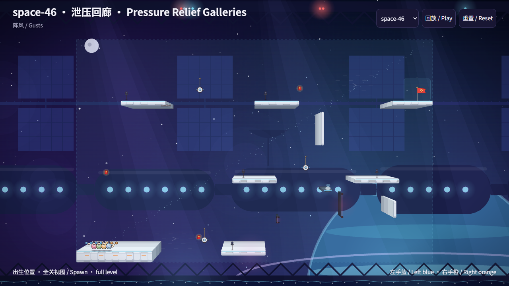

## ho-C11 · 雪山缆车

从 `origin/main` 的 `43a86d61` 建立独立 worktree，雪山机关 A10 已包含在基线中。只新增雪山的六关、十份逐帧回放和六张截图；源码、物理、验收器、package 与锁文件保持基线原样。每帧只记录真实 `setInput` 操作（60 Hz，seq 从 0 递增），没有传送、初速、召唤、物理或复活覆盖。四人录制按状态选择抓取和落点，单人另录；交付 JSON 只含输入帧，验收时不运行创作控制器。

### 布局与操作

| 关卡 | 名称 / Name | tier / teaches | 长×高 | 检查点（依次） | par 秒 / 每人死亡 | 布局、缆车与冰溜子、过法 |
| --- | --- | --- | --- | --- | --- | --- |
| snow-31 | 暮雪候车台 / Dusk Snow Station | 0 / lift | 2560×720 | (980,536) → (1740,446) | 90 / 3 | 三段慢缆椅接力：缆绳从 (285,520)→(1100,450)、(1080,460)→(1860,360)、(1830,370)→(2500,310)，跨 550、500、410 px 的雪坑。抓横杆或上座板，抵达各岸后先松手落站，再上下一段；无冰墙、无危险物，集中学上下车。 |
| snow-32 | 雪谷回环 / Snow Valley Switchbacks | 0 / pendulum | 3300×2000 | (1400, 1856) → (2640, 1206) → (1280, 1206) → (1000, 506) → (2100, 506) | 250 / 6 | 下层雪谷向右，右侧升降木台送到中层；回头向左经过会滑的冰沿，再乘左台到上层雪脊，向右抵达山顶。 [长关详情](#ho-c16-snow-32) |
| snow-33 | 林梢暖厢 / Cabin above the Pines | 1 / combine | 2560×720 | (1100,566) → (1840,356) | 110 / 6 | 松林上方先乘车厢 (280,550)→(1240,480)，再乘缆椅 (1190,490)→(2000,240)，分别跨 650、550 px 的坑。x=1800、2070 是 slip 1.8 / 1.4 秒的冰岸，及时离车抓岸、换手翻上终站；林梢有冰锥和火盆。 |
| snow-34 | 云脊换乘 / Cloud Ridge Transfer | 1 / combine | 2400×1400 | (1000,895) → (2020,197) | 120 / 6 | 两层云脊上行：车厢 (290,1242)→(1190,550) 跨 540 px 深坑；从木站落地、爬 x=1250 的 slip 1.5 秒冰柱，再转缆椅 (1360,690)→(2000,0) 跨 510 px 的断崖。落站在收车前，终段沿上层雪台走到山顶；有电轨和悬冰。 |
| snow-35 | 风口冰环 / Ice Ring in the Gale | 2 / wind | 3500×2100 | (1500, 1936) → (2820, 1266) → (1550, 1266) → (650, 536) → (1920, 536) | 290 / 6 | 沿下谷向右，乘快速吊台上冰环，再折回左侧山口登顶。中层必须经过短抓时限的冰沿，最后沿上脊穿过两只快摆雪球。 [长关详情](#ho-c16-snow-35) |
| snow-36 | 极光风口 / Aurora Pass | 2 / gauntlet | 2560×720 | (1120,496) → (1860,356) | 120 / 8 | 三段断崖综合：缆椅 (320,500)→(1280,400)、缆椅 (1280,420)→(1970,260)、车厢 (1930,280)→(2530,50)，分别跨 630、480、420 px 的雪坑；x=1030 的 slip 1.2 秒冰岸和 x=2400 的 slip 0.8 秒终站要抓住及时倒手。悬冰、火盆、电轨与横移电块交错，多段连链 / 抛接后在收车前下车。 |

### 回放结果与预算

四人主回放的全部分段均为 15–60 秒；单人仅按契约检查不超过 par×2。每根缆绳实际乘坐至少 1 秒，每块冰溜子都有抓取，三枚红包均由 `npm run envelopes -- snow-31 snow-32 snow-33 snow-34 snow-35 snow-36` 从对应四人回放选择且实际拿到。

| 关卡 | 四人秒 / 死亡 P1…P4 | 单人秒 / 死亡 | 四人分段秒 | 动态物体 / 平台 / 危险物 |
| --- | --- | --- | --- | --- |
| snow-31 | 69.97 / 0,0,0,0 | 128.93 / 1 | 26.65 / 17.10 / 26.22 | 11 / 4 / 0 |
| snow-32 | 258.13 / 0,0,0,0 | 186.95 / 0 | 20.02 / 45.88 / 48.32 / 47.72 / 58.65 / 37.55 | 4 / 5 / 0 |
| snow-33 | 66.90 / 0,0,0,0 | 80.23 / 1 | 25.98 / 21.73 / 19.18 | 8 / 6 / 2 |
| snow-34 | 88.53 / 1,0,2,3 | 131.19 / 1 | 24.72 / 45.65 / 18.16 | 8 / 6 / 2 |
| snow-35 | 241.48 / 0,0,0,0 | — | 24.78 / 46.85 / 35.68 / 39.25 / 51.17 / 43.75 | 6 / 5 / 4 |
| snow-36 | 71.34 / 1,3,0,0 | — | 20.97 / 23.47 / 26.91 | 11 / 7 / 5 |

四关用缆车、五关用冰溜子、三关两样都有；缆椅与车厢均有真实乘坐。冰锥分布在 33–36，篝火在 33、35、36，电轨在 34–36。困难两关各有 5 处危险物（含 1 个横移电块），每屏都有；所有危险物在每份回放里均到过 240 px 以内。

| 困难关 | 各段成链秒 | 各段抛接次数 | 单手柄投影 |
| --- | --- | --- | --- |
| snow-35 | 0.03 / 0.00 / 0.00 / 0.00 / 0.65 / 0.00 | 0 / 1 / 0 / 0 / 2 / 3 | 0/4 通关 |
| snow-36 | 12.30 / 6.70 / 1.22 | 72 / 13 / 4 | 0/4 通关 |

### 复核与截图

在 `games/hang-on` 使用 Node 22、Git Bash 跑 `npm test`、`npm run typecheck`、`npm run ip-check` 和原样 `npm run levels`。完整验收表及三项反例的原始错误用于本次 PR 描述。本轮 typecheck 通过、ip-check 0 处、levels 含 `6/6 snow` 通过；`npm test` 为 206/207，唯一失败是 `src/sides.test.ts:12` 固定了旧 24 关的难度名单，合法新关会使断言失效。该文件超出本卡输出范围，保持未改。Steve 明确要求按当前结果先推分支、开 PR；由 Steve 在 main 修复该测试，再自行把 main 合入本分支后审查。反例分别删除 `snow-31.p1.json`、把 snow-31 第一根缆绳下移至穿过起站、把 snow-32 第一块冰壁的 slip 改成 10；逐项执行原验收器、确认退出 1，finally 按原字节恢复，再重新全验。

六张 1280×720 全关截图使用 `npm run levels -- --screenshots` 的原 Pixi Stage 和审查页。当前 `run-levels.mjs` 审查页服务的数据路由只匹配 `table|van`，故截图阶段用临时 Playwright 路由适配器提供六关的原始 JSON / 回放，且保留旧关截图原字节；不修改脚本或验收规则。浏览器内核为已安装的 Chromium。


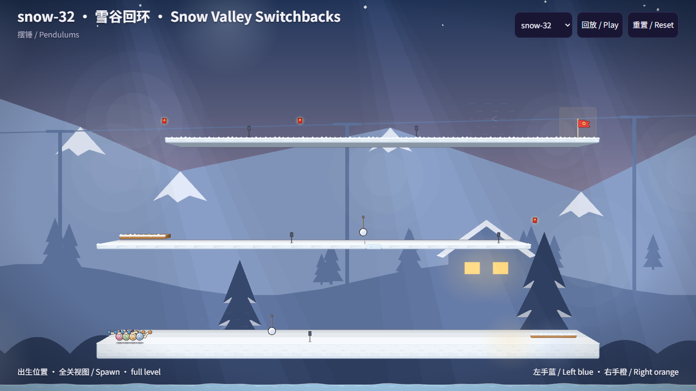

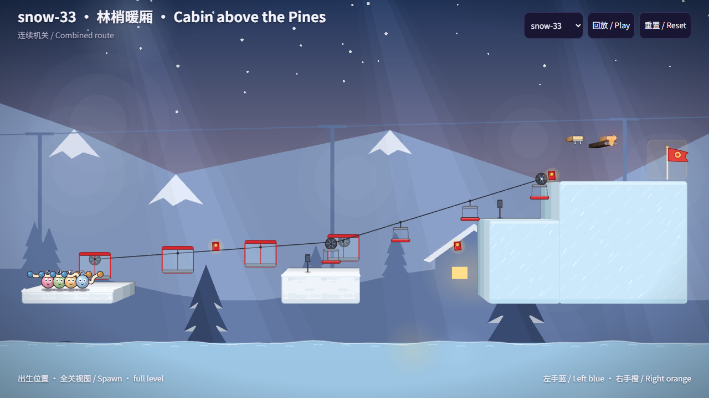

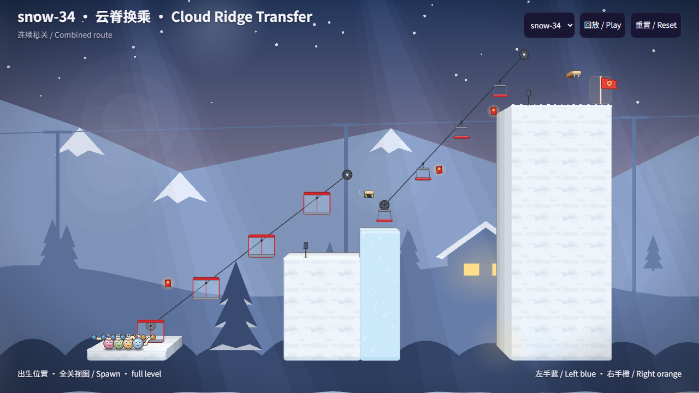


### ho-C16 · 当前长关

以下是本场景两关的当前记录。上方原任务的整体范围统计属于旧版本；涉及这两关时以本节及更新后的行数据为准。中等、困难按手酸录制，所有输入均为 60 Hz 普通手柄操作。

<a id="ho-c16-snow-32"></a>
#### snow-32 · 雪谷回环 / Snow Valley Switchbacks

替换「冰瀑换手 / Frozen Falls」（原四人约 51 秒）。tier 0（简单），teaches pendulum，long: true，不开手酸。尺寸 3300×2000；路线折线长 6925 px；par 250 秒 / 每人 6 次。

下层雪谷向右，右侧升降木台送到中层；回头向左经过会滑的冰沿，再乘左台到上层雪脊，向右抵达山顶。

出生 (150, 1856)；五面旗依次为 (1400, 1856) → (2640, 1206) → (1280, 1206) → (1000, 506) → (2100, 506)；终点 (3040, 350) 240×200。每面旗都有四人的永久落脚平台。等待队友和最难一段前，可在旗边站稳休息。

场景机关：冰沿 (1770, 1250) 100×30，单手 3 秒滑脱；这两关用升降木台，不使用缆椅。

新机关：摆锤 (1150, 1720)、绳长 100、周期 5s；(1750, 1070)、绳长 100、周期 4.5s。阵风 (650, 1680) 360×220、right、喷/停 1.2/3.4s；(2450, 300) 320×250、left、喷/停 1.2/3.4s。

预算：平台 5/60，会动物件 4/40，静态危险物 0/40；动台、转杆、摆锤共 4 件，其中快机关 0 件。整关最高台面重合 32.9%，同场景第一屏 0.0%。

| 人数 | 用时（秒） | 死亡（P1…） | 检查点分段（秒） |
| ---: | ---: | --- | --- |
| 4 | 258.13 | 0 / 0 / 0 / 0 | 20.02 / 45.88 / 48.32 / 47.72 / 58.65 / 37.55 |
| 1 | 186.95 | 0 | 24.75 / 43.52 / 24.02 / 49.12 / 24.13 / 21.42 |

红包（从四人回放选择并实际取得）：(2878, 1088)、(444, 440)、(1335, 439)。


<a id="ho-c16-snow-35"></a>
#### snow-35 · 风口冰环 / Ice Ring in the Gale

替换「雪檐抛接 / Snow Cornice Relay」（原四人约 47 秒）。tier 2（困难），teaches wind，long: true，开启手酸。尺寸 3500×2100；路线折线长 7970 px；par 290 秒 / 每人 6 次。

沿下谷向右，乘快速吊台上冰环，再折回左侧山口登顶。中层必须经过短抓时限的冰沿，最后沿上脊穿过两只快摆雪球。

出生 (150, 1936)；五面旗依次为 (1500, 1936) → (2820, 1266) → (1550, 1266) → (650, 536) → (1920, 536)；终点 (3240, 380) 240×200。每面旗都有四人的永久落脚平台。等待队友和最难一段前，可在旗边站稳休息。

场景机关：冰沿 (1700, 1310) 180×30，单手 1.4 秒滑脱；这两关用升降木台，不使用缆椅。

新机关：摆锤 (1050, 1800)、绳长 100、周期 2.2s；(2350, 1130)、绳长 100、周期 2s；(1000, 400)、绳长 100、周期 3s；(2650, 400)、绳长 100、周期 2.8s。阵风 (650, 1760) 360×220、right、喷/停 1.2/3.4s；(2580, 330) 320×250、right、喷/停 1.2/3.4s。

预算：平台 5/60，会动物件 6/40，静态危险物 4/40；动台、转杆、摆锤共 6 件，其中快机关 4 件。整关最高台面重合 22.0%，同场景第一屏 0.0%。

| 人数 | 用时（秒） | 死亡（P1…） | 检查点分段（秒） |
| ---: | ---: | --- | --- |
| 4 | 241.48 | 0 / 0 / 0 / 0 | 24.78 / 46.85 / 35.68 / 39.25 / 51.17 / 43.75 |

合作证据 S0…S5：挂链秒数 0.03 / 0.00 / 0.00 / 0.00 / 0.65 / 0.00；抛接 0 / 1 / 0 / 0 / 2 / 3 次。四份手柄分别单独回放均 0/4 到顶。

红包（从四人回放选择并实际取得）：(3133, 1177)、(420, 404)、(2631, 466)。


## 中餐馆后厨六关（C10 / Kitchen 25–30）

六关沿用 A10 的蒸笼、点心托盘和后厨画面。简单、中等、困难各两关；25、27、28、29、30 有蒸笼，26、27、28 有托盘，27、28 两样都有。刀、热锅、灭蚊灯各在 29、30 出现。只增加关卡 JSON、真实输入回放、截图与本节，物理、源码和验收器保持原样。

### 布局与过法

坐标单位为 px，蒸笼记录左上角与汽柱高度；托盘记录中心。par 为秒 / 每人允许死亡数，旗按路线列出。

| 关卡与双语名字 | tier / teaches | 宽 × 高 | 检查点 | par | 蒸笼 / 托盘 |
| --- | --- | --- | --- | --- | --- |
| kitchen-25 · 早班第一笼 / First Basket of the Shift | 0 / steam | 2400 × 720 | (1100,256)、(2030,536) | 100 / 3 | 蒸笼 (510,580)，160×40，汽高350，phase=1；无托盘 |
| kitchen-26 · 点心绕灶台 / Dim Sum Kitchen Circuit | 0 / pendulum | 3500×2160 | (1600, 2006) → (2700, 1126) → (1500, 1126) → (650, 366) → (1850, 366) | 280 / 6 | 沿下层灶台向右，乘右端吊台上中层，向左折返到洗碗池上方，再乘左端吊台上顶层；最后向右取盘、把点心送进出菜口。 [长关详情](#ho-c16-kitchen-26) |
| kitchen-27 · 点心上阁楼 / Dim Sum to the Loft | 1 / combine | 2520 × 1440 | (1170,816)、(1700,376) | 90 / 5 | 蒸笼 (760,1296)、(1300,816)，均180×24、汽高480，phase=1/0；托盘 (1580,395) → (1050,835) → (1580,395) |
| kitchen-28 · 蒸汽盘山线 / Steam Switchback Service | 1 / wind | 3200×2000 | (1400, 1786) → (2580, 1146) → (1400, 1146) → (650, 446) → (1800, 446) | 280 / 6 | 下层向右、右井上升、中层向左、左井上升，顶层向右。收尾先在蒸笼上借喷汽抬身，再取点心穿过抽风区送到出菜口。 [长关详情](#ho-c16-kitchen-28) |
| kitchen-29 · 双人传菜梁 / Pass the Dish Beams | 2 / combine | 3600 × 720 | (1270,536)、(2320,496)、(2850,596) | 120 / 8 | 蒸笼 (3040,620)，120×24、汽高360、phase=1.4；无托盘 |
| kitchen-30 · 压轴合宴 / The Closing Banquet | 2 / combine | 3400 × 720 | (1270,536)、(2320,496)、(2700,556) | 120 / 8 | 蒸笼 (2920,580)，120×24、汽高360、phase=1.4；无托盘 |

- **25**：从低工作台坐汽上木架，另一只手抓高台边缘；越过第一面旗后下到出菜台。四人错开出发，避免在蒸笼出口挤作一团。高墙不能抓。
- **26**：沿下层灶台向右，乘右端吊台上中层，向左折返到洗碗池上方，再乘左端吊台上顶层；最后向右取盘、把点心送进出菜口。 [长关详情](#ho-c16-kitchen-26)
- **27**：两层错峰蒸汽向上爬，路线从 y=1296 升到上层 y=376，实际升高超过一屏。上阁楼后取盘，再把点心从上层递到右侧低出菜台；中途翻盘会使用相应旗的托盘点。
- **28**：下层向右、右井上升、中层向左、左井上升，顶层向右。收尾先在蒸笼上借喷汽抬身，再取点心穿过抽风区送到出菜口。 [长关详情](#ho-c16-kitchen-28)
- **29**：两人挂接够到 x=260–730 的梁，交替抓梁越过第一道刀口；下到中间工作台，在 x=1400–1640 附近抛接队友到高岸。之后绕过热锅，坐最后一摞汽到高出菜口。六处危险物加一根致命转杆；出生附近的刀和转杆只在1–4人时启用，保证5、6人也有安全出生脚面。
- **30**：连梁、分组抛接、低台落脚与蒸汽出口连走；第一道沟的底台更高，尾段工作台在 y=580、出口在 y=260，终点比29更早。仍需在不同旗段实际合作。两关的录像各自四个手柄投影成单人后均不能过关；这是录制输入对照，不能当作穷举所有单人解法。

### 回放结果

原 `npm run levels` 的后厨输出如下。四人每段均在15–60秒内，时间/par为0.5–2；四份单人录像均过关且不超过2倍par。回放为60Hz输入、seq从0递增，没有注入状态或初始速度。每关的三个红包由 `npm run envelopes -- kitchen-25 … kitchen-30` 从四人录像选取，正式验收确认全部可拿到。

| Level | Players | Seconds | Deaths (P1…) | All reached | Par ratio | Size | Checkpoint segments (s) | Cookie grabs / Candle bounces | Machines used (s) |
| --- | --- | --- | --- | --- | --- | --- | --- | --- | --- |
| kitchen-25 | 4 | 98.59 | 2 / 1 / 0 / 0 | YES | 0.986 | 2400×720 | 35.08 / 16.40 / 47.11 | — / — | — |
| kitchen-25 | 1 | 34.07 | 0 | YES | 0.341 | 2400×720 | 17.05 / 16.43 / 0.58 | — / — | — |
| kitchen-26 | 4 | 174.58 | 0 / 1 / 2 / 2 | YES | 0.624 | 3500×2160 | 15.48 / 35.98 / 36.02 / 38.98 / 18.12 / 30.00 | — / — | 13.0,10.8 |
| kitchen-26 | 1 | 180.52 | 0 | YES | 0.645 | 3500×2160 | 20.15 / 52.30 / 18.38 / 37.22 / 15.02 / 37.45 | — / — | 11.1,10.4 |
| kitchen-27 | 4 | 68.86 | 0 / 0 / 0 / 0 | YES | 0.765 | 2520×1440 | 18.65 / 16.62 / 33.59 | — / — | — |
| kitchen-27 | 1 | 40.36 | 0 | YES | 0.448 | 2520×1440 | 18.67 / 10.88 / 10.81 | — / — | — |
| kitchen-28 | 4 | 213.27 | 0 / 1 / 0 / 0 | YES | 0.762 | 3200×2000 | 15.25 / 40.68 / 39.35 / 45.02 / 43.67 / 29.31 | — / — | 17.9,28.2 |
| kitchen-28 | 1 | 126.09 | 0 | YES | 0.450 | 3200×2000 | 18.38 / 23.53 / 15.65 / 28.58 / 14.85 / 25.09 | — / — | 4.9,6.4 |
| kitchen-29 | 4 | 91.35 | 0 / 0 / 0 / 0 | YES | 0.761 | 3600×720 | 24.05 / 18.78 / 19.40 / 29.12 | — / — | 0.0 |
| kitchen-30 | 4 | 85.76 | 0 / 0 / 0 / 0 | YES | 0.715 | 3400×720 | 25.42 / 18.73 / 24.87 / 16.74 | — / — | 0.0 |

29 的起段挂链0.33秒，下一段抛接4次；30 的起段挂链0.33秒，下一段抛接4次，后段另有实际抛接。各蒸笼均有至少0.25秒实际托举，有托盘的关都以托盘进终点结束；每个危险物都有路线上的人物从240px内经过。原脚本同时检查每屏旗、永久落脚、人数布局、物体预算、与其他关的台面及首屏相似度。

最终验收使用已同步其他场景的 main：`npm run levels` 检查基础、难关、团队关及四个新场景，后厨为 `6/6 kitchen` PASS；`npm run typecheck` 通过，`npm run ip-check` 为0处。`npm test` 为207项全部通过。最初基线的 `src/sides.test.ts:12` 固定旧24关名单，曾有1条预期失败；该断言现已由 main 修复，本分支未修改测试。六人出生及所有检查点复活测试通过。

三项反例检查逐项临时破坏、记录原验收器错误后恢复原字节：删除25的单人录像、把29的蒸笼移到梁下使汽柱被挡、把26的初始托盘点移到半空。完整输出表及错误原文在本分支 PR 描述中。

### ho-C16 · 当前长关

以下是本场景两关的当前记录。上方原任务的整体范围统计属于旧版本；涉及这两关时以本节及更新后的行数据为准。中等、困难按手酸录制，所有输入均为 60 Hz 普通手柄操作。

<a id="ho-c16-kitchen-26"></a>
#### kitchen-26 · 点心绕灶台 / Dim Sum Kitchen Circuit

替换「洗碗池边的点心 / Dim Sum by the Sink」（原四人约 57 秒）。tier 0（简单），teaches pendulum，long: true，不开手酸。尺寸 3500×2160；路线折线长 7910 px；par 280 秒 / 每人 6 次。

沿下层灶台向右，乘右端吊台上中层，向左折返到洗碗池上方，再乘左端吊台上顶层；最后向右取盘、把点心送进出菜口。

出生 (150, 2006)；五面旗依次为 (1600, 2006) → (2700, 1126) → (1500, 1126) → (650, 366) → (1850, 366)；终点 (3240, 210) 240×200。每面旗都有四人的永久落脚平台。等待队友和最难一段前，可在旗边站稳休息。

场景机关：无蒸笼；托盘从 (2450, 405) 取，必须和人一起进终点。

新机关：摆锤 (1150, 1870)、绳长 100、周期 4.5s；(1900, 990)、绳长 100、周期 3.5s。阵风 (650, 1830) 360×220、right、喷/停 1.2/3.4s；(2500, 160) 500×250、right、喷/停 3/0.8s。
碎台 (1800, 2050) 200×2，触碰 0.5s 后塌、6s 后再生；其下是永久托底，初次练习掉落后仍能站稳。

预算：平台 7/60，会动物件 4/40，静态危险物 0/40；动台、转杆、摆锤共 4 件，其中快机关 2 件。整关最高台面重合 21.4%，同场景第一屏 0.0%。

| 人数 | 用时（秒） | 死亡（P1…） | 检查点分段（秒） |
| ---: | ---: | --- | --- |
| 4 | 174.58 | 0 / 1 / 2 / 2 | 15.48 / 35.98 / 36.02 / 38.98 / 18.12 / 30.00 |
| 1 | 180.52 | 0 | 20.15 / 52.30 / 18.38 / 37.22 / 15.02 / 37.45 |

红包（从四人回放选择并实际取得）：(3117, 943)、(365, 1001)、(384, 183)。

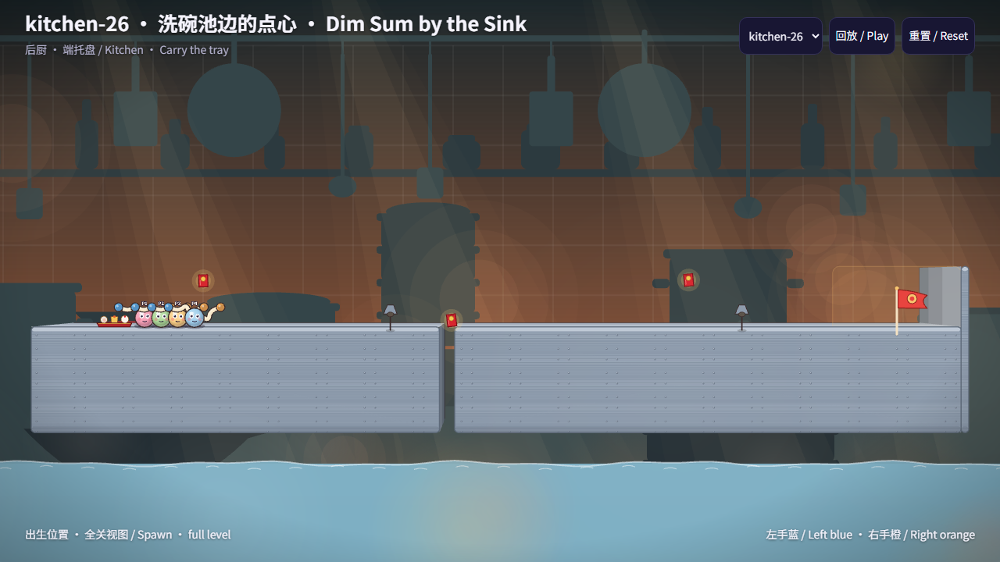

<a id="ho-c16-kitchen-28"></a>
#### kitchen-28 · 蒸汽盘山线 / Steam Switchback Service

替换「蒸汽出菜线 / Steam to the Serving Hatch」（原四人约 63 秒）。tier 1（中等），teaches wind，long: true，开启手酸。尺寸 3200×2000；路线折线长 7210 px；par 280 秒 / 每人 6 次。

下层向右、右井上升、中层向左、左井上升，顶层向右。收尾先在蒸笼上借喷汽抬身，再取点心穿过抽风区送到出菜口。

出生 (150, 1786)；五面旗依次为 (1400, 1786) → (2580, 1146) → (1400, 1146) → (650, 446) → (1800, 446)；终点 (2940, 290) 240×200。每面旗都有四人的永久落脚平台。等待队友和最难一段前，可在旗边站稳休息。

场景机关：蒸笼 (2160, 466) 180×24，汽高 180，喷/停 2/2 秒；托盘从 (2540, 485) 取，必须和人一起进终点。

新机关：摆锤 (1150, 1650)、绳长 100、周期 4.5s；(1900, 1010)、绳长 100、周期 3.5s；(2500, 310)、绳长 100、周期 3s。阵风 (650, 1610) 360×220、right、喷/停 1.2/3.4s；(2280, 240) 320×250、right、喷/停 1.2/3.4s。

预算：平台 3/60，会动物件 5/40，静态危险物 0/40；动台、转杆、摆锤共 5 件，其中快机关 2 件。整关最高台面重合 18.8%，同场景第一屏 0.0%。

| 人数 | 用时（秒） | 死亡（P1…） | 检查点分段（秒） |
| ---: | ---: | --- | --- |
| 4 | 213.27 | 0 / 1 / 0 / 0 | 15.25 / 40.68 / 39.35 / 45.02 / 43.67 / 29.31 |
| 1 | 126.09 | 0 | 18.38 / 23.53 / 15.65 / 28.58 / 14.85 / 25.09 |

红包（从四人回放选择并实际取得）：(2847, 946)、(338, 269)、(313, 666)。

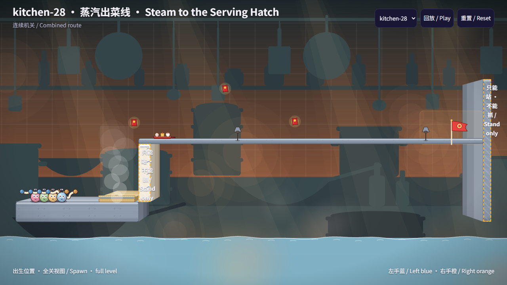

### 全关截图

六张均为仓库 Playwright 无头 Chromium、1280×720、出生全关视图，使用原 `run-levels.mjs` 的页面、Pixi Stage、相机和截图流程。现有截图 HTTP 路由只匹配 table/van，无法读取 kitchen；因此在仓库外临时兼容该路由，仅传入这六关生成图片。未改验收器或渲染源码，未控制桌面 Chrome；手动试玩按补充要求跳过。

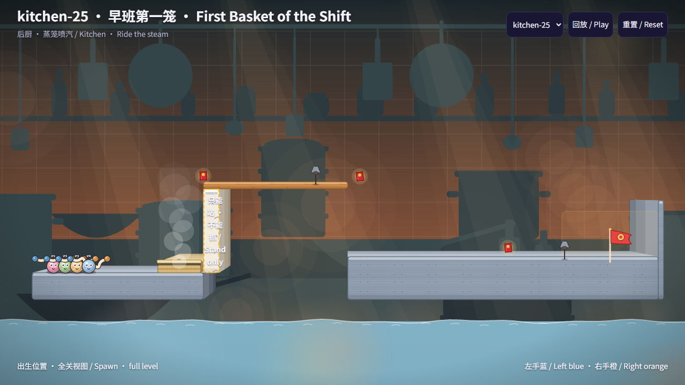

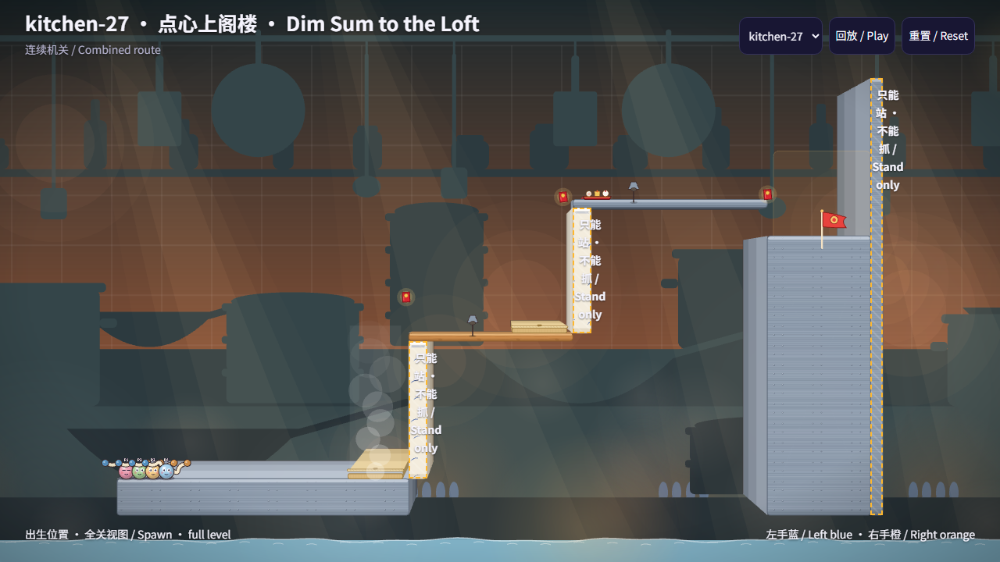

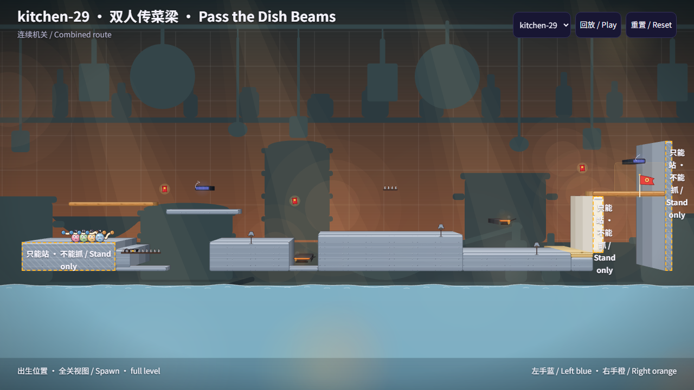
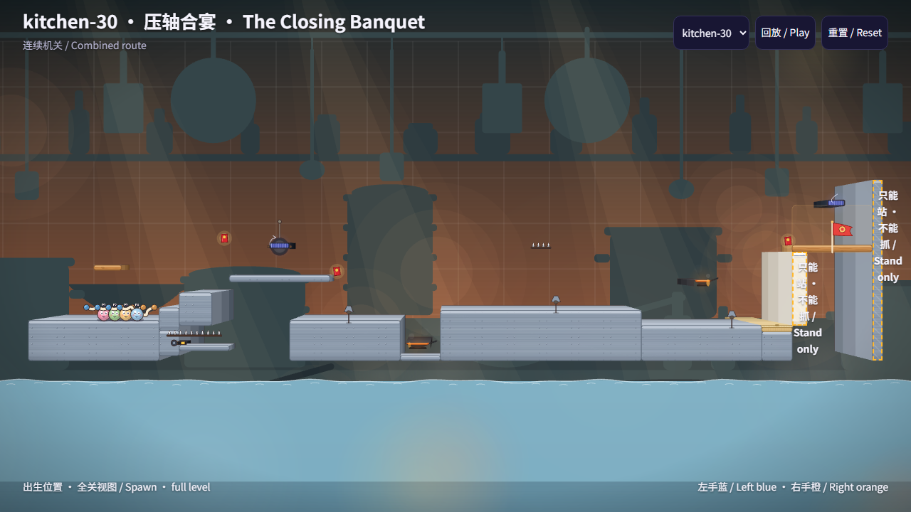


## C15 · 按手酸重录（2026-11-21）

以下是当前改动，覆盖本卡17关、23份回放；旧表为改动前的历史记录。15个困难关均提高既有移动台/转杆速度、缩短移动台等待，并各加一枚路线摆锤；snow-33/34为中等关。全部开启stamina，逐份悬挂和tired统计见validation.md的「按手酸重录」。

### table-13

既有机关提速、加路线摆锤。重新录制两次抛接和末段接驳；保留原地形。

### table-14

既有机关提速、加路线摆锤。首段接驳台改为120 px/s；给双人摆法补(840,660)歇脚台，并把(1420,600)原台加厚到落脚面；重新录四人、双人两份。

### table-15

既有机关提速、加路线摆锤。把第二处上方危险物下移到y=220，贴近攀爬路线；par改为140秒。

### table-16

既有机关提速、加路线摆锤。重录四人、双人两份转杆及抛接，死亡预算按双人实际结果调为每人6次。

### table-17

既有机关提速、加路线摆锤。升降台改为220 px/s直达高岸，缩短连续悬挂；par改为170秒。

### table-18

既有机关提速、加路线摆锤。重录三面旗的转杆、抛接和接驳，保留原地形。

### van-19

既有机关提速、加路线摆锤。重录转杆和接驳；死亡预算按新回放调为每人6次。

### van-20

既有机关提速、加路线摆锤。摆锤放在第一面旗上方；重录四人、双人两份，末段沿原台阶攀登。

### van-21

既有机关提速、加路线摆锤。接驳台起点改为y=540、150 px/s直达；高岸加(1000,300)歇脚台并把第一面旗移到(1070,276)，下移原危险物以贴近实际路线。

### van-22

既有机关提速、加路线摆锤。长升降台改为220 px/s直达，末转杆改为1.65 rad/s；(2200,720)补滑脱后可站的窄台，末段电区上移到y=900；重录四人、双人两份。

### van-23

既有机关提速、加路线摆锤。接驳台改为140 px/s，摆锤放在第二面旗上方；par改为130秒。

### van-24

既有机关提速、加路线摆锤。重录三段接驳及抛接，保留原地形。

### kitchen-29

既有机关提速、加路线摆锤。起台可抓，刀口前补(520,510)、(600,450)两级歇脚处，抛接口补(1560,600)窄台；底台和致命转杆移开落脚面；后两面旗移到(2100,496)、(2900,596)。

### kitchen-30

既有机关提速、加路线摆锤。起台可抓，刀口前补(520,510)、(600,450)两级歇脚处；起步梁缩短到110px，为起身换手留空间；三面旗改为(1275,536)、(2100,496)、(2800,556)，覆盖各人数复活落脚范围。

### snow-33

两段缆车改为55/45 px/s；在(2010,325)加60px宽木台，分开两段冰壁攀爬并避开座椅扫过的路径；par改为100秒；重录四人和单人。

### snow-34

两段缆车改为60/60 px/s，在(1130,869)补木台歇脚；重录四人和单人。

### snow-36

既有机关提速、加路线摆锤。原致命移动物提速到52.5 px/s并加路线摆锤，三段缆车为35/45/100 px/s；重录接应、冰壁和滑脱后的恢复。 起步由P1抓队友接应后再换手，四份单人投影均不能通关。

## 节日关（C19）

节日关都是简单档（tier 0），没有尖刺、烫、电、涨潮或要命的机关；不做长关、不启用手酸。布局和名字原创，节日装饰沿用 A27。回放使用未改动的 Rapier 物理：创作时读取真实状态选择普通手柄操作，保存的文件只有 60 Hz 输入（ax/ay/gl/gr/seq/t），没有传送、初速、物理覆盖或召唤。四人回放与独立单人回放共用同一摆法。

### fest-xmas · 圣诞星灯驿 / Christmas Starlight Stops

- **节日、世界、教学**：圣诞（xmas；12 月 1 日至元旦），雪山（snow），坐缆椅（lift）。尺寸 **2560 × 720**；par **120 秒 / 每人 4 次摔落**。
- **故事与路线**：从山脚的圣诞候车台出发，沿两段雪坡走到谷口，抓住挂着彩灯的慢速缆椅穿过雪谷，到山腰驿站集合；再沿错开的雪台逐级攀上山顶星灯站。终点在最后一块山顶平台上。没有追赶倒计时，可以等下一把椅子，掉下去回最近的旗。
- **怎么过**：先向前下方伸手、抓地、往前拉；面对高一阶的台子，先抓侧面再往上推。谷口先松开地面和队友，再抓横杆；抓稳后松摇杆，让缆椅带着走。到接站雪台上方再松手，落脚后继续。多人分开候车，先到的人在终点稳住等大家。
- **检查点**：山腰接站 (980, 516)，上山步道 (2160, 356)；各自有永久雪台，可承接四人复活。路线先过谷再登阶，两屏都有旗。
- **机关与预算**：一根 589 px 缆绳，24 px/s，间隔 220 px，3 把缆椅；8 块永久平台，3 件运动物体。四人 / 单人回放实际乘坐缆椅 **44.60 / 17.83 秒**，均超过 1 秒；没有人数专用摆法。
- **红包**：运行 `npm run envelopes -- fest-xmas` 从四人回放挑三枚，原验收器逐枚验证实际取得；每次重录后重挑。

| 关卡 | 人数 | 秒 | 摔落（P1…） | 全员到达 | par 比值 | 检查点分段（秒） | 缆椅使用（秒） |
| --- | ---: | ---: | --- | :---: | ---: | --- | ---: |
| fest-xmas | 4 | 99.49 | 4 / 4 / 3 / 3 | YES | 0.829 | 51.08 / 16.82 / 31.59 | 44.60 |
| fest-xmas | 1 | 48.38 | 0 | YES | 0.403 | 26.25 / 18.18 / 3.95 | 17.83 |

四人用时、分段、14 次全队摔落（预算 16）、红包与机关均由原验收规则检查；单人另验能过关、机关使用和死亡预算。单人分段和 par 下界按原规则不设限制。全关图使用原 Pixi Stage、1280 × 720；大厅证据放在 PR 的不可变提交图片链接中，最终此路径保留全关图。

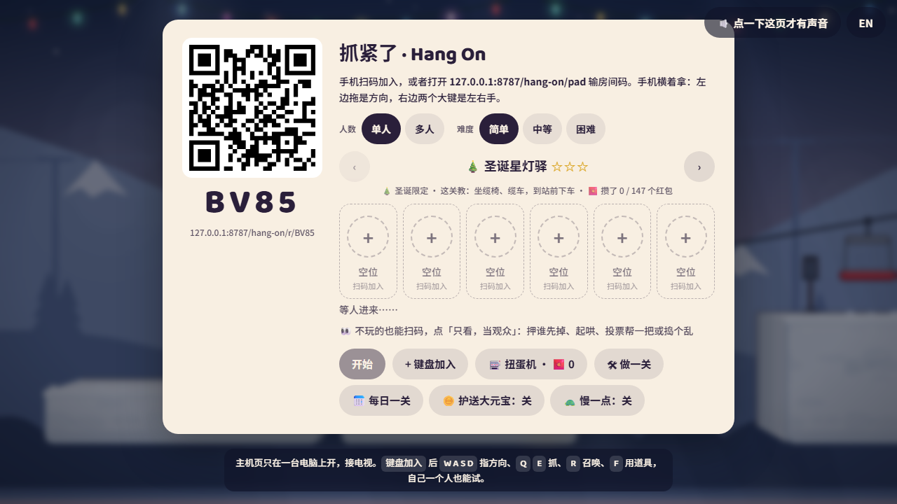


### fest-cny · 新春蒸笼宴 / New Year Steamer Banquet

- **节日、世界、教学**：春节（cny；正月初一前 7 天至元宵），后厨（kitchen），蒸笼喷汽（steam）。**2560 × 720**，par **120 秒 / 每人 3 次摔落**。
- **故事、路线与过法**：糯米团赶赴山一样高的团圆饭桌，从竹案板走到第一摞蒸笼，等盖子预告、松手乘汽上出菜台；经过山腰保温灯，再乘第二摞蒸汽过到高一层的竹台，经短踏台到最后的团圆桌。过蒸笼时先抓侧面爬上去，喷汽时松手，升起后向右抓接台。机关在宽台上出现，落脚后再继续；单人同样可以等下一阵汽。
- **检查点**：(1270, 408) 在第二摞蒸笼前；(2140, 276) 在团圆桌前的接台。永久落脚面容纳四人复活；三段 **16.13 / 16.53 / 45.10 秒**。
- **预算与机关证据**：9 块 rects、2 摞固定蒸笼，0 件运动物体。四人每摞实际托起 **1.98 / 1.95 秒**；单人 **0.62 / 1.50 秒**。不靠队友也能乘汽上桌。
- **红包**：原命令 `npm run envelopes -- fest-cny` 生成三枚，原回放验收逐枚实际取得。

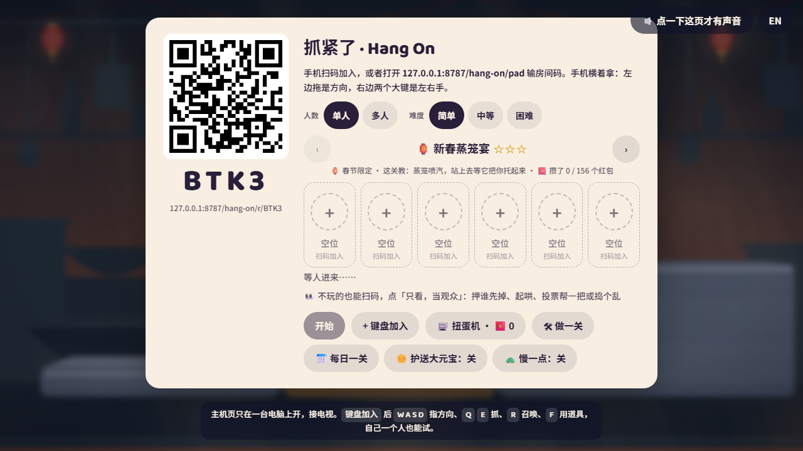

### fest-halloween · 南瓜访灯夜 / Pumpkin Lantern Trail

- **节日、世界、教学**：万圣节（halloween；10 月 20–31 日），老宅（house），黑屋子（dark）。**2480 × 720**，par **100 秒 / 每人 3 次摔落**。
- **故事、路线与过法**：从门口提灯处出发，沿南瓜灯拜访两间黑屋子，点亮廊下的油灯，最后到亮堂堂的讨糖台。小台阶先抓侧面再翻上去，宽砖台歇脚；灯笼放在门口永久砖台，身体或手碰到未点的灯就会点亮。两间黑屋子的固定灯与角色身边的光能指路。
- **检查点**：(1270, 468) 门廊，(2260, 340) 讨糖台；下方都是永久平台。四人三段 **17.10 / 15.68 / 27.18 秒**。
- **预算与机关证据**：7 块平台、1 盏可提灯笼、5 盏墙灯、2 间黑屋子，1 件运动物体。四人、单人回放均点亮两盏初始灭灯；灯笼与所有人的出生位置留开距离。没有门或钥匙需要多人代劳。
- **红包**：原命令 `npm run envelopes -- fest-halloween` 生成三枚，随单人、四人回放复核。故事终站在第二间黑屋子之后，终点由南瓜装饰与亮灯门廊标出。


### fest-midautumn · 中秋月兔阶 / Moon Rabbit Steps

- **节日、世界、教学**：中秋（midautumn；八月十五前 7 天至后 3 天），太空站（space），失重（float）。**2560 × 1600**，par **150 秒 / 每人 3 次摔落**。
- **故事、路线与过法**：从地面的月兔发射台出发，先在宽甲板上熟悉抓地与喷气，再进入大失重舱，循三个高度的信标向右上方奔月；经过中继甲板、上方月兔踏台，最后到大月亮前的接月台。悬空时松开抓键轻推摇杆喷气；从台子侧面飘到上沿，落脚集合，再认下一盏信标。
- **检查点**：(1000, 1476) 发射甲板，(1250, 976) 中继甲板，(2100, 346) 接月踏台；覆盖两列、三个高度区间，均有四人永久落脚面。四人四段 **25.30 / 32.38 / 54.43 / 52.40 秒**。
- **预算与机关证据**：7 块平台、1 块失重区，0 件运动物体。四人 / 单人实际在失重舱中 **162.98 / 140.55 秒**，均超过 1 秒；不需要拉杆或队友托举。
- **红包**：原命令 `npm run envelopes -- fest-midautumn` 挑三枚，原回放检查全部取得。最终目标在最后一块高处甲板上，与中秋大月亮同侧。

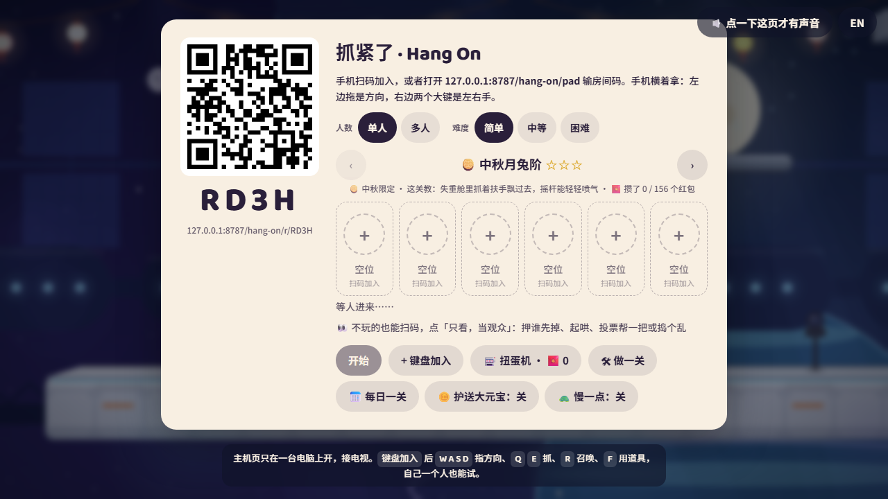

### 另外三关的回放结果

| 关卡 | 人数 | 秒 | 摔落（P1…） | 全员到达 | par 比值 | 检查点分段（秒） |
| --- | ---: | ---: | --- | :---: | ---: | --- |
| fest-cny | 4 | 77.77 | 0 / 0 / 0 / 0 | YES | 0.648 | 16.13 / 16.53 / 45.10 |
| fest-cny | 1 | 38.84 | 0 | YES | 0.324 | 13.17 / 19.55 / 6.12 |
| fest-halloween | 4 | 59.97 | 0 / 0 / 0 / 0 | YES | 0.600 | 17.10 / 15.68 / 27.18 |
| fest-halloween | 1 | 33.57 | 0 | YES | 0.336 | 19.83 / 12.78 / 0.95 |
| fest-midautumn | 4 | 164.52 | 0 / 0 / 0 / 0 | YES | 1.097 | 25.30 / 32.38 / 54.43 / 52.40 |
| fest-midautumn | 1 | 143.33 | 0 | YES | 0.956 | 31.58 / 37.43 / 57.12 / 17.20 |

三关的所有分段、机关、红包与死亡预算均用原验收器检查，单人按原契约只验通关、上界、死亡预算和机关使用；四人的三段/四段分别满足 15–60 秒。平台上沿按原验收器的 40 px 网格与现有关卡逐一比较。全关图与大厅证据均用仓库 Playwright 无头 Chromium，1280 × 720，页面错误为零；大厅证据在 PR 的独立提交图片链接中，最终允许路径保留全关图。截图服务沿用原 Pixi review 页面，只在临时服务补上节日 id 的 JSON 路由，未改验收器或游戏源码。
