# 抓紧了 · 关卡与回放（C7 / C8）

从 main `7ffd856` 开始，沿用 C1（#172）的 JSON、四人逐帧回放和 A3/Pixi 截图流程。12 个 id、世界、中英文名字、teaches 均保持 C1 原值；第一屏教学保留，蒸笼与图腾整体下移以留出上方攀爬空间。仅修改 `games/hang-on/levels/**`、`docs/levels/**`、`games/hang-on/scripts/run-levels.mjs`。

## 运行与复核

在 `games/hang-on`，Node 22，Windows 使用 Git Bash：

```sh
export npm_config_script_shell="C:/Program Files/Git/bin/bash.exe"
npm ci
npm test
npm run typecheck
npm run ip-check
npm run levels
```

typecheck 保留 main 的 Worker 类型生成和 `/dev/null` 重定向。没有修改 src、物理参数、package.json、锁文件或 C4 文件。

验收器将未改动的 `world.ts` / `replay.ts` 用现有 esbuild 打到临时目录，逐关调用 `runReplay(level, replay)`，结束后清理。12 份回放均按新布局重新录制展开输入：4 人、60 Hz，seq 从 0 递增，t 为毫秒；模拟内部仍固定 120 Hz。沿用 C1 的离线操作录制方式，在创作时按真实状态选择手柄操作、按永久落点分批集合；提交的回放只含输入帧，验收时没有寻路或反馈控制器。没有传送、初始速度注入、物理覆盖、召唤或修改复活逻辑。

## 布局

横向关为 2560 px（两屏），总复习为 3200 px（三屏）；两道攀爬关为 2560×1440，先横后竖。终点位于延长路线末端，后屏继续练同一种抓取、荡行或攀爬动作，并增加错高、窄落点、较宽缝或组合机关。每屏有检查点，按路线顺序排列；精确分段时间见 [验收结果](validation.md)。

| 关卡 | 名称 / Name | 教学 | 长×高 | 检查点（依次） | par（秒 / 每人死） | 布局与操作 |
| --- | --- | --- | --- | --- | --- | --- |
| table-01 | 茶布起步 / Tea Cloth Crawl | crawl | 2560×720 | (1240, 536) → (2250, 376) | 110 / 2 | 原茶布起步；长茶布上练连续换抓，后段两道 80 px 折台，终点收窄。 |
| table-02 | 碗沿小缝 / Between the Bowls | gap | 2560×720 | (1240, 536) → (1890, 476) | 100 / 2 | 原 80 px 碗缝；后段 70 px 缝接定时饼干，再以 90 px 缝和上升碗沿收尾。 |
| table-03 | 筷子桥 / Chopstick Bridge | swing | 2560×720 | (1240, 506) → (1990, 326) | 90 / 2 | 原两根薄筷子保留；饼干 → 蜡烛上升 180 px → 两次 80 px 高差的筷台。 |
| table-04 | 蒸笼叠叠高 / Steamer Stack | climb | 2560×1440 | (1210, 936) → (2224, 396) | 110 / 2 | 原四级蒸笼整体下移 720 px；永久休息台后走蜡烛，续接六级 80 px 蒸笼。 |
| table-05 | 面条过火锅 / Noodle over the Hotpot | rope | 2560×720 | (1240, 536) → (2030, 496) | 70 / 2 | 原 280 px 绳坑；后段第二根面条绳跨 300 px，最后是 60 px 缝和 80 px 翻沿。 |
| table-06 | 一串汤圆过大锅 / Dumpling Chain | chain | 2560×720 | (1275, 356) → (2240, 196) | 80 / 2 | 原只能站的起台、高筷子和两人成链缺口保留；后段错高的窄碗沿，最后两道 80/90 px 缝。 |
| van-07 | 天车门把手 / SkyTrain Handles | door | 2560×720 | (1240, 536) → (2330, 466) | 100 / 2 | 原门把手保留；后段两组更窄、错高的门柱，门缝增至 90/100 px。 |
| van-08 | 图腾向上 / Totem Ascent | climb | 2560×1440 | (1210, 856) → (2224, 316) | 100 / 2 | 原五级窄图腾整体下移 720 px；蜡烛接六级窄柱，最后连续向上换手。 |
| van-09 | 摇摇浮筒 / Wobbling Pontoons | balance | 2560×720 | (1240, 536) → (2150, 516) | 100 / 2 | 原浮筒转轴下移 30 px，保留第一段教学水面；第二块 640 px 浮筒跨更宽水面。 |
| van-10 | 狮门抛接力 / Lions Gate Toss | throw | 2560×720 | (1275, 402) → (2140, 296) | 90 / 2 | 原只能站的起台、160 px 水面与 80 px 高差保留；两组队友抛接后，连续翻上错高的金属桥墩。 |
| van-11 | 雨中快抓 / Rain Grip | ice | 2560×720 | (1240, 536) → (2310, 296) | 80 / 2 | 原三道 70 px 冰缝保留；定时冰饼干接连续上升的冰岸，后段不能在消失平台上久留。 |
| van-12 | 从夜市到海湾 / Night Market to Harbour | combine | 3200×720 | (1275, 476) → (1760, 476) → (2754, 236) | 120 / 2 | 原台阶、绳、浮筒与冰岸串联；绳后加宽永久回收落点，后段加入冰饼干、蜡烛及三段上升冰岸。 |

## 机关与预算

饼干在 table-02、table-03、van-11、van-12；蜡烛在 table-03、table-04、van-08、van-12；table-03 和 van-12 两样都有。每块饼干都要求实际 terrain grab 的点落在其矩形内，每根蜡烛都要求对应编号的 bounce，不能只摆在路线外。

| 关卡 | 会动物体（≤40） | 矩形总数（≤60） | 饼干 / 蜡烛块数 |
| --- | ---: | ---: | ---: |
| table-01 | 0 | 4 | 0 / 0 |
| table-02 | 0 | 6 | 1 / 0 |
| table-03 | 0 | 10 | 1 / 1 |
| table-04 | 0 | 14 | 0 / 1 |
| table-05 | 16 | 5 | 0 / 0 |
| table-06 | 0 | 7 | 0 / 0 |
| van-07 | 0 | 11 | 0 / 0 |
| van-08 | 0 | 15 | 0 / 1 |
| van-09 | 2 | 6 | 0 / 0 |
| van-10 | 0 | 6 | 0 / 0 |
| van-11 | 0 | 9 | 1 / 0 |
| van-12 | 9 | 11 | 1 / 1 |

会动物体按绳节数 + 跷跷板 + 箱子累计；矩形总数从严包含永久平台、饼干、蜡烛、跷跷板初始矩形和箱子。所有初始矩形都进行两两不重叠检查，相邻边缘接触允许。

## 验收规则

保留 C1 的关数、双语内容、材质、几何、回放格式、四手柄、seq/t、轴值、过关、par、死亡、绳/浮筒真实使用、合作机制、单人投影和 PNG 尺寸检查。C7 增加身份固定、2400–3600 px 横关 / 1400–2200 px 攀爬关、末端终点、每个横向屏与攀爬纵向屏的检查点、物体预算和机关覆盖检查。

每个检查点必须在关内，按数组顺序实际触发且不能跳过；下方 24–80 px 必须有永久平台，能容纳复活位置 cp.x + 玩家编号 × 30 和身体半径 24。饼干、蜡烛和动态浮筒均不能充当这个复活落脚面。时间按模拟的 checkpoint 事件计算：出生 → 首旗、相邻旗、末旗 → 全员 win，每段原始数值均须在 15–60 秒内，不能只看四舍五入后的表。

par 按新回放重定，仍限制 60–180 秒，过关用时须为 par 的 0.5–2 倍。保留每人死亡数 ≤ deathsPerPlayer×4 的原检查，同时增加全队死亡总数 ≤ deathsPerPlayer×4。

第六关要求至少 0.25 秒真实的悬空「玩家 → 玩家 → 地形/绳」链；第十关要求至少两次释放正在向右上飞行的队友（vx>150、vy<−100）。四份录制输入分别投影为单人，两关均 0/4 通关；这沿用 C1 的防退化对照，不是任意输入可达性的穷举。第十二关实际抓绳、抓并压斜浮筒、抓冰、抓饼干和弹蜡烛，验收至少四种，当前五种都用到。

当前反例及完整 npm 输出在 [validation.md](validation.md)；逐个改坏、确认退出码 1，finally 恢复原文件，然后重新跑全部验收。

## 截图与浏览器回放

```sh
# 审查页：选择关卡，回放 / 暂停 / 重置；Ctrl+C 停止
npm run levels -- --serve

# 使用项目现有 Playwright 与已安装的 Chromium
HANG_ON_PLAYWRIGHT="$(pwd)/node_modules/playwright" npm run levels -- --screenshots
```

12 张同名 PNG 已重拍并逐张检查，均为 1280×720、deviceScaleFactor=1。使用游戏本身的 A3 Pixi Stage 与远景画；停在四人出生状态，相机缩到全关，机关与终点同时可见。仅审查页采用全关缩放，游戏镜头仍按 src/render/stage.ts 跟随玩家、到边停、最低 0.45。不可抓起台沿用虚线和「只能站 / Stand only」。

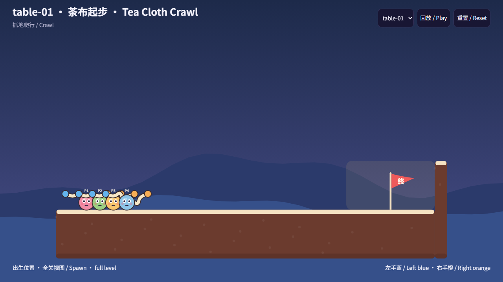
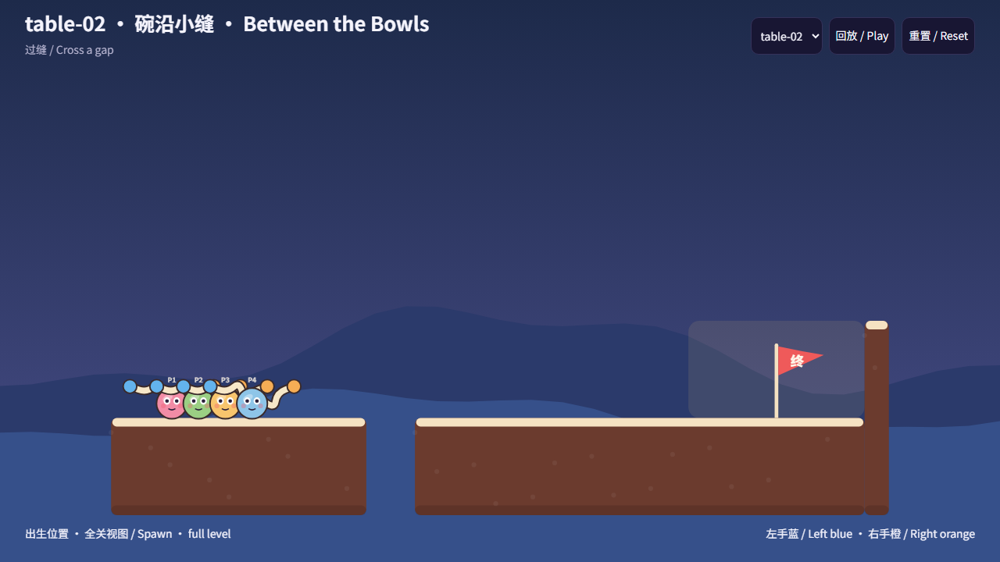
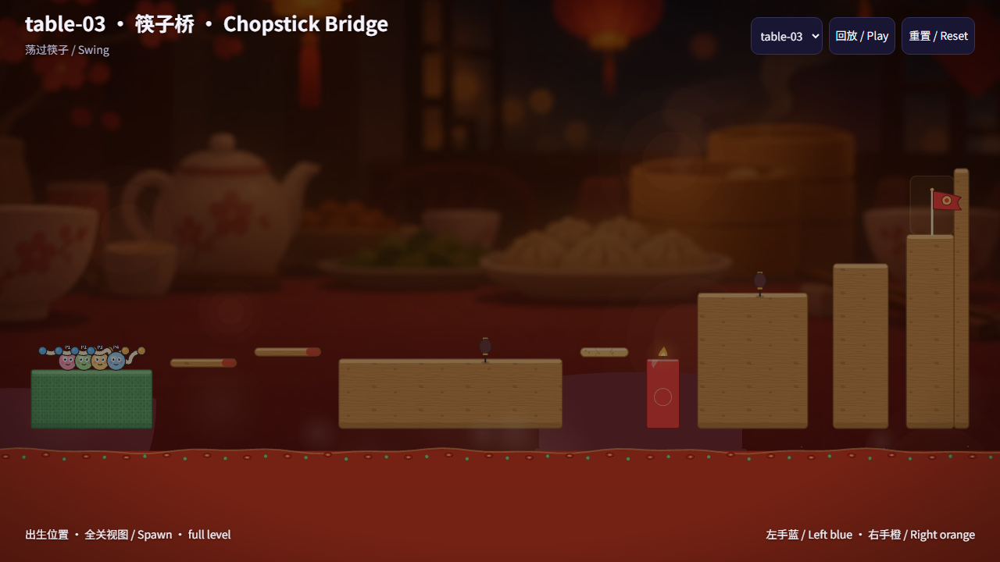
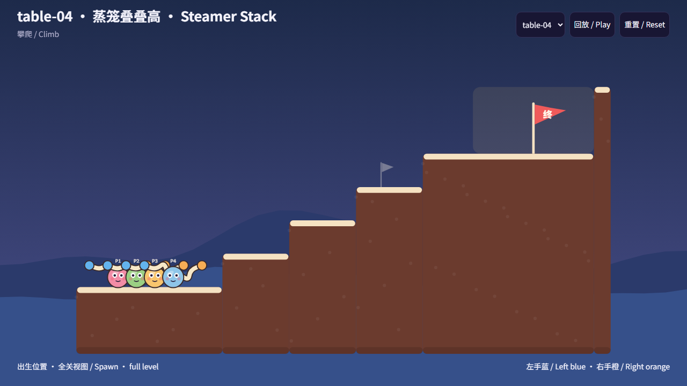

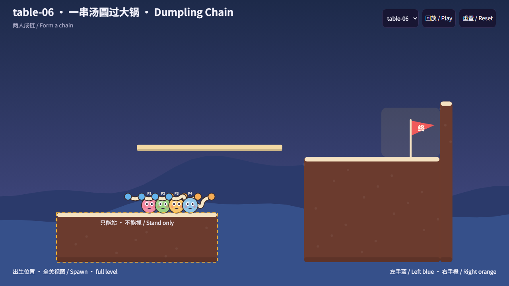
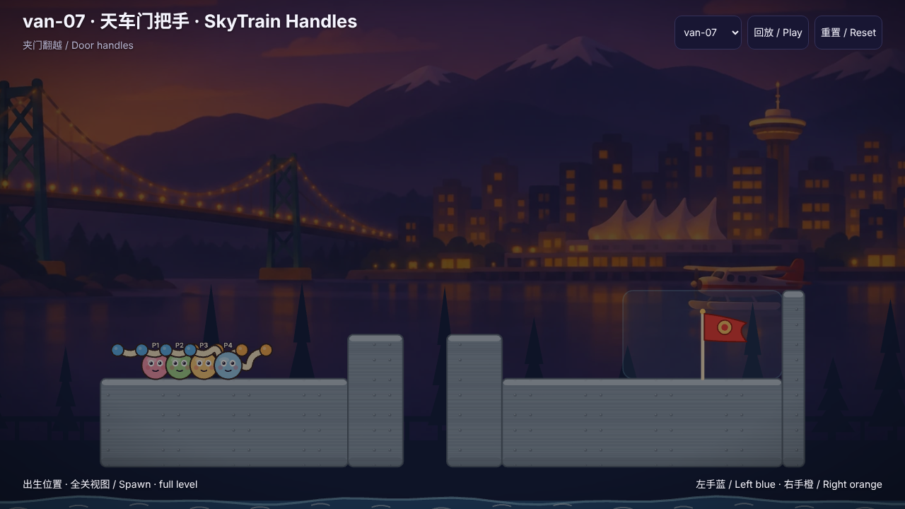
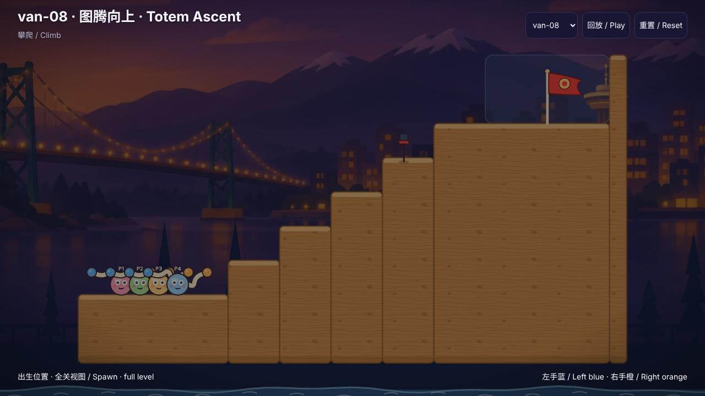
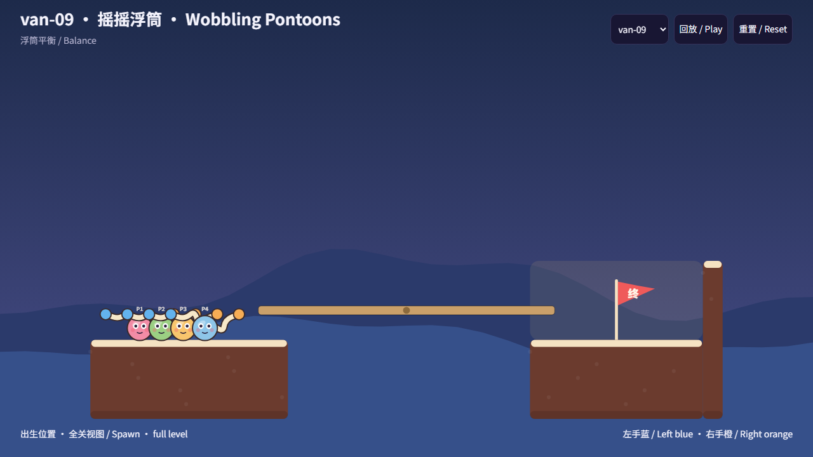
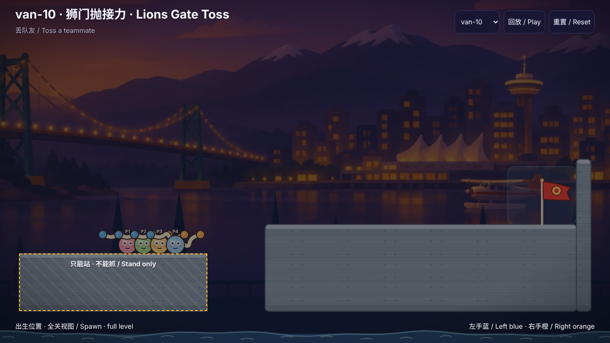
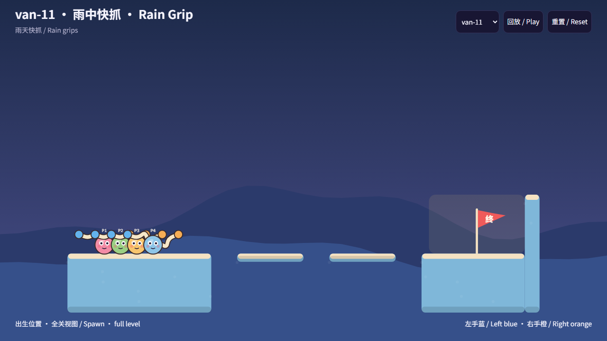
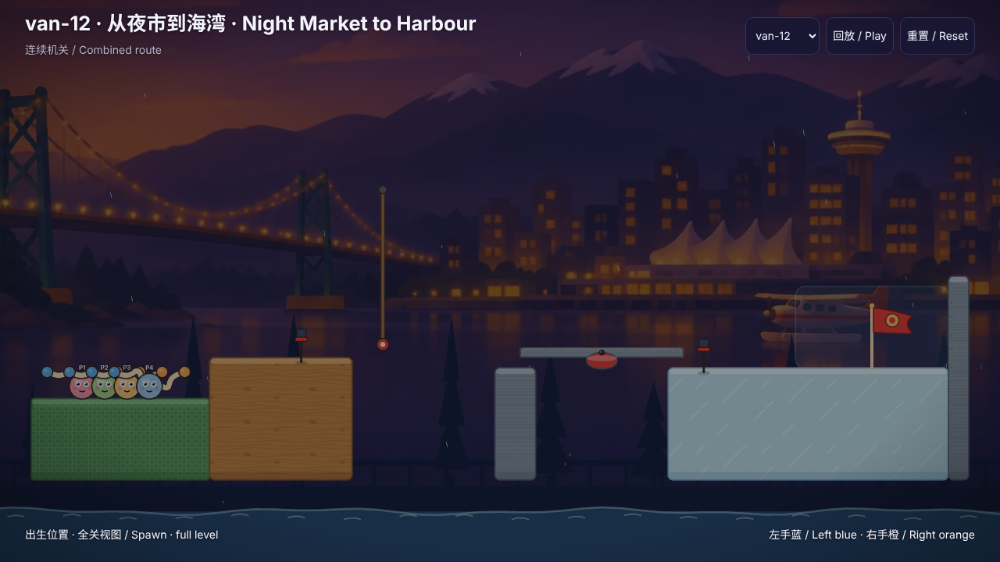

## ho-C8 · 第二版独立难关路线

PR #418 按 #422 更新后的 C8 卡重做。分支已合入 main `c15877c`（含 A7 与 #422），只创作 `games/hang-on/levels/**` 与 `docs/levels/**`。基础 12 关 JSON、回放和截图保持原字节；难关名字、世界与 teaches 沿用第一版，12 条路线、16 份回放和 12 张全关图重做。

每关从第一屏起有自己的路线：斜行下降、向上抛接、慢速三臂转筷、港底上升、先下后上的码头、L 形升降与折线长摆渡分别展开；两道攀爬关的下层和上层接驳也不同。合作分别安排在第一处缺口和下一处动台、转杆或抛接缺口，详见下表及 [逐段证据](validation.md)。

| 关卡 | 名称 / Name | teaches | 长×高 | 检查点（顺序） | par 秒 / 每人死亡预算 | 哪里会死 | 路线与两处合作 | 按人数变化 |
| --- | --- | --- | --- | --- | --- | --- | --- | --- |
| table-13 | 竹签窄渡 / Skewer Narrows | spike | 3000×720 | (1200, 316) → (2200, 156) → (2800, 336) | 150 / 2 | 竹签沟与倒签、碗口往返签块、末沟竹签 | 第一屏抛过 180 px 竹签沟，三段碗沿向上；第二次抛接上高碗，再抓高处动盘过末沟 | 1–4 人同布局。 |
| table-14 | 转盘送席 / Serving Shuttle | mover | 2560×720 | (1192, 656) → (1980, 456) | 180 / 2 | 下沉盘下红油、倒挂热丝、中坑与末坑 | 起段抱下降的斜行盘，落入低碗；向上抛接回高桌，末段转筷接窄碗 | 1–2 人：中段抛接沟多一块 (1420,600) 接应木台；3–4 人撤去。 |
| table-15 | 红油吊廊 / Chilli-Oil Catwalk | hot | 2560×720 | (1180, 376) → (1900, 576) | 150 / 3 | 红油沟、碗口升降烫块、转筷下方与末坑 | 第一屏向上抛接，再过高低碗沿的升降门；中段抓转筷下落接应，末段斜盘上升 | 1–4 人同布局。 |
| table-16 | 筷影回环 / Chopstick Revolve | spinner | 2560×720 | (1040, 616) → (1940, 376) | 120 / 2 | 转筷下电丝、抛接坑电丝与致命短转杆、末沟电丝 | 第一屏三臂慢转筷，向下接低碗；中段抛上高碗，最后用更快的双臂转筷跨缝 | 1–2 人：首段转筷沟和中段抛接沟各多一块接应木台；3–4 人撤去。 |
| table-17 | 热丝蒸笼塔 / Steamer Wire Tower | zap | 2560×1440 | (1240, 936) → (1980, 456) | 180 / 4 | 下层电沟、升降电块、塔间电沟与末沟 | 低处抛过电沟再爬三层蒸笼；两人挂 L 形动盘向上约 600 px，末段转筷接高层 | 1–4 人同布局。 |
| table-18 | 年夜忙不停 / Reunion Rush | gauntlet | 3000×720 | (1200, 596) → (1980, 616) → (2764, 456) | 180 / 8 | 竹签沟、倒挂热丝、电沟、巡回烫块与锅底短转杆 | 第一屏折线盘；第二段转筷；最后两折长动盘，串接五类机关，三处永久回收点 | 1–4 人同布局。 |
| van-19 | 潮栅间隙 / Tidal Grating | spike | 2560×720 | (1160, 336) → (1860, 496) | 150 / 2 | 低码头栅沟、倒挂栅栏、岸口栅块与两处水下栅栏 | 第一屏先向下抛到低码头，再上两级护岸；中段转梁落接，末段水平摆渡到更低的岸 | 1–4 人同布局。 |
| van-20 | 海湾摆渡 / Harbour Shuttle | mover | 2560×720 | (1210, 536) → (1960, 616) | 180 / 6 | 港池栅栏、倒挂栏杆、往返栅块与末段顶栅 | 第一屏斜向上摆渡；中段反转钢梁接下层岸，最后攀两级短护岸，避开上方顶栅 | 1–2 人：反转钢梁下多一块 (1500,600) 接应木台；3–4 人撤去。 |
| van-21 | 电轨折返 / Switchback Current | zap | 2560×720 | (1210, 416) → (2020, 256) | 150 / 6 | 港池电轨、倒挂电轨、巡回电块、致命电杆与末沟 | 第一屏竖升再横走的 L 形平台；中段把队友抛到两层高岸，末段钢梁转到低岸 | 1–4 人同布局。 |
| van-22 | 塔顶接驳 / Totem Transfer | mover | 2560×1440 | (1240, 1096) → (2020, 616) | 180 / 5 | 下层电沟、倒挂电轨、升降电块与两层接驳沟 | 第一屏从港底抓三臂转梁上升；第二段长升降台向上约 600 px，最后转梁接高岸 | 1–2 人：下层转梁与长升降台旁各多一块木台，末沟电轨在 820 高度；3–4 人撤木台，电轨在 1000 高度。 |
| van-23 | 炙桥转轮 / Sizzling Bridge | hot | 2560×720 | (1240, 536) → (2080, 456) | 150 / 3 | 烤架沟、倒挂烤架、升降热块、长烤架与坑底短转杆 | 第一屏抛接后走先上后下的夜市台；中段挂斜升动台串过长烤架，末段抓转梁上岸 | 1–4 人同布局。 |
| van-24 | 海港夜班 / Harbour Night Shift | gauntlet | 3000×720 | (1160, 536) → (2080, 216) → (2764, 336) | 180 / 2 | 栅沟、倒挂电轨、烤架、巡回电块与末沟致命转梁 | 第一屏慢速三臂转梁；中段抛接连爬两层岸，末段高处长摆渡越过电轨与转梁，串五类机关 | 1–4 人同布局。 |

四张人数关的 `.p2.json` 分别覆盖 1/2 人摆法，四人主回放覆盖 3/4 人摆法。每种摆法都跑通，每台安全机关均被站/抓至少 0.25 秒，每处致命物均有身体到过 240 px 内。四人主回放每段 15.92–54.72 秒；攀爬关 table-17 / van-22 都是 2560×1440，分别从 1240 / 1320 高度爬到 400 / 480，横向屏与上下两层均有检查点。

沿用 C1 的离线输入录制：对最终关卡只调用原模拟的 setInput / step，按实际抓点与复活位置继续操作，录成 60 Hz 输入，seq 从 0 递增；每帧单独一行，便于对比。没有传送、初速、召唤、改复活或改物理。验收只重放固定输入，不运行录制控制器。12 份四人输入序列各不相同，全部单手柄投影为 0/4。六人出生及检查点落脚另由 main 的 A7 测试覆盖。

### 自有布局与合作

原验收器按 40 px 上沿格比较所有基础关与难关。当前整关最高重合 36.3%（上限 60%），第一屏最高 44.9%（上限 85%）。不靠改世界或材质区分路线。

| 关卡 | 整关最接近 | 重合率 | 第一屏最接近 | 重合率 |
| --- | --- | ---: | --- | ---: |
| table-13 | van-10 | 16.2% | table-16 | 18.3% |
| table-14 | van-21 | 25.5% | van-19 | 23.3% |
| table-15 | van-23 | 36.3% | van-23 | 44.9% |
| table-16 | van-10 | 23.3% | table-13 | 18.3% |
| table-17 | table-04 | 18.1% | van-22 | 3.4% |
| table-18 | van-20 | 24.4% | table-13 | 0.0% |
| van-19 | table-14 | 20.7% | table-14 | 23.3% |
| van-20 | van-23 | 26.4% | van-23 | 20.4% |
| van-21 | van-23 | 31.4% | table-15 | 28.8% |
| van-22 | table-17 | 17.6% | table-17 | 3.4% |
| van-23 | table-15 | 36.3% | table-15 | 44.9% |
| van-24 | table-18 | 16.9% | van-20 | 16.7% |

| 关卡 | 两处实际合作位置（x 范围，px） | 各段挂链秒数 S0… | 各段抛接次数 S0… | 合作段数 |
| --- | --- | --- | --- | ---: |
| table-13 | 起段抛接（420–600）＋高碗抛接（1560–1740） | 0.00 / 0.00 / 0.00 / 0.00 | 2 / 4 / 2 / 0 | 3 |
| table-14 | 下降动盘（500–1000）＋向上抛接（1400–1580） | 14.78 / 0.00 / 0.00 | 0 / 2 / 2 | 3 |
| table-15 | 红油沟抛接（600–820）＋中段转筷接应（1400–1700） | 0.00 / 4.92 / 0.02 | 2 / 3 / 0 | 2 |
| table-16 | 首段转筷（520–820）＋中段高差抛接（1280–1520） | 5.47 / 0.00 / 0.00 | 1 / 2 / 2 | 3 |
| table-17 | 下层抛接（400–600）＋上升动盘（1360–1880） | 0.00 / 11.87 / 0.02 | 2 / 2 / 1 | 3 |
| table-18 | 折线动盘（400–900）＋中段转筷（1320–1660） | 14.35 / 4.83 / 0.20 / 0.00 | 0 / 0 / 1 / 0 | 3 |
| van-19 | 低码头抛接（360–560）＋转梁接应（1280–1600） | 0.00 / 5.43 / 0.00 | 2 / 2 / 0 | 2 |
| van-20 | 斜行摆渡（360–880）＋反转钢梁（1400–1720） | 10.52 / 0.38 / 0.00 | 0 / 0 / 1 | 3 |
| van-21 | L 形平台（480–1000）＋两层高岸抛接（1400–1640） | 13.52 / 0.00 / 0.00 | 0 / 2 / 2 | 3 |
| van-22 | 港底转梁（320–700）＋高层升降台（1360–1840） | 0.05 / 17.10 / 0.00 | 1 / 0 / 0 | 2 |
| van-23 | 夜市抛接（660–860）＋长烤架斜台（1380–1900） | 0.00 / 9.77 / 0.00 | 2 / 2 / 0 | 2 |
| van-24 | 首段转梁（280–640）＋两层岸抛接（1280–1500） | 3.77 / 0.00 / 9.40 / 1.63 | 0 / 2 / 2 / 0 | 4 |

S0 是出生到第一面旗，之后按实际检查点事件划段。表中位置同时说明两处合作障碍，避免只在同一个起段分两批连一下。挂链与抛接均按原验收器的真实抓点、悬空状态和释放速度统计；单手柄投影仍是 C1 的录制输入对照，不是穷举所有单人解法。

### 机关预算与截图

| 关卡 | 会动物体 ≤40 | 最多同场平台 ≤60 | 最多同场致命物 ≤40 |
| --- | ---: | ---: | ---: |
| table-13 | 2 | 11 | 5 |
| table-14 | 3 | 10 | 5 |
| table-15 | 3 | 10 | 6 |
| table-16 | 3 | 11 | 5 |
| table-17 | 3 | 10 | 6 |
| table-18 | 5 | 8 | 6 |
| van-19 | 4 | 10 | 6 |
| van-20 | 3 | 10 | 5 |
| van-21 | 4 | 9 | 6 |
| van-22 | 4 | 10 | 6 |
| van-23 | 4 | 10 | 6 |
| van-24 | 4 | 12 | 7 |

11 关有安全动台，11 关有安全转杆，11 关有致命动块，6 关有致命转杆。尖刺、烫、电均覆盖至少三关；table-18 与 van-24 都串接静态危险物、安全动台、致命动块、安全转杆、致命转杆五类。没有同时存在的平台重叠，物体预算和人数范围由原脚本检查。

原 `npm run levels -- --screenshots` 重拍下列 12 张 1280×720 出生全关图，逐张查看路线、旗与终点；基础 12 张截图恢复原字节。完整命令输出、两项新规则的反例报错见 [验收结果](validation.md)。

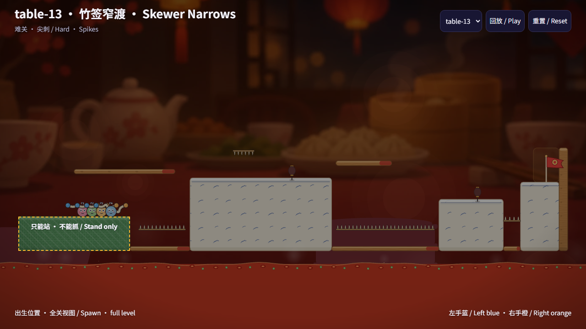
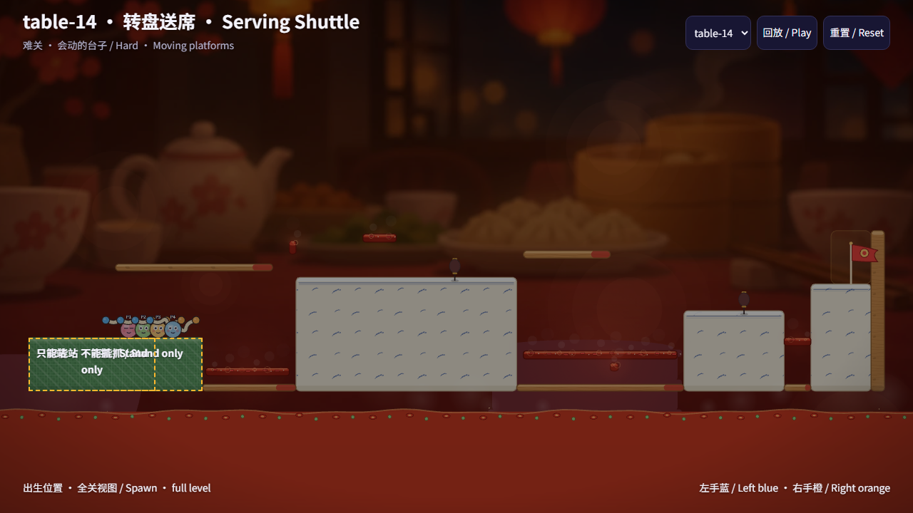
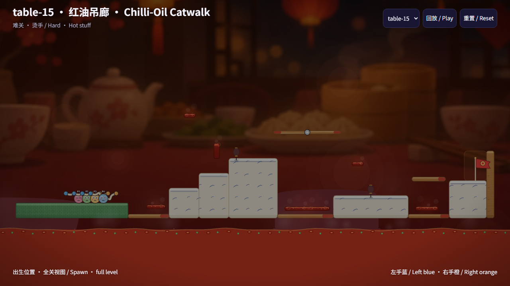
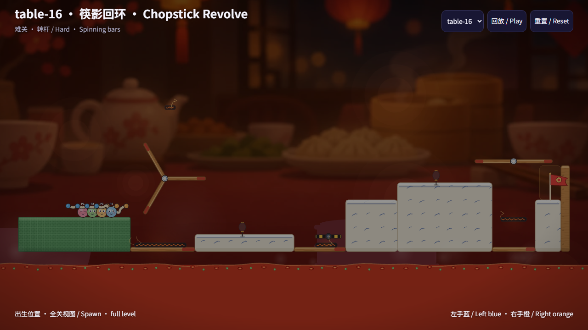
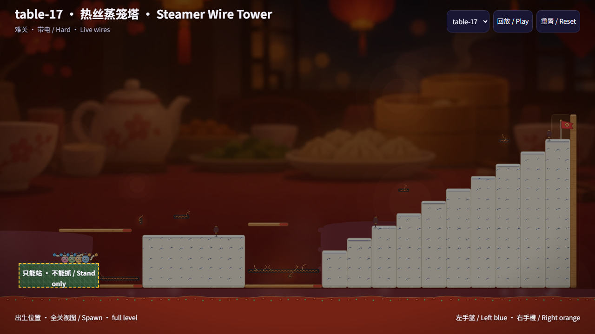

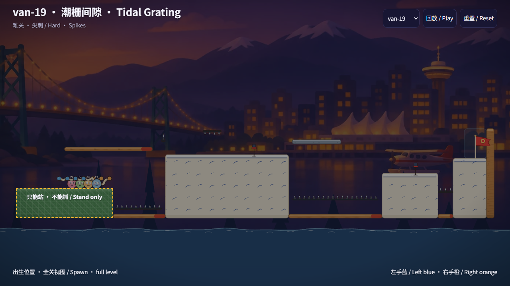
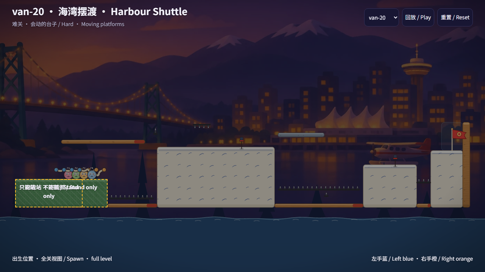

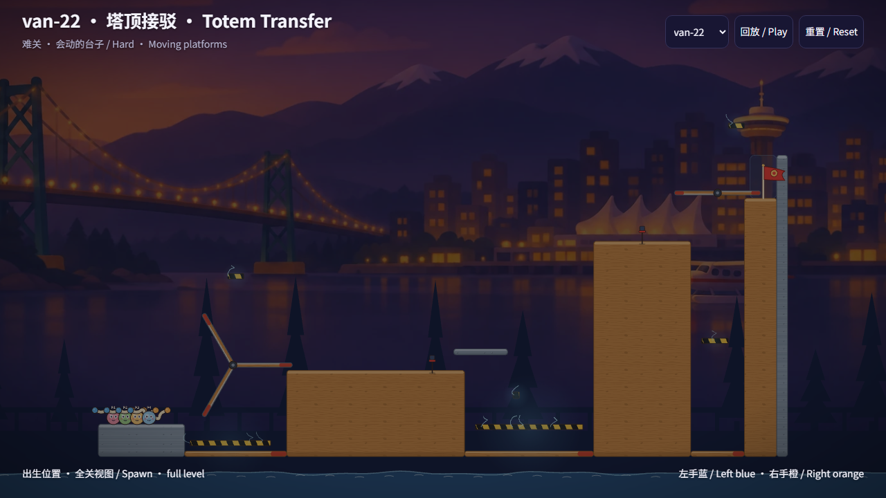
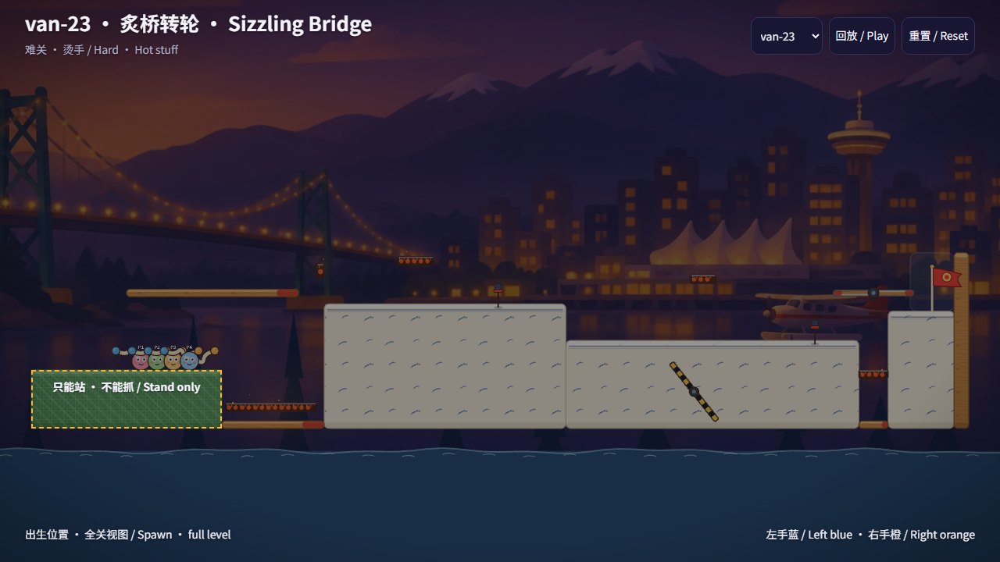
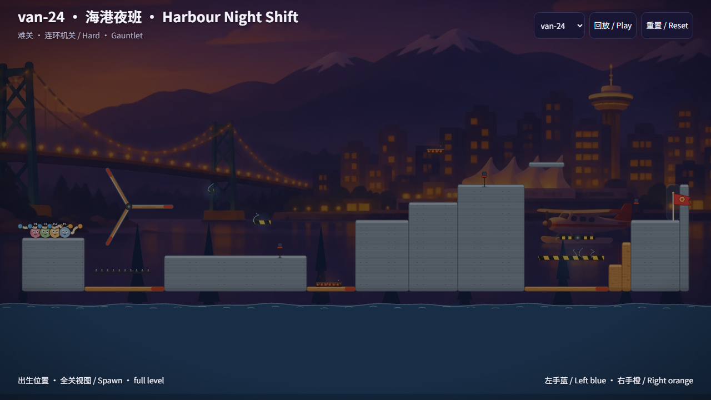
