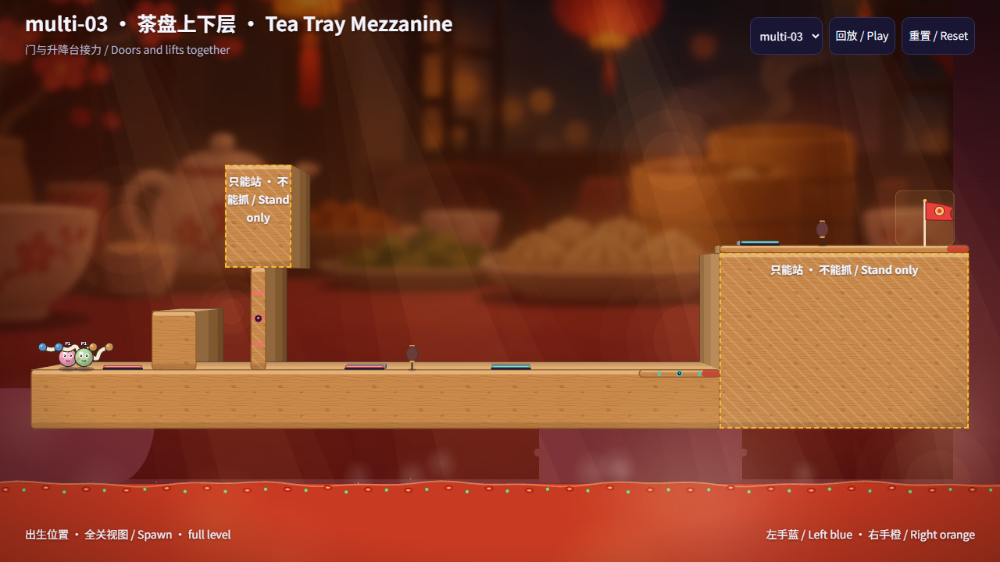
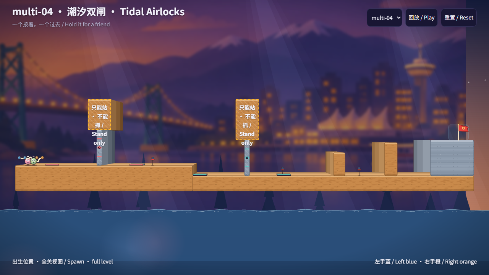
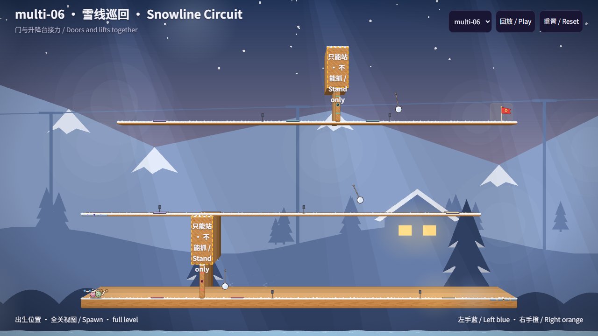
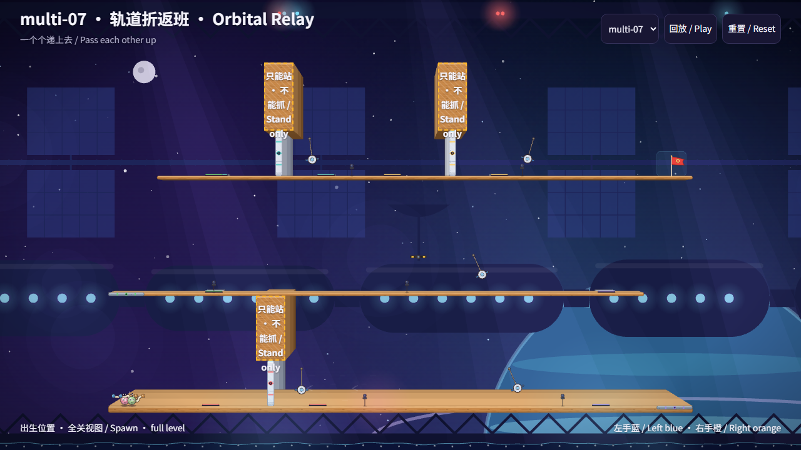

# C14 · 多人自己的关 / Multiplayer levels

C14 初版保留为历史基线。C17（2026-11-20 更新）使用从 `origin/main` 的 `24e52198` 建立的独立 worktree，分支 `codex/ho-c17-long-multi-levels`；只替换 multi-01、multi-06、multi-07 及它们的九份回放和三张截图，其余六关、回放、截图保持原字节。三关写 `long: true`，中等、困难写 `stamina: true`；物理、验收器、探路规则和 C15/C16 文件没有修改。 / C17 replaces only the three shortest multiplayer levels, preserving the six other levels and all validation rules.

## 四个场景合入后的重合检查 / Layout overlap after integration

C17 三关改为三层折返：下层向右、右侧升降转层、中层向左、左侧升降转层、上层向右。六面旗分为七段，连线长度均超过 8,100 px。下表更新这三关的全量比较，其他六行保留 C14 整合时的历史结果。 / The three replacement routes turn twice across three floors, with six checkpoints and seven sections; other rows below retain the C14 integration measurements.

按验收器相同的 40px 上沿格子与交集/并集公式，对全部 63 个关卡 JSON 扫描：多人按 2/3/4 人摆法，其他关额外覆盖 1–6 人摆法；没有超过 60% 的组合。

| 多人关 / Level | 最大重合 / Maximum | 最近的关 / Closest level | 人数摆法 / Layouts |
| --- | ---: | --- | --- |
| multi-01 | 14.01% | team-04 | 2 / 1 |
| multi-02 | 44.80% | team-01 | 2 / 1 |
| multi-03 | 42.59% | table-01 | 2 / 1 |
| multi-04 | 33.09% | house-38 | 2 / 1 |
| multi-05 | 15.22% | kitchen-27 | 2 / 1 |
| multi-06 | 17.07% | multi-04 | 2 / 2 |
| multi-07 | 12.10% | table-18 | 2 / 1 |
| multi-08 | 36.36% | multi-01 | 2 / 2 |
| multi-09 | 23.42% | house-42 | 2 / 1 |

<!-- C14_MULTI_SECTIONS {"multi-01":[0,4],"multi-02":[0,1],"multi-03":[0,1],"multi-04":[0,1],"multi-05":[0,1],"multi-06":[0,4,5],"multi-07":[0,4,5],"multi-08":[0,1,2],"multi-09":[0,1,2]} -->

段号从 0 开始：出生点 → 第一面旗为第 0 段。完整探路按每种 2/3/4 人布局让单人尝试 200 次、每次 60 秒。有限采样是验收证据，不是对任意输入的穷举证明。
Zero-based blocked sections are verified with 200 deterministic solo attempts of 60 seconds on every selected layout.

| ID | 名称 / Name | tier | teaches | 长 × 高 / Size | 检查点 / Checkpoints | par 秒 / deaths per player | 单人受阻段 / Solo-blocked sections |
| --- | --- | ---: | --- | --- | --- | --- | --- |
| multi-01 | 回锅接班 / Kitchen Switchbacks | 0 | wind | 3600 × 2160 | (1580,2006) → (2800,2006) → (1840,1306) → (650,1306) → (1500,606) → (2550,606) | 250 / 6 | 0, 4 |
| multi-02 | 云边换班 / Shift Above the Bay | 0 | hold | 3600 × 1440 | (1230,1266) → (2240,486) → (2660,486) | 120 / 6 | 0, 1 |
| multi-03 | 茶盘上下层 / Tea Tray Mezzanine | 0 | combine | 2560 × 720 | (1040,526) → (2160,186) | 60 / 6 | 0, 1 |
| multi-04 | 潮汐双闸 / Tidal Airlocks | 1 | hold | 3600 × 720 | (1080,486) → (2100,566) → (2700,566) | 100 / 6 | 0, 1 |
| multi-05 | 叠碟接力台 / Plate Stack Shuttles | 1 | hold | 2560 × 1440 | (1200,926) → (2050,546) | 100 / 6 | 0, 1 |
| multi-06 | 雪线巡回 / Snowline Circuit | 1 | combine | 3600 × 2160 | (1580,2046) → (2800,2046) → (1840,1346) → (650,1346) → (1500,586) → (2550,586) | 250 / 6 | 0, 4, 5 |
| multi-07 | 轨道折返班 / Orbital Relay | 2 | relay | 3600 × 2160 | (1580,2086) → (2800,2086) → (1840,1386) → (650,1386) → (1500,666) → (2550,666) | 250 / 6 | 0, 4, 5 |
| multi-08 | 雨港轮班 / Rain Harbour Shifts | 2 | hold | 3600 × 720 | (1100,626) → (2110,246) → (3100,466) | 150 / 6 | 0, 1, 2 |
| multi-09 | 合席登高 / Together at the Top | 2 | combine | 3600 × 720 | (1140,306) → (2110,466) → (3230,246) | 150 / 6 | 0, 1, 2 |

## 布局与合作 / Layout and cooperation

三种人数使用同一套不可单人绕过的墙与门：额外队员不会获得可以独自抄近路的平台。2、3、4 人分别录制，守板者与过门者互换，每个人都到终点；升降台先接走队员，再由上方踏板把留守者接上去。
The geometry stays the same for two, three and four players; every size has its own input-only replay and every player reaches the goal.

### multi-01 · 回锅接班 / Kitchen Switchbacks

替换原「你先请 / After You」。世界 / world：后厨 / Kitchen；tier 0；teaches `wind`；3600 × 2160；`long: true`；par 250s / 6 deaths per player。

下层从出生点向右走，经前两面旗到东侧升降台；先过去的队员踩中层接应板，把留守者接上来。中层向左折回，经两面旗到西侧升降台，再换一次守板人；上层向右走，经最后两面旗到出口。 / Travel east along the lower floor, return west on the middle balcony, then head east on the top floor. At each lift, an advance party operates the upper plate to collect the lower keeper.

- 检查点 / checkpoints：(1580,2006) → (2800,2006) → (1840,1306) → (650,1306) → (1500,606) → (2550,606)。每面旗都在永久台上，2/3/4 人共用同一几何，出生与复活落脚均留足四人宽。
- 合作 / cooperation：S0 先守下层门，再由过去的人接回守门者；S2、S4 两次升降也必须接回留守者，声明 S0、S4 两个受阻段。 / Hold the lower door in S0, then exchange keepers at both lifts; declared solo barriers are S0 and S4.
- 新机关 / new machines：摆锤 / pendulums P1 (1190,1810), 4.6s；P2 (2050,410), 4.6s；下层 (1100,1830) 的逆风覆盖门后的接应路线，三份回放每个摆锤都有人经过、每阵风都实际刮到人。 / The headwind covers the lower-door return route; every replay passes every pendulum and experiences the wind.
- 首次摆锤与逆风下面都是连续地板；最难的上层段前可在西侧永久台站稳休息。升降全程可站，不要求长时间悬挂；中等和困难按手酸录制。 / Continuous footing makes the first exposure recoverable; the permanent western balcony is a rest stop before the upper run, and the lifts support standing riders.
- 人数 / party sizes：2 人先送一人，3/4 人先送其余队员；一人在下层守板，先上去的人在上层接回他。各人数分别录制输入，没有额外捷径。 / Send the advance party first, then swap who holds the plate; each party size has its own input-only recording.
- 简单 / easy：没有涨潮、致命摆锤或其他致命机关。 / No tide, deadly pendulums or other deadly machinery.

- g0: (980,1760), 40 × 280, move (0,-220), 360px/s；踏板 / plates (630,2028) ↔ (1290,2028)。
- lift0: (3380,2040), 220 × 20, move (0,-780), 180px/s；踏板 / plates (3035,2028) ↔ (3070,1328)。
- lift1: (0,1340), 220 × 20, move (0,-780), 180px/s；踏板 / plates (650,1328) ↔ (650,628)。

### multi-02 · 云边换班 / Shift Above the Bay

两次长升降与中间下落的谷地；低处存档后翻越三根可抓的墩柱，到第二台电梯。末屏再攀上高台。 / Two long shuttles, a low valley checkpoint, three solo piers and a final climb.

- g0: 升降台 / lift (650, 1300), move (0, -780), hold 0s；踏板 / plates (295,1288) ↔ (925,508)。
- g1: 升降台 / lift (1900, 1300), move (0, -780), hold 0s；踏板 / plates (1345,1288) ↔ (2175,508)。

### multi-03 · 茶盘上下层 / Tea Tray Mezzanine

先翻矮碗、换手过门，再在后半段轮流乘升降台；高层的平台从门外延续到终点。 / A low bowl, reciprocal doorway, then a shuttle up to the mezzanine.

- g0: 门 / door (600, 280), move (0, -220), hold 0s；踏板 / plates (195,548) ↔ (855,548)。
- g1: 升降台 / lift (1660, 560), move (0, -340), hold 0s；踏板 / plates (1255,548) ↔ (1935,208)。

### multi-04 · 潮汐双闸 / Tidal Airlocks

高低两片海堤、两组双向闸门；后一道闸门的接应板放在更深处，之后翻过两根错高礁墩，再登上高码头。 / Two descending sea walls, two airlocks, two uneven piers and a high final quay.

- g0: 门 / door (640, 240), move (0, -220), hold 0s；踏板 / plates (235,508) ↔ (895,508)。
- g1: 门 / door (1800, 320), move (0, -220), hold 0s；踏板 / plates (1395,588) ↔ (2055,588)。

### multi-05 · 叠碟接力台 / Plate Stack Shuttles

两部升降台连续上升 760 px；首面旗在上层与下部电梯的公共落脚面，末段爬上瓷台。 / Two consecutive lifts rise 760 px, ending on a ceramic plinth.

- g0: 升降台 / lift (620, 1340), move (0, -380), hold 0s；踏板 / plates (215,1328) ↔ (895,948)。
- g1: 升降台 / lift (1570, 960), move (0, -380), hold 0s；踏板 / plates (1165,948) ↔ (1845,568)。

### multi-06 · 雪线巡回 / Snowline Circuit

替换原「先升后放 / Up Before Through」。世界 / world：雪山 / Snow；tier 1；teaches `combine`；3600 × 2160；`long: true`，`stamina: true`；par 250s / 6 deaths per player。

下层从出生点向右走，经前两面旗到东侧升降台；先过去的队员踩中层接应板，把留守者接上来。中层向左折回，经两面旗到西侧升降台，再换一次守板人；上层向右走，经最后两面旗到出口。 / Travel east along the lower floor, return west on the middle balcony, then head east on the top floor. At each lift, an advance party operates the upper plate to collect the lower keeper.

- 检查点 / checkpoints：(1580,2046) → (2800,2046) → (1840,1346) → (650,1346) → (1500,586) → (2550,586)。每面旗都在永久台上，2/3/4 人共用同一几何，出生与复活落脚均留足四人宽。
- 合作 / cooperation：S0 下层换岗，S2 右侧升降，S4 左侧升降，S5 在终段前再换岗过雪闸；单人受阻证据声明 S0、S4、S5，合作分散在前后。 / Exchange keepers at the lower door, both lifts and the final snow gate; declared solo barriers are S0, S4 and S5.
- 新机关 / new machines：摆锤 / pendulums P1 (1190,1850), 3.2s；P2 (2250,1150), 3.2s；P3 (2600,390), 3.2s；下层 (1100,1870) 的逆风覆盖门后的接应路线，三份回放每个摆锤都有人经过、每阵风都实际刮到人。 / The headwind covers the lower-door return route; every replay passes every pendulum and experiences the wind.
- 首次摆锤与逆风下面都是连续地板；最难的上层段前可在西侧永久台站稳休息。升降全程可站，不要求长时间悬挂；中等和困难按手酸录制。 / Continuous footing makes the first exposure recoverable; the permanent western balcony is a rest stop before the upper run, and the lifts support standing riders.
- 人数 / party sizes：2 人先送一人，3/4 人先送其余队员；一人在下层守板，先上去的人在上层接回他。各人数分别录制输入，没有额外捷径。 / Send the advance party first, then swap who holds the plate; each party size has its own input-only recording.
- 中等 / medium：3 个摆锤均为 3.2s 周期，比简单关的 4.6s 更快。 / Three 3.2s pendulums, faster than the easy level’s 4.6s swings.

- g0: (980,1800), 40 × 280, move (0,-220), 360px/s；踏板 / plates (630,2068) ↔ (1290,2068)。
- g1: (2100,340), 40 × 280, move (0,-220), 360px/s；踏板 / plates (1750,608) ↔ (2410,608)。
- lift0: (3380,2080), 220 × 20, move (0,-780), 180px/s；踏板 / plates (3035,2068) ↔ (3070,1368)。
- lift1: (0,1380), 220 × 20, move (0,-840), 180px/s；踏板 / plates (650,1368) ↔ (650,608)。

### multi-07 · 轨道折返班 / Orbital Relay

替换原「三次请客 / Three Invitations」。世界 / world：太空站 / Space；tier 2；teaches `relay`；3600 × 2160；`long: true`，`stamina: true`；par 250s / 6 deaths per player。

下层从出生点向右走，经前两面旗到东侧升降台；先过去的队员踩中层接应板，把留守者接上来。中层向左折回，经两面旗到西侧升降台，再换一次守板人；上层向右走，经最后两面旗到出口。 / Travel east along the lower floor, return west on the middle balcony, then head east on the top floor. At each lift, an advance party operates the upper plate to collect the lower keeper.

- 检查点 / checkpoints：(1580,2086) → (2800,2086) → (1840,1386) → (650,1386) → (1500,666) → (2550,666)。每面旗都在永久台上，2/3/4 人共用同一几何，出生与复活落脚均留足四人宽。
- 合作 / cooperation：S0 下层门、S4 左侧升降后的第一道上层门、S5 第二道上层门分别换岗；S2 的右侧升降另有一次接回。声明 S0、S4、S5 三段。 / Three separated door exchanges in S0, S4 and S5, plus both lift returns.
- 新机关 / new machines：摆锤 / pendulums P1 (1190,1890), 2.2s；P2 (2470,1890), 2.2s；P3 (2250,1190), 4.6s；P4 (1240,470), 4.6s；P5 (2620,470), 4.6s；下层 (1100,1910) 的逆风覆盖门后的接应路线，三份回放每个摆锤都有人经过、每阵风都实际刮到人。 / The headwind covers the lower-door return route; every replay passes every pendulum and experiences the wind.
- 首次摆锤与逆风下面都是连续地板；最难的上层段前可在西侧永久台站稳休息。升降全程可站，不要求长时间悬挂；中等和困难按手酸录制。 / Continuous footing makes the first exposure recoverable; the permanent western balcony is a rest stop before the upper run, and the lifts support standing riders.
- 人数 / party sizes：2 人先送一人，3/4 人先送其余队员；一人在下层守板，先上去的人在上层接回他。各人数分别录制输入，没有额外捷径。 / Send the advance party first, then swap who holds the plate; each party size has its own input-only recording.
- 困难 / hard：5 个摆锤加 1 根致命转杆，共 6 个；前两只摆锤周期 2.2s，转杆 1.6rad/s。中层转杆位置 (1910,1200)。 / Five pendulums and one deadly spinner; two pendulums meet the fast-period threshold.

- g0: (980,1840), 40 × 280, move (0,-220), 360px/s；踏板 / plates (630,2108) ↔ (1290,2108)。
- g1: (1030,420), 40 × 280, move (0,-220), 360px/s；踏板 / plates (680,688) ↔ (1340,688)。
- g2: (2100,420), 40 × 280, move (0,-220), 360px/s；踏板 / plates (1750,688) ↔ (2410,688)。
- lift0: (3380,2120), 220 × 20, move (0,-780), 180px/s；踏板 / plates (3035,2108) ↔ (3070,1408)。
- lift1: (0,1420), 220 × 20, move (0,-800), 180px/s；踏板 / plates (650,1408) ↔ (650,688)。

### multi-08 · 雨港轮班 / Rain Harbour Shifts

门 → 长升降 → 门；升降台出口落到下层码头。转杆逆时针转，带电的短块在首闸旁。 / Door, long shuttle, door; a reverse spinner and a live block flank the route.

- g0: 门 / door (650, 380), move (0, -220), hold 0s；踏板 / plates (245,648) ↔ (905,648)。
- g1: 升降台 / lift (1570, 660), move (0, -380), hold 0s；踏板 / plates (1165,648) ↔ (1845,268)。
- g2: 门 / door (2740, 220), move (0, -220), hold 0s；踏板 / plates (2335,488) ↔ (2995,488)。

### multi-09 · 合席登高 / Together at the Top

升降 → 门 → 升降；每段都有接回留守队员的板，三种高度组成折线路线。 / Lift, door, lift across three elevations; every station returns for its keeper.

- g0: 升降台 / lift (600, 700), move (0, -360), hold 0s；踏板 / plates (325,688) ↔ (875,328)。
- g1: 门 / door (1670, 220), move (0, -220), hold 0s；踏板 / plates (1265,488) ↔ (1925,488)。
- g2: 升降台 / lift (2700, 640), move (0, -360), hold 0s；踏板 / plates (2295,628) ↔ (2975,268)。

## 回放与复核 / Replays and verification

每份是 60 Hz 的展开手柄输入，`seq` 从 0 递增，`t` 是毫秒。离线录制时只读真实状态选择抓、松和摇杆，提交数据只有输入，不含传送、初速、召唤、道具或物理覆盖。验收直接调用原来的 `createSim` / `runReplay`。每个手柄单独投影，在原始选择与固定后的多人布局中都须无法通关。
Replays contain controller frames only; the unchanged simulation supplies all movement and checkpoints.

合作按原模拟逐帧量：连续挂链、踩队友、向右上抛队友，或守板者连续至少 1 秒且另一人真正跨过对应门的原始右边界。升降台按载人的位移算行进；没有操作且所有活人的身体静止才累加全员暂停。PNG 是仓库 Playwright 独立无头 Chromium 使用游戏自己的 Pixi Stage 生成的 1280 × 720 双人全关视图。

C14 历史验收见 [validation.md](validation.md)；C17 的完整验收输出、默认 200 次探路和三处故意改坏的错误记录附在本轮 PR。 / The C17 PR includes the complete validator output, full probes and negative checks.

<!-- C14_RESULTS -->

## 结果表 / Results

C17 九份回放使用 Node 22 验收；每份 150–300s，分段均为 15–60s，每个手柄单独运行均未通关。下表只更新 C17 三行，其余为 C14 历史结果；暂停只计全员没有操作且所有活人的身体静止。 / Only the three C17 result rows are updated; the other six retain their C14 measurements.

| Level | 2 players (s) | 3 players (s) | 4 players (s) | 全部分段范围 / Segments (s) | 最大暂停 / Max idle (s) | Solo cleared |
| --- | ---: | ---: | ---: | --- | ---: | --- |
| multi-01 | 221.25 | 216.22 | 284.56 | 15.67–58.10 | 2.43 | 0/2, 0/3, 0/4 |
| multi-02 | 87.04 | 117.55 | 145.55 | 16.17–50.58 | 2.63 | 0/2, 0/3, 0/4 |
| multi-03 | 47.74 | 82.56 | 111.28 | 15.18–49.72 | 0.73 | 0/2, 0/3, 0/4 |
| multi-04 | 128.77 | 138.04 | 163.23 | 22.52–56.50 | 0.00 | 0/2, 0/3, 0/4 |
| multi-05 | 65.35 | 89.44 | 118.43 | 16.03–46.38 | 2.07 | 0/2, 0/3, 0/4 |
| multi-06 | 206.92 | 219.74 | 209.90 | 19.82–47.43 | 0.78 | 0/2, 0/3, 0/4 |
| multi-07 | 196.20 | 186.55 | 247.12 | 15.83–55.82 | 1.27 | 0/2, 0/3, 0/4 |
| multi-08 | 86.98 | 98.38 | 120.07 | 18.06–48.77 | 1.70 | 0/2, 0/3, 0/4 |
| multi-09 | 76.75 | 121.88 | 143.63 | 15.07–57.61 | 2.05 | 0/2, 0/3, 0/4 |

重拍截图：在 `games/hang-on` 安装仓库的 Playwright Chromium 后运行 `npm run levels -- --multi-screenshots`。它只写 `docs/levels/multi/`，使用两个人的布局，且先跑所有原有和多人验收。
