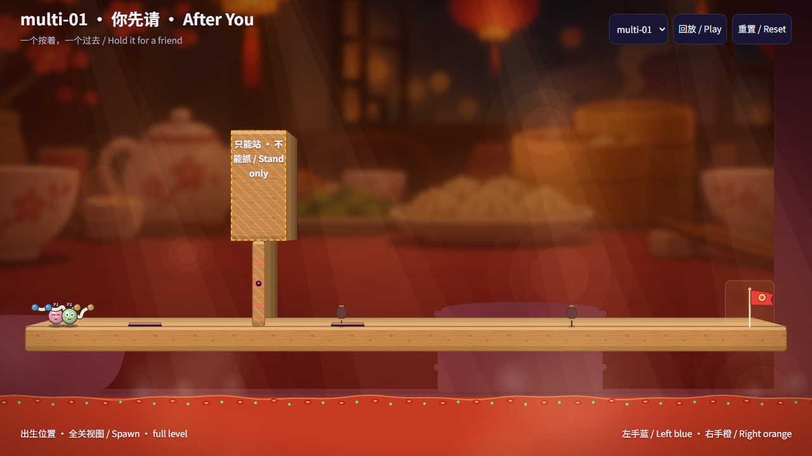
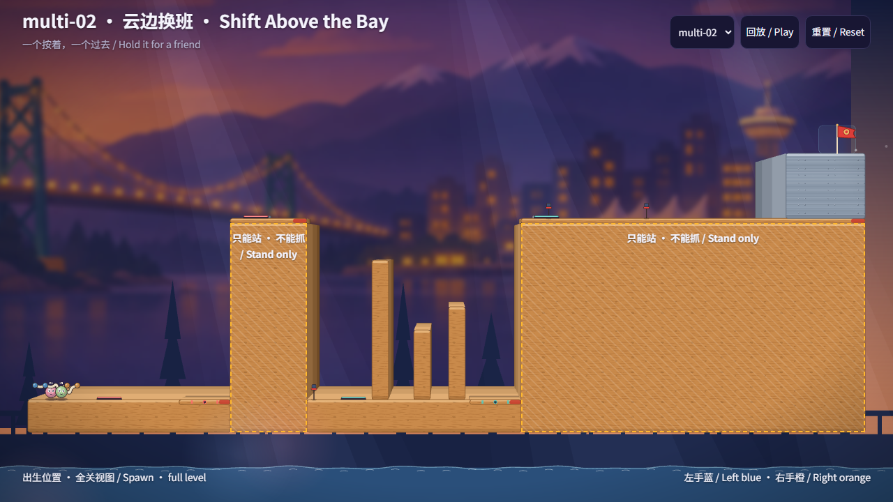
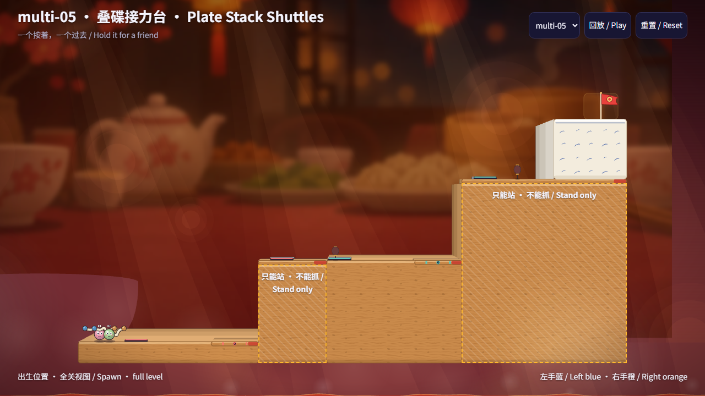
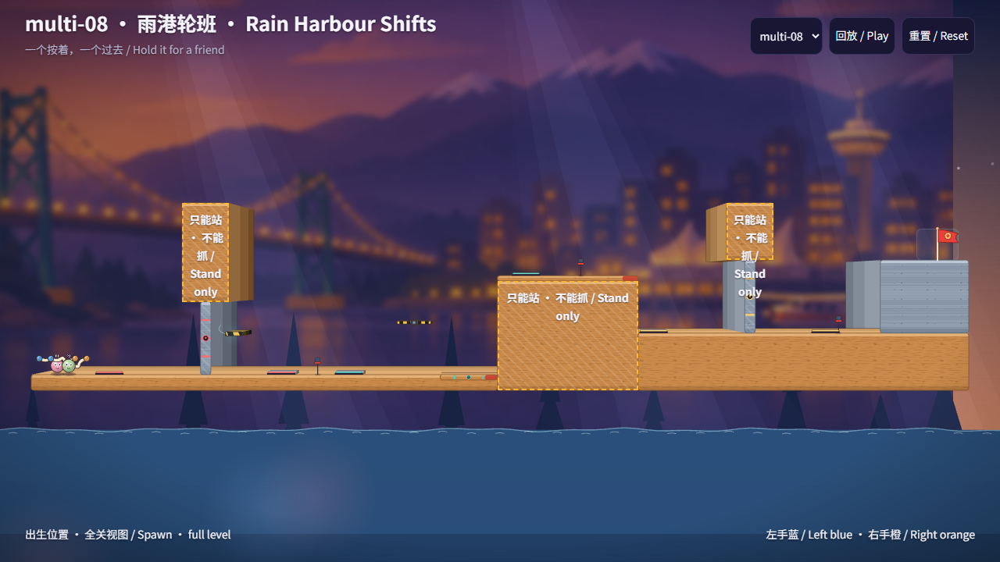
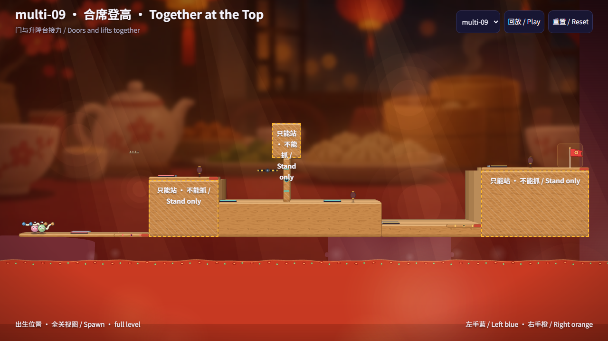

# C14 · 多人自己的关 / Multiplayer levels

初版从 `origin/main` 的 `96d88c89` 建立独立 worktree，分支 `codex/ho-c14-multi-levels`。本轮合入最新 `origin/main`（`45443092`，含后厨、雪山、老宅、太空站的 24 关），只调整 multi-01 和它的回放、截图、文档；其余八张多人关保留原字节。场景关、大关、物理及验收/探路脚本均未修改。

## 四个场景合入后的重合检查 / Layout overlap after integration

原 multi-01 与 space-43 的平台格子重合为 68.49%。multi-01 的台面从 y=600 下移至 y=640，出生点、检查点、门和踏板同步下移 40px；底板缩为 80px 厚，保持在 2480 × 720 关界内。三份 60Hz 回放重新录制，合作机制与验收阈值保留。

按验收器相同的 40px 上沿格子与交集/并集公式，对全部 63 个关卡 JSON 扫描：多人按 2/3/4 人摆法，其他关额外覆盖 1–6 人摆法；没有超过 60% 的组合。

| 多人关 / Level | 最大重合 / Maximum | 最近的关 / Closest level | 人数摆法 / Layouts |
| --- | ---: | --- | --- |
| multi-01 | 36.36% | multi-08 | 2 / 2 |
| multi-02 | 44.80% | team-01 | 2 / 1 |
| multi-03 | 42.59% | table-01 | 2 / 1 |
| multi-04 | 33.09% | house-38 | 2 / 1 |
| multi-05 | 15.22% | kitchen-27 | 2 / 1 |
| multi-06 | 25.76% | house-41 | 2 / 1 |
| multi-07 | 20.37% | table-18 | 2 / 1 |
| multi-08 | 36.36% | multi-01 | 2 / 2 |
| multi-09 | 23.42% | house-42 | 2 / 1 |

<!-- C14_MULTI_SECTIONS {"multi-01":[0],"multi-02":[0,1],"multi-03":[0,1],"multi-04":[0,1],"multi-05":[0,1],"multi-06":[0,1],"multi-07":[0,1,2],"multi-08":[0,1,2],"multi-09":[0,1,2]} -->

段号从 0 开始：出生点 → 第一面旗为第 0 段。完整探路按每种 2/3/4 人布局让单人尝试 200 次、每次 60 秒。有限采样是验收证据，不是对任意输入的穷举证明。
Zero-based blocked sections are verified with 200 deterministic solo attempts of 60 seconds on every selected layout.

| ID | 名称 / Name | tier | teaches | 长 × 高 / Size | 检查点 / Checkpoints | par 秒 / deaths per player | 单人受阻段 / Solo-blocked sections |
| --- | --- | ---: | --- | --- | --- | --- | --- |
| multi-01 | 你先请 / After You | 0 | hold | 2480 × 720 | (1030,606) → (1780,606) | 100 / 6 | 0 |
| multi-02 | 云边换班 / Shift Above the Bay | 0 | hold | 3600 × 1440 | (1230,1266) → (2240,486) → (2660,486) | 120 / 6 | 0, 1 |
| multi-03 | 茶盘上下层 / Tea Tray Mezzanine | 0 | combine | 2560 × 720 | (1040,526) → (2160,186) | 60 / 6 | 0, 1 |
| multi-04 | 潮汐双闸 / Tidal Airlocks | 1 | hold | 3600 × 720 | (1080,486) → (2100,566) → (2700,566) | 100 / 6 | 0, 1 |
| multi-05 | 叠碟接力台 / Plate Stack Shuttles | 1 | hold | 2560 × 1440 | (1200,926) → (2050,546) | 100 / 6 | 0, 1 |
| multi-06 | 先升后放 / Up Before Through | 1 | combine | 2560 × 720 | (1140,206) → (1900,366) | 100 / 6 | 0, 1 |
| multi-07 | 三次请客 / Three Invitations | 2 | hold | 3600 × 720 | (1090,586) → (2110,626) → (3140,666) | 120 / 6 | 0, 1, 2 |
| multi-08 | 雨港轮班 / Rain Harbour Shifts | 2 | hold | 3600 × 720 | (1100,626) → (2110,246) → (3100,466) | 150 / 6 | 0, 1, 2 |
| multi-09 | 合席登高 / Together at the Top | 2 | combine | 3600 × 720 | (1140,306) → (2110,466) → (3230,246) | 150 / 6 | 0, 1, 2 |

## 布局与合作 / Layout and cooperation

三种人数使用同一套不可单人绕过的墙与门：额外队员不会获得可以独自抄近路的平台。2、3、4 人分别录制，守板者与过门者互换，每个人都到终点；升降台先接走队员，再由上方踏板把留守者接上去。
The geometry stays the same for two, three and four players; every size has its own input-only replay and every player reaches the goal.

### multi-01 · 你先请 / After You

完整门楣封住上方；先踩西侧板放同伴过门，再由东侧板接回守板的人。末段在木桌上集合。 / A sealed lintel and reciprocal plates; swap who holds the door.

- g0: 门 / door (740, 360), move (0, -220), hold 0s；踏板 / plates (335,628) ↔ (995,628)。

### multi-02 · 云边换班 / Shift Above the Bay

两次长升降与中间下落的谷地；低处存档后翻越三根可抓的墩柱，到第二台电梯。末屏再攀上高台。 / Two long shuttles, a low valley checkpoint, three solo piers and a final climb.

- g0: 升降台 / lift (650, 1300), move (0, -780), hold 0s；踏板 / plates (295,1288) ↔ (925,508)。
- g1: 升降台 / lift (1900, 1300), move (0, -780), hold 0s；踏板 / plates (1345,1288) ↔ (2175,508)。

### multi-03 · 茶盘上下层 / Tea Tray Mezzanine

先翻矮碗、换手过门，再在后半段轮流乘升降台；高层的平台从门外延续到终点。 / A low bowl, reciprocal doorway, then a shuttle up to the mezzanine.

- g0: 门 / door (600, 280), move (0, -220), hold 0s；踏板 / plates (195,548) ↔ (855,548)。
- g1: 升降台 / lift (1660, 560), move (0, -340), hold 0s；踏板 / plates (1255,548) ↔ (1935,208)。

### multi-04 · 潮汐双闸 / Tidal Airlocks

高低两片海堤、两组双向闸门；后一道闸门的接应板放在更深处，之后翻过两根错高礁墩，再登上高码头。 / Two descending sea walls, two airlocks, two uneven piers and a high final quay.

- g0: 门 / door (640, 240), move (0, -220), hold 0s；踏板 / plates (235,508) ↔ (895,508)。
- g1: 门 / door (1800, 320), move (0, -220), hold 0s；踏板 / plates (1395,588) ↔ (2055,588)。

### multi-05 · 叠碟接力台 / Plate Stack Shuttles

两部升降台连续上升 760 px；首面旗在上层与下部电梯的公共落脚面，末段爬上瓷台。 / Two consecutive lifts rise 760 px, ending on a ceramic plinth.

- g0: 升降台 / lift (620, 1340), move (0, -380), hold 0s；踏板 / plates (215,1328) ↔ (895,948)。
- g1: 升降台 / lift (1570, 960), move (0, -380), hold 0s；踏板 / plates (1165,948) ↔ (1845,568)。

### multi-06 · 先升后放 / Up Before Through

先乘慢速升降台，越过下降台阶；再换岗放行较低的门，最后攀上出口。 / A slow lift, a drop, a reciprocal low door and the exit climb.

- g0: 升降台 / lift (590, 600), move (0, -360), hold 0s；踏板 / plates (315,588) ↔ (865,228)。
- g1: 门 / door (1670, 220), move (0, -220), hold 0s；踏板 / plates (1265,388) ↔ (1925,388)。

### multi-07 · 三次请客 / Three Invitations

三道门沿下降的长席排列；中段悬着带刺转杆，首段侧上方是热源。第三扇门后还有高台。 / Three descending door exchanges with an overhead rotating hazard and a final plinth.

- g0: 门 / door (650, 340), move (0, -220), hold 0s；踏板 / plates (245,608) ↔ (905,608)。
- g1: 门 / door (1680, 380), move (0, -220), hold 0s；踏板 / plates (1275,648) ↔ (1935,648)。
- g2: 门 / door (2720, 420), move (0, -220), hold 0s；踏板 / plates (2315,688) ↔ (2975,688)。

### multi-08 · 雨港轮班 / Rain Harbour Shifts

门 → 长升降 → 门；升降台出口落到下层码头。转杆逆时针转，带电的短块在首闸旁。 / Door, long shuttle, door; a reverse spinner and a live block flank the route.

- g0: 门 / door (650, 380), move (0, -220), hold 0s；踏板 / plates (245,648) ↔ (905,648)。
- g1: 升降台 / lift (1570, 660), move (0, -380), hold 0s；踏板 / plates (1165,648) ↔ (1845,268)。
- g2: 门 / door (2740, 220), move (0, -220), hold 0s；踏板 / plates (2335,488) ↔ (2995,488)。

### multi-09 · 合席登高 / Together at the Top

升降 → 门 → 升降；每段都有接回留守队员的板，三种高度组成折线路线。 / Lift, door, lift across three elevations; every station returns for its keeper.

- g0: 升降台 / lift (600, 700), move (0, -360), hold 0s；踏板 / plates (325,688) ↔ (875,328)。
- g1: 门 / door (1670, 220), move (0, -220), hold 0s；踏板 / plates (1265,488) ↔ (1925,488)。
- g2: 升降台 / lift (2700, 640), move (0, -360), hold 0s；踏板 / plates (2295,628) ↔ (2975,268)。

## 回放与复核 / Replays and verification

每份是 60 Hz 的展开手柄输入，`seq` 从 0 递增，`t` 是毫秒。离线录制时只读真实状态选择抓、松和摇杆，提交数据只有输入，不含传送、初速、召唤、道具或物理覆盖。验收直接调用原来的 `createSim` / `runReplay`。每个手柄单独投影，在原始选择与固定后的多人布局中都须无法通关。
Replays contain controller frames only; the unchanged simulation supplies all movement and checkpoints.

合作按原模拟逐帧量：连续挂链、踩队友、向右上抛队友，或守板者连续至少 1 秒且另一人真正跨过对应门的原始右边界。升降台按载人的位移算行进；没有操作且所有活人的身体静止才累加全员暂停。PNG 是仓库 Playwright 独立无头 Chromium 使用游戏自己的 Pixi Stage 生成的 1280 × 720 双人全关视图。

最终完整结果表、完整探路和三处故意改坏的错误记录见 [validation.md](validation.md)。

<!-- C14_RESULTS -->

## 结果表 / Results

Node 22；全部 27 份回放零死亡；每个手柄在原始及固定多人布局中单独运行均未通关。表中暂停只计全员没有操作且所有活人的身体静止。

| Level | 2 players (s) | 3 players (s) | 4 players (s) | 全部分段范围 / Segments (s) | 最大暂停 / Max idle (s) | Solo cleared |
| --- | ---: | ---: | ---: | --- | ---: | --- |
| multi-01 | 51.98 | 62.79 | 61.86 | 15.10–25.26 | 0.00 | 0/2, 0/3, 0/4 |
| multi-02 | 87.04 | 117.55 | 145.55 | 16.17–50.58 | 2.63 | 0/2, 0/3, 0/4 |
| multi-03 | 47.74 | 82.56 | 111.28 | 15.18–49.72 | 0.73 | 0/2, 0/3, 0/4 |
| multi-04 | 128.77 | 138.04 | 163.23 | 22.52–56.50 | 0.00 | 0/2, 0/3, 0/4 |
| multi-05 | 65.35 | 89.44 | 118.43 | 16.03–46.38 | 2.07 | 0/2, 0/3, 0/4 |
| multi-06 | 56.96 | 73.78 | 95.65 | 15.15–55.90 | 2.78 | 0/2, 0/3, 0/4 |
| multi-07 | 98.93 | 75.71 | 89.63 | 15.35–39.97 | 0.00 | 0/2, 0/3, 0/4 |
| multi-08 | 86.98 | 98.38 | 120.07 | 18.06–48.77 | 1.70 | 0/2, 0/3, 0/4 |
| multi-09 | 76.75 | 121.88 | 143.63 | 15.07–57.61 | 2.05 | 0/2, 0/3, 0/4 |

重拍截图：在 `games/hang-on` 安装仓库的 Playwright Chromium 后运行 `npm run levels -- --multi-screenshots`。它只写 `docs/levels/multi/`，使用两个人的布局，且先跑所有原有和多人验收。
