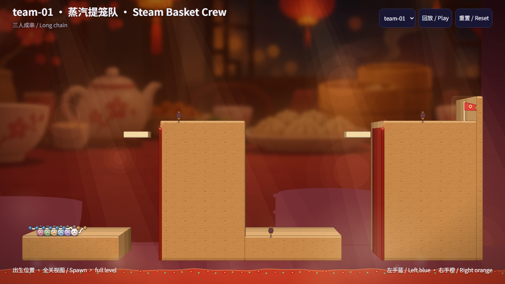
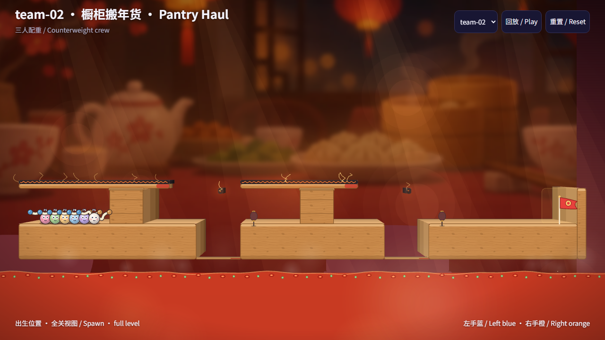
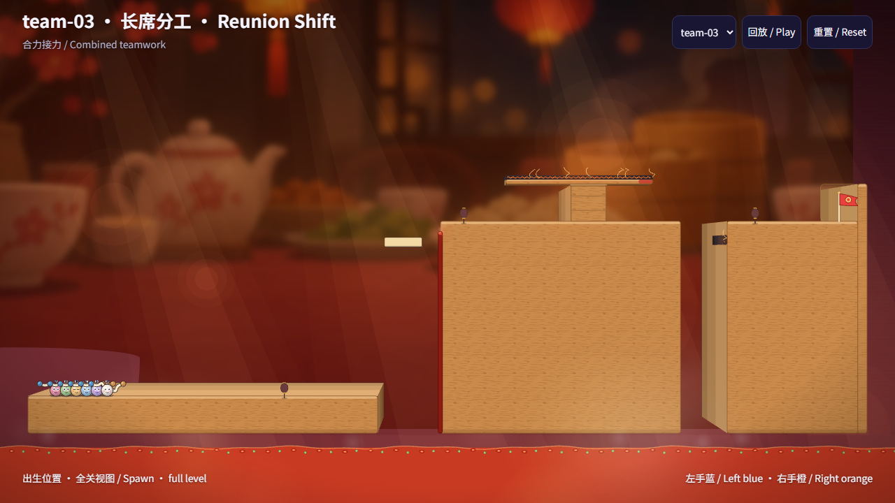
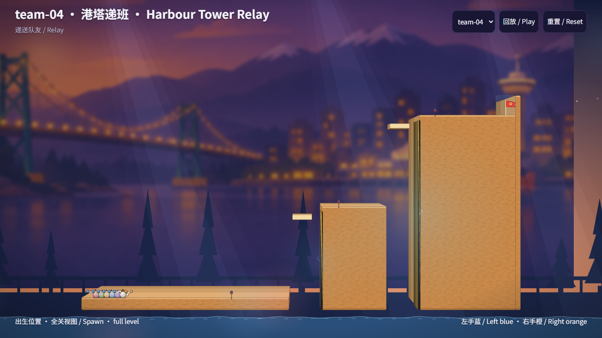
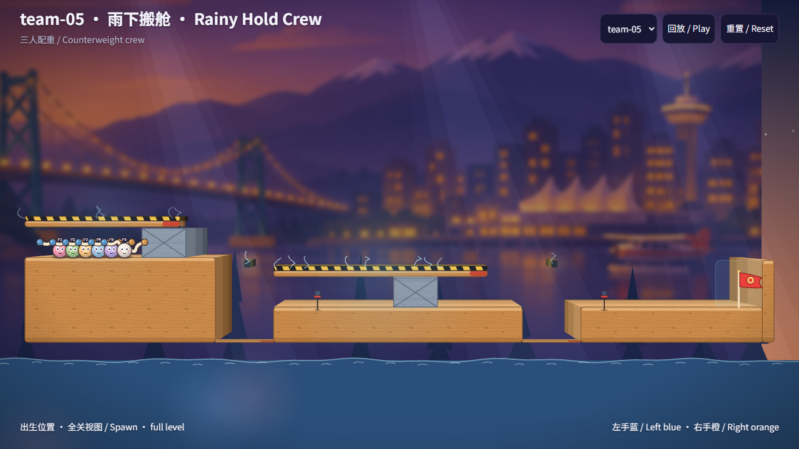
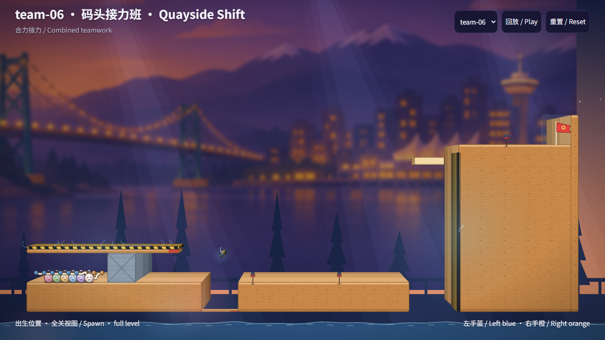

# C9 · 大团队的大关 / Team levels

在独立 C9 worktree 的 `codex/ho-c9-team-levels` 合入 main `6b00276a`，包含 #435、#436、#426。六关、18 份回放和截图全部重做。只编写大关数据、本文目录与验收器的大关部分。
Merged main `6b00276a`; all six layouts, eighteen replays and screenshots replace revision one.

<!-- C9_TEAM_SECTIONS {"team-01":[0,2],"team-02":[0,1],"team-03":[1,2],"team-04":[1,2],"team-05":[0,1],"team-06":[0,2]} -->

段号从 0 开始；以下多人段已由不带 `--quick` 的 `npm run probe` 逐摆法复核。每段单人 200 次、双人 100 次，每次 60 秒均未通过。有限采样不代表数学上的不可通过证明。
Zero-based crew sections match the full probe table for every layout. Finite sampling is evidence, not a proof of impossibility.

| ID | 名称 / Name | teaches | 尺寸 / Size | 检查点 / Checkpoints | par 秒 / deaths per player | 多人段 / Crew sections |
|---|---|---|---|---|---|---|
| team-01 | 蒸汽提笼队 / Steam Basket Crew | longchain | 3000×1440 | (1020,506) → (1620,1256) → (2610,506) | 160 / 6 | 0, 2 |
| team-02 | 橱柜搬年货 / Pantry Haul | counterweight | 2560×720 | (1060,536) → (1910,536) | 140 / 6 | 0, 1 |
| team-03 | 长席分工 / Reunion Shift | combine | 3600×1440 | (1100,1256) → (1870,506) → (3120,506) | 160 / 6 | 1, 2 |
| team-04 | 港塔递班 / Harbour Tower Relay | relay | 3600×2160 | (1230,2036) → (2110,1286) → (2900,536) | 160 / 6 | 1, 2 |
| team-05 | 雨下搬舱 / Rainy Hold Crew | counterweight | 2560×720 | (1000,576) → (1980,576) | 120 / 6 | 0, 1 |
| team-06 | 码头接力班 / Quayside Shift | combine | 3000×1440 | (1230,1256) → (1700,1256) → (2610,506) | 160 / 6 | 0, 2 |

- **01 蒸汽提笼队**：两次 750 px 攀升，中间下降重整。抓点下沿离地 640 px，接收台立面带热区；第 0、2 段分别搭三人以上挂链。 / Two chain climbs separated by a descent and regroup.
- **02 橱柜搬年货**：两间矮顶货道各有重箱。三人以上合推到落箱槽，再越过出口；两个多人段都有实际合推证据。五人回放收尾还要回头拉走队友。 / Two low cargo passages require separate group pushes, followed by teammate retrieval.
- **03 长席分工**：长地面进场后搭串升至上层，再合推货道中的重箱；第 1、2 段分别用长串和推箱。 / A long approach, chain ascent, then an upper cargo passage: two distinct methods.
- **04 港塔递班**：三层港塔、两次连续高差；两个多人段中记录搭串和向右上方放手抛人，每份回放至少两次。 / Three tiers with two upward transfers; every replay records at least two throws.
- **05 雨下搬舱**：第一货道的出口下降到舱底，第二间在低处；两个 100 px 高重箱配 105 px 净空矮顶，分别合推。 / Two group pushes across a descending passage and a lower hold.
- **06 码头接力班**：先合推清货道，跨过集合平台后搭长串升上码头接收台；第 0、2 段用推箱和长串两种办法。 / Clear cargo, regroup, then chain up to the quay ledge.

**人数变化 / Scaling**：02、03、05、06 的 5/6 人版本，在探路判定的合推段出口或坑口增加危险；03、05、06 的部分箱子还更重。变化没有放在普通过场段。01、04 布局固定。
Extra five/six-player hazards are inside blocked crate sections, with heavier variants in some passages.

**回放与验收 / Replay evidence**：18 份仅含普通 60 Hz 输入，由脚本控制手柄录制，再由当前物理重放；没有传送、初始速度、物理或复活覆盖。全部按顺序过检查点、到终点；每段 15–60 秒，par 比值 0.5–2，死亡不超每人 6 次。没有凑满 15 秒的等待逻辑。单人对照同时保留原布局筛选方式，并增加固定原人数布局的方式，避免一人重筛时删除重箱。两种方式共 180 次单手柄对照均失败。
Replays contain ordinary inputs only, recorded by scripted controllers and replayed in current physics. Both original and fixed-layout solo controls fail.

全部回放的最长全员无输入为 **1.00 秒**（上限 3 秒）。 / Longest all-player input idle: **1.00 s**.

## 结果 / Results

| Level | Players | Seconds | Deaths (P1…) | All reached | Par ratio | Size | Checkpoint segments (s) | 3+ chain / weight+push (s) | Relays | Solo cleared |
| --- | ---: | ---: | --- | :---: | ---: | --- | --- | --- | ---: | --- |
| team-01 | 4 | 101.55 | 3 / 3 / 4 / 4 | YES | 0.635 | 3000×1440 | 17.92 / 24.75 / 35.50 / 23.38 | 13.13 / 0.00 | 4 | 0/4 |
| team-01 | 5 | 84.83 | 2 / 2 / 4 / 2 / 2 | YES | 0.530 | 3000×1440 | 20.10 / 15.85 / 24.27 / 24.62 | 18.17 / 0.00 | 6 | 0/5 |
| team-01 | 6 | 114.23 | 1 / 2 / 4 / 3 / 2 / 2 | YES | 0.714 | 3000×1440 | 29.43 / 17.75 / 24.63 / 42.41 | 6.37 / 0.00 | 6 | 0/6 |
| team-02 | 4 | 85.81 | 1 / 1 / 1 / 2 | YES | 0.613 | 2560×720 | 20.10 / 19.07 / 46.64 | 0.53 / 4.15 | 5 | 0/4 |
| team-02 | 5 | 70.48 | 4 / 5 / 5 / 3 / 4 | YES | 0.503 | 2560×720 | 16.53 / 25.93 / 28.01 | 2.42 / 3.50 | 5 | 0/5 |
| team-02 | 6 | 83.18 | 3 / 4 / 5 / 5 / 2 / 4 | YES | 0.594 | 2560×720 | 21.70 / 22.95 / 38.53 | 3.25 / 3.80 | 9 | 0/6 |
| team-03 | 4 | 120.44 | 0 / 1 / 2 / 1 | YES | 0.753 | 3600×1440 | 48.63 / 19.55 / 16.28 / 35.98 | 8.20 / 1.68 | 3 | 0/4 |
| team-03 | 5 | 159.20 | 2 / 1 / 3 / 1 / 2 | YES | 0.995 | 3600×1440 | 38.15 / 39.17 / 44.97 / 36.92 | 5.93 / 2.98 | 3 | 0/5 |
| team-03 | 6 | 153.71 | 5 / 4 / 4 / 2 / 2 / 1 | YES | 0.961 | 3600×1440 | 16.52 / 53.85 / 52.00 / 31.34 | 27.13 / 11.88 | 5 | 0/6 |
| team-04 | 4 | 138.43 | 2 / 1 / 1 / 3 | YES | 0.865 | 3600×2160 | 16.20 / 39.40 / 26.05 / 56.78 | 15.62 / 0.00 | 7 | 0/4 |
| team-04 | 5 | 142.13 | 2 / 3 / 0 / 1 / 2 | YES | 0.888 | 3600×2160 | 17.15 / 32.20 / 33.03 / 59.75 | 13.43 / 0.00 | 8 | 0/5 |
| team-04 | 6 | 131.40 | 1 / 1 / 2 / 2 / 2 / 2 | YES | 0.821 | 3600×2160 | 25.93 / 19.07 / 27.85 / 58.55 | 10.58 / 0.00 | 10 | 0/6 |
| team-05 | 4 | 72.63 | 2 / 4 / 2 / 4 | YES | 0.605 | 2560×720 | 16.52 / 37.45 / 18.67 | 0.60 / 2.35 | 13 | 0/4 |
| team-05 | 5 | 118.63 | 3 / 0 / 1 / 1 / 2 | YES | 0.989 | 2560×720 | 46.32 / 20.13 / 52.18 | 0.00 / 4.57 | 1 | 0/5 |
| team-05 | 6 | 74.67 | 1 / 1 / 2 / 3 / 2 / 1 | YES | 0.622 | 2560×720 | 16.27 / 19.55 / 38.85 | 0.00 / 1.92 | 3 | 0/6 |
| team-06 | 4 | 127.03 | 2 / 2 / 5 / 2 | YES | 0.794 | 3000×1440 | 28.10 / 15.10 / 47.17 / 36.66 | 11.95 / 1.33 | 7 | 0/4 |
| team-06 | 5 | 109.91 | 1 / 2 / 1 / 0 / 2 | YES | 0.687 | 3000×1440 | 24.58 / 16.62 / 34.55 / 34.16 | 6.97 / 11.87 | 9 | 0/5 |
| team-06 | 6 | 87.38 | 1 / 1 / 1 / 0 / 2 / 0 | YES | 0.546 | 3000×1440 | 21.87 / 15.32 / 30.35 / 19.85 | 7.68 / 4.15 | 2 | 0/6 |

完整四项检查、逐段证据、完整版探路及四处反例见 [validation.md](validation.md)。原闯关、难关规则已逐字核对 main，大关以外只接入导出、调用和结果计数。
See [validation.md](validation.md) for complete checks, section evidence, full probe and negative examples. Base/hard rules remain unchanged.

## 六人全关截图 / Six-player full-level views

## 交接 / Handoff

本次完成 C9 第二版，继续使用 PR #425。保留未合并状态；未部署，未操作 Cloudflare。复审请重点看两段多人证据、不同 combine 办法及完整 probe 表；没有放松任务卡阈值，也没有待批准的规则例外。
Revision two is ready for review in PR #425. Leave unmerged; no deployment or Cloudflare action. No rule waiver is requested.
