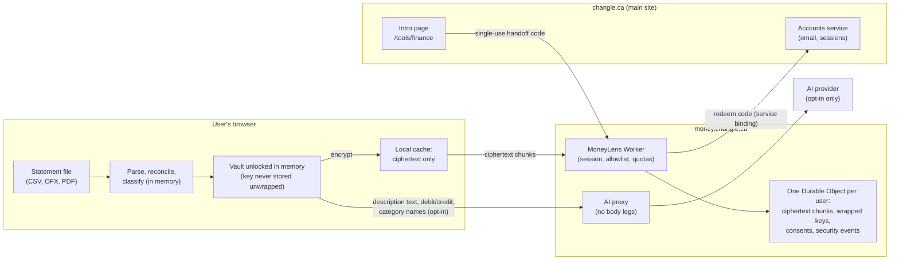

# MoneyLens data inventory and flows

Version 0, 18 November 2026. It starts from section 6.3 of [`docs/moneylens.md`](../moneylens.md),
narrowed to the decisions taken (encrypted vault, own origin, AI opt-in). Nothing here is built
yet. DOC-1 applies: every release checks the legal documents against this file, and this file
against the code.

## Inventory

| Data | Collected from | Where it is kept | Who can read it | Kept until |
|---|---|---|---|---|
| changle.ca account: email, display name, avatar, and phone, city, gender, bio where given | The user, at sign-up on the main site | Accounts service (`site/worker`, Durable Object `Hub`) | Operator | Account deletion (the main site's rules). MoneyLens receives only the account identifier and whether it is the owner's account |
| Eligibility attestations (age of majority, province), consent records (document, version hash, UTC time, choice, language, app version) | The user, at onboarding and when a document changes | The user's MoneyLens Durable Object | Operator | Account deletion, plus the period counsel advises (Appendix C, question 9) |
| Wrapped vault keys and their parameters (salt, iteration count, kind) | Made in the browser at vault setup | The user's MoneyLens Durable Object | Operator can read the bytes; they open nothing without the user's passphrase, passkey or recovery code | Vault deletion |
| Financial records: transactions, accounts (last four digits only), balances, categories, rules, aliases, budgets, goals, notes, import history | Statement files the user imports; what the user types | Ciphertext in the user's MoneyLens Durable Object and in the browser's cache | The user only. The operator and Cloudflare hold ciphertext | The user deletes them, the account is deleted, or the inactivity rule applies (BAK-4); possibly up to 30 more days in the platform's recovery history (BAK-3, to confirm) |
| Other people's names inside statements (payees, e-Transfer senders and recipients) | Statement files | Inside the financial records above | The user only | As above. Never sent to an AI provider (PRIV-8) |
| Vault metadata: chunk identifiers, sizes, version numbers, timestamps | Produced by sync | The user's MoneyLens Durable Object | Operator | With the vault |
| Sessions and devices: hashed session token, created and last-seen times, a device label | Sign-in through the handoff | The user's MoneyLens Durable Object | Operator | Session end; listed to the user while active |
| Security events: sign-ins, handoffs, failed unlocks, device and passkey changes, exports, deletions, consent changes, admin actions. No transaction content | The app and the server | The user's MoneyLens Durable Object | Operator; the user sees their own | 12 months (SEC-17) |
| Allowlist and invitations: account identifiers allowed in, invitation codes and who used them | The operator; the invited user | A MoneyLens gate object | Operator | Until open registration, then deleted |
| Statement files | The user's device | Browser memory during import only. Never uploaded (IMP-7) | Nobody but the user | Discarded when the import ends |
| AI requests, only if the user opted in: cleaned description text, debit or credit, the user's category names (AI-3) | The user's transactions, in the browser | Not stored by MoneyLens. Passes through the proxy to the provider | In transit: the operator's proxy (no body logging, AI-7) and the provider | The provider's stated retention |
| Usage counters: users, import successes and failures, record counts, AI calls and cost, errors | The server | MoneyLens metrics, aggregate only | Operator | 13 months |
| Network logs: IP address, URL, time | Every request | Cloudflare | Operator, limited; Cloudflare | The platform's log retention (to confirm and state) |
| Support and privacy email | The sender | The operator's mailbox | Operator | 24 months |

Not collected: online-banking credentials, full account or card numbers, the account holder's name
and address as printed on statements (dropped at extraction, IMP-6), location, contacts, device
identifiers for advertising. No third-party analytics (OBS-2).

## Flows

Statement files and decrypted records do not leave the browser. The only financial text that can
leave it is the AI request, and only after opt-in.

## Processors (first draft of the vendor list, PRIV-4)

| Processor | Purpose | Data it handles | Location | Terms to record |
|---|---|---|---|---|
| Cloudflare | Hosting, storage, network | Everything in the inventory that is stored or passes through the Worker; financial records as ciphertext | No Canada-only option; in practice the United States and other countries (PRIV-14) | Self-serve subscription agreement and data processing addendum, version and date accepted |
| Resend | Sign-in codes sent by the accounts service; MoneyLens security and inactivity notices through the same door | Email address, message content | United States | Terms and DPA, version and date |
| AI provider, one, to be chosen (Cloudflare Workers AI or the Gemini API paid tier) | Category suggestions for users who opted in | The fields in AI-3 | To state at build time | No-training and retention terms, re-checked at build time (AI-4) |
| GitHub | Source code and CI | No user data. Synthetic fixtures only (SEC-12) | United States | n/a |

The site-wide list is longer (other tools use Google services) and is compiled with the site-wide
Privacy Policy (PRIV-5).

## To confirm before the documents state a number

- Cloudflare's log retention on the Free plan.
- Whether data deleted from a Durable Object can still be restored inside the 30-day recovery
  window (BAK-3).
- The retention period for consent records and the inactivity period (counsel).
